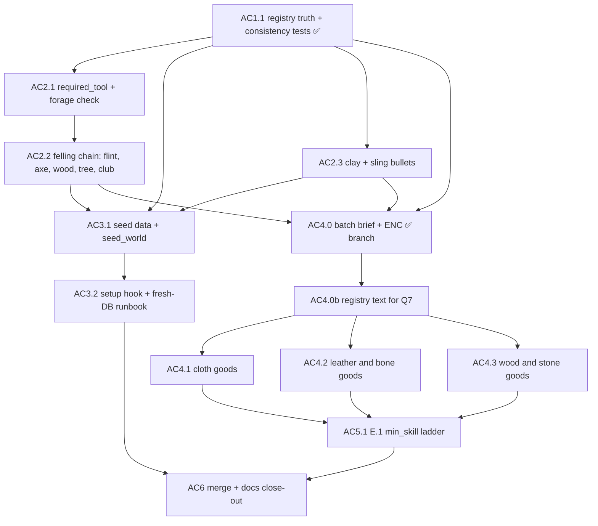

# PolishedWorld — Alpha Content Decomposition

> **Rev 3 · 2026-10-24** — **AC4.0 shipped on `feature/alpha-content`** (`45b20ea`, tree `9d39f0c`; §9 record) and **its batch brief added** (§9, B1–B9, 18 items): Q1 → ladder rungs with the vessels struck, Q5 → `twine`, Q6 → book ENC per item, Q7 → the rabbit yields `raw_hide`. Breeches and the bandolier take the existing `bottom` and `accessory` slots (§3 finding 4 corrected); new Task AC4.0b corrects the registry's Q7 text before AC4.1. Brief and `AGENTS.md` Rev 7 land on `main` (D1(b)) and reach the branch by merge.
> **Rev 2 · 2026-10-18** — **AC1.1 shipped** as `cb60434`, on `main` directly rather than through `feature/alpha-content` (lesson 64: `git switch -c X origin/main` tracks `origin/main`); Adam decided it stays there. §6 turns from plan into record: the five decisions taken while building it (**T1–T5** — prototypes read through `search_prototype(no_db=True)` instead of Rev 1's scan of the module's dicts, recipes through the crafting contrib's own registry, the `required_tool` branch of test (d) deferred to AC2.1, a vacuity guard, and `source` meaning *what the code does today* for EXISTS entries, which moved `knife` and `needle` to `stone_knife` and `bone_needle`), the eight tests as shipped with what each one catches, a mutation table that replaces Rev 1's two mutations, and the suite figure, **519**. §2's heading now counts all eight decisions (AD1–AD8) — it was one short of its own content since Rev 1. §3 is marked a snapshot and gains **finding 6**: four things AC1.1 surfaced, each given a home and none resolved here (Q7, Q8, AC6). AD6 records what the direct landing costs: the Source/Sink Ledger on `main` lags the registry on `main` until AC6. AC2.1–2.2 carry T3 and T5 forward. No code.
> **Rev 1 · 2026-10-18** — first version. Decomposes `docs/BACKLOG.md` *Alpha content epic* (roadmap Rev 27, alpha entry (D)) into five components and a close-out, against live source read the same day (`main` at `5921ed2`, Evennia at the pinned `v6.1.0` tag). Locks **AD1–AD8**: a stone axe with a hard tool check in `forage` (AD1), generic `wood` for the alpha with DECISION #10's revisit re-anchored to Stage 5 (AD2), registry corrections widened to everything a mechanical loop finds (AD3), `sinew` out of the alpha (AD4), a use-in-alpha column now and the inert-goods policy before the first catalogue batch (AD5), registry-with-code on the branch and derived docs at close-out (AD6), a seeding design shaped by what the setup hook actually does (AD7), and Legend ENC carried on every item prototype from now on, with the weight mechanic itself decomposed separately as a seventh alpha prerequisite (AD8). **Three figures the epic was filed with are corrected here** (§3): the reachable catalogue is **24** items as written, not about 29; the bow does **not** need `sinew`; and DECISION #10's revisit condition **cannot** fire inside an alpha with no combat. No code.
> **Canonical:** `docs/PolishedWorld_Alpha_Content_Decomposition.md` @ G0dlet/PolishedWorld — git wins. If a project-knowledge copy's Rev is lower than the repo's, it's stale.

**Status:** in progress — **AC1.1 shipped** on `main` (`cb60434`, 2026-10-18; §6). AC2.1 onward ride `feature/alpha-content` as planned. The AC4.0 batch brief is in §9 (Rev 3).
**Feature branch:** `feature/alpha-content` (one branch, one merge, as Epic A).
**Rough scope:** 13 tasks (Rev 3: + AC4.0b), 7.5–10 sessions at 5 h/week (AC1 0.5 · AC2 1.5–2 · AC3 1–1.5 · AC4 3.5–4.5 · AC5 0.5–1 · AC6 0.5) — inside the 6–11 that roadmap Rev 27 (D) priced for the same work.
**Philosophy:** skynda långsamt — no material lands without the recipe that consumes it.

---

## 1. Why this epic

Roadmap Rev 27 (D) found that the work between the alpha decision and E.1 was one epic, not a list: the FAS 1 cut (wood, flint, clay), the registry corrections the tanning discovery exposed, seeding as the only versioned way to place nodes, the catalogue authoring nobody had named, and E.1's `min_skill` ladder. It filed the epic in `docs/BACKLOG.md` (*Crafting & Tools*) with two choices left to the decomposition — the felling model and DECISION #10. This document makes those two, plus five the source forced (§2), and orders the work so that **every commit leaves every registered material with a source and a consumer** (§5, AC1.1's test).

---

## 2. Decisions locked 2026-10-18 (AD1–AD8)

**AD1 — Felling: a stone axe and a hard tool check in `forage` (option B).** A tree node carries `required_tool = "axe"`; `CmdForage` refuses without a usable axe and wears the axe on each successful fell, through the same `DurableObject.apply_wear()` crafting uses. *Why:* it is the only option that gives `flint` a consumer in the alpha (§3, finding 3) — Flint and Tinder, flint's only consumer among the 44 `[DATA]` items, needs a steel striker that is `[BLOCKED: smithing]`. With wear, the axe is a **recurring** sink for flint, stick and twine, which Economic Philosophy §3 (*wear is the economic engine*) asks for and which almost none of the alpha's finished goods provide (§4). No bootstrap lock: every axe input is gathered without tools. No Stage 6 debt: the requirement is node data and the check runs after the node is resolved, so it survives either answer to Stage 6 question 2. *Rejected:* **A**, a tool-free deadfall — pure data, but flint ships as a source with no sink, which is the thing roadmap Rev 27 (D2) cut ore and sulfur to avoid; **C**, deadfall plus an axe-gated tree — two node types for one material, against the interim placement rule's intent to keep the count small.

**AD2 — DECISION #10: generic `wood` for the alpha; the revisit trigger moves to Stage 5 (option C).** The registry's own condition is *"revisit only if bows need a distinct springy wood mechanically"*. In an alpha with no combat a bow has no mechanic at all, so the condition cannot fire inside the alpha — roadmap Rev 27 and the epic both said it could. Stage 5 is the first point where a bow has numbers a species could change. Splitting after the alpha costs no migration: the persistent instance is wiped at close-out (BACKLOG *Persistent alpha instance*). Species stay flavour, in node descriptions. *Rejected:* **A**, closing #10 for good — it answers a question that cannot be asked yet; **B**, a second bow-wood material and node — a scarce source whose only consumer is an item with no use in the alpha.

**AD3 — Registry corrections cover everything the loop finds, and a test keeps them true (option A).** The epic listed `stone`, `stick`, `leather` and `raw_hide`. A loop over all of `MATERIALS` and `TOOLS` against the crafting tags in `world/prototypes.py` (§3, finding 1) finds six drifted entries and one unregistered tag — including `feather` and `tusk`, marked EXISTS since the registry's first commit (`0e0d224`) with no prototype and no harvest source, which licenses a content generator to reference something that does not exist. All are corrected in AC1.1, with a test that fails the next time code and registry disagree. *Rejected:* **B**, the epic's list only with the rest filed — it leaves `feather` = EXISTS standing while AC4 hands catalogue work to a generator that reads the registry.

**AD4 — `sinew` is not in the alpha (option A).** The bow's string is `plant_fiber/sinew/hair`, and the fiber string is listed as its own `[DATA]` branch (AoL decomposition, Bow). The 9-item count included sinew because it carries a `[NEW MATERIAL]` tag, not because the bow needs it. The only creature in `HARVEST_TEMPLATES` is the rabbit. `world/harvest_templates.py` is not touched; `sinew` stays DATA. *Rejected:* **B**, a sinew part on the rabbit — a harvest change for an optional input.

**AD5 — Inert goods: the column now, the policy before the first batch.** §4 records, per reachable item, whether anything in the alpha uses it. About half the list are goods nothing consumes or wears (no combat, mount, shelter or watercraft mechanic); three are containers that matter once the weight mechanic ships (AD8). Whether such items are authored anyway (as ladder rungs), dropped, or given a minimal use is **open question Q1**, to be locked in AC4.0 before any batch is ordered — with the numbers in front of it rather than in the abstract.

**AD6 — Registry with code on the branch; derived docs at close-out (derived from the branch discipline, not chosen).** The epic says the registry corrections, `render_ledger()` and the AoL `[DECISION #2]` sweep land *in the same commit as the materials they touch*. The registry is code in `world/`, so it rides `feature/alpha-content` and flips **in the same commit as the code that makes each flip true** — lesson 49's rule, kept in full. The Source/Sink Ledger and the AoL decomposition are docs on `main`, and `main` does not describe branch code as shipped (Core Instructions, *Branch discipline*; the Stage 4.5 clean-up in roadmap Rev 23). They are regenerated and swept in **AC6**, the docs close-out after the merge — the ledger *from* `render_ledger()`, so it cannot drift from the registry it renders. This is a deviation from the epic's wording, recorded here. *Rev 2:* AC1.1 landed on `main` directly (§6), so for this epic's first task the registry did not ride the branch, and the drift AD6 exists to prevent is back in a small form: `docs/PolishedWorld_SourceSink_Ledger.md` on `main` still renders the registry as it was before `cb60434` (EXISTS 7, orphans `feather, raw_hide, tusk`) and will until AC6 regenerates it — after Q8. The remaining registry flips ride the branch.

**AD7 — Seeding is shaped by what Evennia's setup hook does, not by what its template says (derived from source).** Verified at `v6.1.0` (§3, finding 5): an `ImportError` raised while importing the hook module is swallowed, the step is still recorded as done, and the world comes up empty for good; an exception raised *inside* `at_initial_setup()` is re-raised, startup stops, and the step re-runs on the next start. So: the hook imports the seeding code **inside** the function, never at module level; `seed_world()` is idempotent and callable on an existing database; and the seed **never creates the Treasury**, because `typeclasses/treasury.py` states that a fresh database must not silently acquire a money-holding object nobody placed. The Treasury is an admin step in the AC3.2 runbook.

**AD8 — Weight: the data now, the mechanic in its own decomposition (option C); the mechanic is a seventh alpha prerequisite.** Legend's encumbrance rule (core p. 86) gives every item an ENC score and lets a character carry STR+SIZ without penalty; above it they are *Overloaded* (−20 % to physical tests, Movement halved, −20 % to Fatigue tests), and about 20 items too light to score count as 1 ENC when carried in a sack or backpack. Nothing in the code has a weight today. From AC2.2 on, every **item** prototype carries `enc` — from the Legend and *Arms of Legend* ENC columns where they give one, by Q6's rule where they do not — and AC4.0 backfills the 23 item prototypes that exist and adds a test that keeps the field complete. Node and creature prototypes carry none: they cannot be picked up. **Nothing in this epic reads `enc`.** The limit, the penalty and `put` containers are their own decomposition, filed in `docs/BACKLOG.md` (*Containers*, *Weight and encumbrance*), and roadmap Rev 28 (E) makes that mechanic an alpha prerequisite outside (A)'s chain. *Why the data now:* adding a field to some fifty item prototypes later — 23 today, six from AC2, 22 from AC4 — is a retrofit, adding it as each is written is free, and the values come from the rulebook rather than from a generator. *Why the mechanic later:* the rule does not translate directly — a room-based world has no Movement rate to halve, the project's fatigue is a survival counter rather than Legend's Fatigue test, and coin lives in a wallet attribute, not in objects. *Why a prerequisite:* without weight, distance costs nothing — haulage is no service, and a price cannot differ between where a thing is gathered and where it is used — so an alpha testing emergent prices would test them in a world without geography. *Rejected:* **A**, filing it and backfilling later — the retrofit; **B**, a component of this epic — five open translation questions in an epic that is otherwise settled.

---

## 3. Verified source anchors and findings (read 2026-10-18)

Read against `main` at `5921ed2` and Evennia at the `v6.1.0` tag (the version the project pins — BACKLOG and Evennia Reference cite it); `initial_setup.py` is byte-identical on Evennia `main` the same day. *Rev 2: this section is a dated snapshot. Finding 1's drift was corrected by AC1.1 (`cb60434`, §6); its tables record what was corrected, not the registry today.*

| What | Where | What it says |
|---|---|---|
| `ResourceNode` | `typeclasses/resources.py:36` | `AttributeProperty(autocreate=False)` config; `harvest()` is a synchronous read-modify-write; no tool attribute exists |
| `CmdForage` | `commands/foraging_commands.py:17` | lookup through `caller.location.contents` (47); `node.harvest(1)` (71) **before** `spawn()` (78), refund on spawn failure; cooldown only on success (87); **no tool check** |
| Tool wear | `world/crafting_base.py:92, 118, 285–291` | `tool_wear = 5`; `_used_tool()` skips broken tools; wear via `apply_wear()`, break noted, tool not deleted |
| `apply_wear` | `typeclasses/durable.py:42, 72` | floors at 0, returns new condition; `is_broken` is `condition <= 0` |
| Tool typeclass | `typeclasses/tools.py:32` | `class Tool(DurableObject, Object)` |
| Node prototypes | `world/prototypes.py:185–240` | `STONE`, `STICK`, `STONE_OUTCROP`, `STICK_DEADFALL` (`3caaefc`) |
| Tools | `world/prototypes.py:266, 283, 350, 370` | `KNIFE`, `STONE_KNIFE`, `NEEDLE`, `BONE_NEEDLE` — tags `knife` / `needle` in `crafting_tool` |
| Recipes | `world/recipes.py` | eight; `LeatherRecipe` (152), `StoneKnifeRecipe` (201), `BoneNeedleRecipe` (235); duplicate import at 24–25; stale "future garments" comment at 262–265 still says leather boots need leather |
| Harvest | `world/harvest_templates.py:66` | **one** template, `rabbit`: meat, hide, bone |
| Registry | `world/material_registry.py` | `MATERIALS` 87, `TOOLS` 326 (`axe` 355, prototype_key `"axe"`), `OPEN_DECISIONS` 451 (#2, #5, #10), `render_ledger()` 531 |
| Spawn rooms | `typeclasses/scripts.py:149` | `CreatureSpawnScript` reads `room.db.spawn_creatures` on rooms tagged `creature_spawn` / `room_flag` |
| Room attributes read by systems | `world/weather.py:84`, `world/thermal.py:68`, `typeclasses/corpse.py:103` | `db.is_indoor`, `db.thermal_regime`, `db.is_cold_storage` |
| Treasury | `typeclasses/treasury.py:29–32` | never auto-created; `work` pays only in the Treasury's room |
| Setup hook | `evennia/server/initial_setup.py:126–143, 173–215` | see finding 5 |
| Superuser | `evennia/server/evennia_launcher.py:1467–1488` | `EVENNIA_SUPERUSER_USERNAME` / `_PASSWORD` / `_EMAIL` create Account #1 non-interactively |
| Tag search | `evennia/utils/search.py:349, 372` | `search_tag(key, category)` returns the matches, empty when none |

**Finding 1 — registry drift is wider than the epic's list.** Loop: for every `MATERIALS`/`TOOLS` entry, is status EXISTS exactly when a prototype carries its tag in the right category?

| tag | registry | code |
|---|---|---|
| `stone` | DATA | live (`STONE`, `3caaefc`) |
| `leather` | DECISION | live (`LEATHER`, `LeatherRecipe`, `896ce33`) |
| `bone` | DATA | live (`BONE`, rabbit template, `BoneNeedleRecipe`) |
| `needle` (tool) | DATA | live (`NEEDLE`, `BONE_NEEDLE`) |
| `feather` | **EXISTS** | **nothing** — no prototype, no template, ever |
| `tusk` | **EXISTS** | **nothing** — no prototype, no template, ever |
| `stick` | unregistered | live (`STICK`) |

Plus two entries that are wrong without being drifted in status: `knife` has `source: ""` and DECISION #5 is open, though `StoneKnifeRecipe` answered both; DECISION #2 is open though roadmap Rev 27 (D2) ratified the shipped answer. `render_ledger()` today: EXISTS 7, DATA 17, BLOCKED 12, DECISION 1, ORPHANS `feather, raw_hide, tusk`.

**Finding 2 — the 44/22/9/13 census reproduces, and the trees say more than the tags.** A parser over `docs/crafting/PolishedWorld_Crafting_Decomposition_AoL_Complete.md` (bold item headers with a status tag, categories A–I) reproduces roadmap Rev 25 (B) and Rev 27 (D): 44 `[DATA]`, 43 `[BLOCKED]`, 22 citing a `[NEW MATERIAL]`, 9 reachable by the FAS 1 cut, 13 not. Reading the trees by hand: **five** of the 22 "no new material" items need wood without tagging it (Tent poles, Fishing Kit rod, Arrow and Bolt shafts, Sled runners) — wood has more consumers than the 9 says; and **five** items do not resolve as written (§4).

**Finding 3 — flint has no consumer in the alpha unless the felling model gives it one.** Flint and Tinder is the only item among the 44 that uses flint, and its steel striker is `[BLOCKED: smithing]`. Clay's only consumer is Sling Bullets. Both are thin; flint's is empty. AD1 answers this.

**Finding 4 — most finished goods have no use in the alpha.** There is no weapon or armour typeclass, `CmdHunt` reads no weapon, combat is excluded, nothing implements `put` containers, mounts, shelter or watercraft, and no object has a weight. Garments are the exception: `ClothingWithBuffs` has warmth and wears. `clothing_type` accepts only `fullbody`, `top`, `undershirt`, `shoes`, `hat` (`AGENTS.md` §3.6), so breeches and a bandolier have no slot and are FLAGs, not data. *Rev 3:* the five were `AGENTS.md`'s list, not the game's — `CLOTHING_TYPE_ORDERED` (`server/conf/settings.py`) already holds `bottom` and `accessory`. AGENTS Rev 7 admits both, so breeches and the bandolier are data (§9, B4).

**Finding 5 — the setup hook.** `handle_setup()` runs `create_objects` → `at_initial_setup` → `collectstatic` → `done`, recording each step in `ServerConfig("last_initial_setup_step")` on success. `at_initial_setup()` wraps **only the `__import__`** of `settings.AT_INITIAL_SETUP_HOOK_MODULE` (default `"server.conf.at_initial_setup"`) in `except (ImportError, ValueError): return` — that return is a *success*, so the step is recorded and never retried. Any exception from the hook *function* propagates out of `handle_setup()`, which re-raises: startup stops, the step is not recorded, the hook runs again next start. The template's *"tracebacks in this module will be QUIETLY ignored"* is true of the import and false of the call. Limbo and the superuser's character exist before the hook runs.

**Finding 6 — four things AC1.1 surfaced (Rev 2; recorded, not resolved here).**

- **(i) A source string the approach did not list.** `raw_hide`'s source read *thick-hided game harvest (boar, deer; rabbit -> see #1)*, and `bone`'s *creature harvest (deer, boar)*; the only template in `HARVEST_TEMPLATES` is the rabbit. `cb60434` corrected both to `rabbit harvest (HARVEST_TEMPLATES)` — `bone`'s was in AC1.1's approach, `raw_hide`'s was not. No home needed; §6's approach now says what shipped.
- **(ii) DECISION #1 against the rabbit.** #1 says soft-furred animals yield `fur` and thick-hided ones `raw_hide`, and `fur`'s source names the rabbit; the rabbit template yields `raw_hide`, which `LeatherRecipe` consumes. A generator reading #1 would put fur on the rabbit; the code gives it hide. Home: **Q7** → AC4.0.
- **(iii) `render_ledger()` prints no tools.** It renders `MATERIALS` only, so `knife`, `needle` and (from AC2.2) `axe` appear in no ledger line (lesson 62). AC6's *regenerated from `render_ledger()`* would therefore drop every tool. Home: **Q8** → before AC6.
- **(iv) `search_prototype` returns a homogenized shape.** With `no_db=True` it loads `settings.PROTOTYPE_MODULES` and returns copies in which tags are `(key, category, data)` and non-reserved keys such as `yield_prototype` and `harvest_template` are attrs `(key, value, category, lockstring)`, not the top-level keys the module dicts carry. Code that reads node or creature config from a loaded prototype must read the attrs — as the helpers `_tags()` and `_attr()` in `tests/test_material_registry.py` do. Home: `docs/PolishedWorld_Evennia_Reference.md`, in AC6's docs patch unless an earlier Evennia Reference edit takes it.

---

## 4. The reachable catalogue — 24 items, by name

After the FAS 1 cut (AD1–AD4) and AC1, a `[DATA]` item is **reachable** when every input in its tree is EXISTS or provided by AC2. Line numbers are the item headers in the AoL decomposition. *Use in alpha* is AD5's column: **wear** = a garment that is worn, warms and wears out; **input** = consumed by another reachable recipe; **carry** = a container, used once the weight mechanic ships (AD8); **—** = nothing in the alpha uses it.

| # | Item | AoL | Needs from AC2 | Fit (`AGENTS.md`) | Use in alpha |
|---|---|---|---|---|---|
| 1 | Backpack | 72 | — | container (AD8) | carry |
| 2 | Sack | 83 | — | container (AD8) | carry |
| 3 | Scrollcase | 108 | — | Object | — |
| 4 | Rope, Hemp | 158 | — | material? (Q5) | input (Tent, Raft) if Q5 makes it one |
| 5 | Tent | 266 | wood | Object | — |
| 6 | Saddlebag | 352 | — | container (AD8) | carry |
| 7 | Breeches/Pants | 395 | — | Clothing `bottom` (Rev 3, B4) | wear |
| 8 | Dress/Robe | 402 | — | Clothing `fullbody` | wear |
| 9 | Shoes | 434 | — | Clothing `shoes` | wear |
| 10 | Hood/Cowl | 451 | — | Clothing `hat` | wear |
| 11 | Reversible Clothes | 468 | — | Clothing `top` | wear |
| 12 | Bandolier | 475 | — | Clothing `accessory` (Rev 3, B4) | — |
| 13 | Linen Cuirass | 505 | — | Clothing (armour semantics deferred to Stage 5) | wear |
| 14 | Bone Armour | 563 | — | Clothing (as 13) | wear |
| 15 | Sling | 643 | — | Object | — |
| 16 | Sled (basic) | 796 | wood | Object | — |
| 17 | Milling Stones | 294 | — (stone exists) | Object | — |
| 18 | Club | 608 | wood | Object | — (wood's first consumer, AC2.2) |
| 19 | Quarterstaff | 615 | wood | Object | — |
| 20 | Spear | 623 | wood (bone tip) | Object | — |
| 21 | Bow | 633 | wood (fiber string, AD4) | Object | — |
| 22 | Sling Bullets | 734 | clay (or stone) | Object | — (clay's first consumer, AC2.3) |
| 23 | Raft | 806 | wood | Object | — |
| 24 | Canoe (dugout / hide) | 814 | wood | Object | — |

**Not reachable as written (5):** Arrows (715) and Bolts (727) — `feather` has no source (finding 1); Climbing Kit (312) — pitons `[BLOCKED: smithing]` inside a `[DATA]` tag; Fishing Kit (285) — corks of oak bark, which is *Tanning upgrade*'s open question; Flint and Tinder (148) — steel striker `[BLOCKED: smithing]`. Two of these could be made reachable by a design change — the kit without corks, a flint-on-stone striker — and neither is made here.

**Arithmetic, so it can be checked:** 22 items cite no new material; two are already recipes (Shirt/Tunic = `LinenShirtRecipe`, Boots = `LeatherBootsRecipe`); four of the remaining 20 fail (Arrows, Bolts, Climbing Kit, Fishing Kit) → 16. Of the 9 the cut reaches, Flint and Tinder fails → 8. **16 + 8 = 24.** Use in alpha: 6 wear today, 1 FLAGged wear, 1 conditional input, 3 carry once weight ships, 13 none.

**Supply note:** `bone` and `raw_hide` have one source — the rabbit, one bone and one hide per kill at SIZ 4 — and the list adds Scrollcase, Spear tips and Bone Armour to bone's consumers and four leather goods to hide's. Calibration for AC4, not a blocker.

*Rev 3:* the AC4.0 brief (§9) strikes Rope, Hemp (B2) and Raft, Canoe and Sled (B1), moves Sack to AC4.1, and leaves Club and Sling Bullets out as shipped: **18 items** go to the batches. The counts above are the ones Q1 was decided against and are left as they were.

---

## 5. Dependency graph



AC1.1 first because its tests are what every later task must keep green: from then on, a material cannot become EXISTS without a recipe that consumes it. AC2.2 and AC2.3 each ship a material **with** its first consumer for the same reason. AC3 is placed after AC2 so the seed places the alpha's nine node types once, not six now and three later; AC4 batches are independent of each other and of AC3.

---

## 6. Component AC1 — Registry truth (Claude)

### Task AC1.1 — Correct the registry against shipped content; add the consistency tests — ✅ SHIPPED
- **Shipped:** `cb60434` on `main`, 2026-10-18 — `world/material_registry.py`, `world/recipes.py`, new `tests/test_material_registry.py`. It went to `main` directly, not through `feature/alpha-content` (lesson 64); Adam decided it stays. What that costs is recorded under AD6.
- **Goal:** Every registry status matches the code, every EXISTS material is consumed by a real recipe, and a test fails the next time either stops being true.
- **Dependencies:** None.
- **Approach, as shipped (edits to `world/material_registry.py`):** `stone` DATA → EXISTS, source `stone_outcrop (ResourceNode)`, sinks `stone knife recipe` first; `stick` registered (RAW, EXISTS, prototype `stick`, source `stick_deadfall (ResourceNode)`, sinks `stone knife recipe`; alias `sticks`); `leather` DECISION → EXISTS, `blocked_on` emptied, source `LeatherRecipe (raw_hide x2, knife optional)`; `raw_hide` gains its sink `leather recipe` and its source becomes `rabbit harvest (HARVEST_TEMPLATES)` (§3 finding 6 (i)); `bone` DATA → EXISTS, source the rabbit harvest; `needle` tool DATA → EXISTS, `prototype_key` `bone_needle`, source `BoneNeedleRecipe (bone -> bone_needle)`; `knife` `prototype_key` `stone_knife`, source `StoneKnifeRecipe (stone + stick + fiber -> stone_knife)`; `feather` and `tusk` EXISTS → DATA, sources annotated *no harvest creature yet*; the field comment says what `source` and `sinks` mean per status (T5); `OPEN_DECISIONS` #2 and #5 marked `[RESOLVED]` with the answer and its citation, #10 marked per AD2. Prose sites in the same commit: the `bone` entry's *"in the deer batch — commit to flip"* comment, the `raw_hide` ORPHAN comment, and in `world/recipes.py` the stale *Future garments* line and the duplicate import.
- **Decisions taken while building it (T1–T5):**
  - **T1 — prototypes are read the way production reads them:** `search_prototype(no_db=True)`, which loads `settings.PROTOTYPE_MODULES` and returns homogenized copies; a tag's category is `t[1]`. This replaces Rev 1's *scanning the module's dicts for `prototype_key`*, which would have tested a different shape than the spawner uses (§3 finding 6 (iv)).
  - **T2 — recipes are read the way `craft` resolves them:** `_load_recipes()`, then `_RECIPE_CLASSES` — the crafting contrib's own registry, keyed on `cls.name`, which `world/knowledge.py` and `commands/crafting_commands.py` already use.
  - **T3 — test (d) does not yet count a node's `required_tool`.** The field does not exist until AC2.1; the branch lands in AC2.1, at the latest AC2.2, where `axe` flips EXISTS and (d) would otherwise fail on it.
  - **T4 — the eight tests below, guard first:** at least 30 prototypes and 8 recipes loaded, and a non-empty set of sourced prototype keys, before any per-entry loop runs. An empty set makes every *for each … assert* pass.
  - **T5 — `source` is code for EXISTS, intent for the rest.** For an EXISTS entry, `source` and `sinks` say what the code does today; for every other status, what is intended. Hence `knife` → `stone_knife` and `needle` → `bone_needle` as `prototype_key`: the generic `KNIFE` and `NEEDLE` carry the same tags, but nothing in the code produces them, so (f) fails on them.
- **Tests (`tests/test_material_registry.py`, `EvenniaTestCase`, pure data; each entry in a `subTest`, so one run names every bad entry):**
  - **guard** — T4's floors. Catches a loader that silently returns nothing, which would turn every check below green.
  - **(a) status ⇔ code** — an entry is EXISTS exactly when some prototype carries its tag (`crafting_material` for `MATERIALS`, `crafting_tool` for `TOOLS`). Catches drift in both directions: live but DATA (`stone`, `bone`, `needle`), EXISTS with nothing behind it (`feather`, `tusk`).
  - **(a′) its own prototype carries the tag** — an EXISTS entry's `prototype_key` is in `PROTOTYPE_MODULES` and carries the entry's tag. Catches a registry pointing at a wrong or missing prototype while some other prototype keeps (a) green.
  - **(b) no unregistered tags** — every such tag on a prototype is a registry key. Catches `stick`'s case: a tag in the game the registry has never heard of.
  - **(c) every EXISTS material is consumed** — its tag is in some recipe's `consumable_tags`. Catches the orphan, as `raw_hide` was before its sink was written down.
  - **(d) every EXISTS tool is used** — its tag is some recipe's `tool_tag` (T3: a node's `required_tool` is not counted yet). Catches a tool with no job.
  - **(e) every recipe input is an EXISTS entry** — each `consumable_tags` entry and `tool_tag`. The inverse of (c): catches a recipe consuming something the registry calls DATA or does not list.
  - **(f) every EXISTS prototype has a source in code** — a node's `yield_prototype`, a harvest part in a template that some prototype's `harvest_template` names, or a recipe's `output_prototypes`. Catches the `feather` error one layer down: (c) without (f) checks who consumes a material and not where it comes from.
- **`render_ledger()` as shipped** (Adam, in game): EXISTS 9 (`bone, cloth, fiber, gourd, leather, raw_hide, stick, stone, twine`), DATA 17, BLOCKED 12, DECISION 0, ORPHANS `(none)` — the block Rev 1 predicted, line for line. The EXISTS tools, which `render_ledger()` does not print (§3 finding 6 (iii)): `[('knife', 'exists', 'stone_knife'), ('needle', 'exists', 'bone_needle')]`.
- **Testing, as run:** `evennia test --settings settings.py tests.test_material_registry` — 8 OK (sandbox). Full suite, Adam locally without `TREASURY_DBREF`: **519 OK**. *Not yet run:* with `TREASURY_DBREF = "#10"` set — expected 517 OK plus exactly the two known treasury FAILs, judged by name. In game: `@py from world.material_registry import render_ledger; self.msg(render_ledger())`.
- **Mutations — each must fail a named test, and each did:**

  | Mutation | Fails |
  |---|---|
  | `stone` → DATA | (a), (e) |
  | `feather` → EXISTS | (a), (a′), (c), (f) |
  | `knife` `prototype_key` → `"knife"` | (f) |
  | `stick` removed from the registry | (b), (e) |
  | `needle` → DATA | (a), (e) — three subtest failures: the entry, `LinenShirt`, `LeatherBoots` |

  A consistency test that survives any of these is not checking anything.
- **Commit:** `fix(registry): align material statuses with shipped content and test it` (`cb60434`)

---

## 7. Component AC2 — The FAS 1 cut

### Task AC2.1 — `required_tool` on `ResourceNode`; tool check and wear in `forage` (Claude)
- **Goal:** A node may name a tool tag that `forage` requires, and a successful forage from such a node wears the tool.
- **Dependencies:** AC1.1.
- **Approach (key shape):**
  ```python
  # typeclasses/resources.py — one more config field, same pattern as the others
  required_tool = AttributeProperty(None, autocreate=False)  # crafting_tool tag-key, or None

  # commands/foraging_commands.py — after the node is resolved, BEFORE node.harvest(1)
  tool = None
  if node.required_tool:
      tool = _usable_tool(caller, node.required_tool)   # carried, tagged, not broken
      if tool is None:
          caller.msg(...)                               # names the tool; no cooldown, nothing claimed
          return
  # ... harvest, spawn, refund-on-failure exactly as today ...
  # AFTER a successful spawn, before the cooldown:
  if tool is not None and hasattr(tool, "apply_wear"):
      if tool.apply_wear(FORAGE_TOOL_WEAR) <= 0:
          caller.msg(...)                               # it broke; it is not deleted (crafting's D.2 rule)
  ```
  The check sits before `harvest()` so a refusal claims nothing and needs no refund; wear sits after the spawn so the existing refund path never wears a tool for a forage that produced nothing. `_usable_tool` mirrors `MongooseCraftRecipe._used_tool()`'s rule — tag in `crafting_tool`, `is_broken` getattr-guarded — over `caller.contents`. Module docstring and `CmdForage`'s help text say an axe is needed for some nodes.
- **Multiplayer:** the check, `harvest()` and `apply_wear()` run synchronously in one command under the reactor; two fellers on one tree are serialised exactly as two foragers are today, and each wears their own axe.
- **Calibration (Q3):** `FORAGE_TOOL_WEAR` proposed at **5**, mirroring `tool_wear`. Confirmed at task start.
- **Testing (`tests/test_forage_tools.py`, `EvenniaCommandTest`):** no axe → refusal message, `get_available()` unchanged, no `forage` cooldown set; broken axe → same; usable axe → one unit, axe condition down by exactly `FORAGE_TOOL_WEAR`; node with no `required_tool` → unchanged behaviour (regression); last use breaks the axe → break message, axe still in inventory. Each "nothing changed" assertion carries a receipt that the command ran (the refusal text). **T3 (§6):** this task also extends `tests/test_material_registry.py` (d) to count a node prototype's `required_tool` — read as an attr (§3 finding 6 (iv)) — so a tool used only by a node passes; if AC2.1 does not, AC2.2 must, before `axe` flips.
- **In-game protocol:** `@spawn {"prototype_parent": "stick_deadfall", "key": "test tree", "required_tool": "axe"}` → `forage test tree` is refused; `@spawn {"typeclass": "typeclasses.tools.Tool", "key": "test axe", "tags": [("axe", "crafting_tool")]}` → `forage test tree` yields a stick; `@py self.msg(str(self.search("test axe").condition))` shows 95. The fixture node is deleted afterwards; real trees come in AC2.2.
- **Mutation:** move the wear above the spawn → the refund test (spawn forced to fail) must catch a worn axe.
- **Commit:** `feat(forage): let resource nodes require a tool and wear it on use`

### Task AC2.2 — The felling chain: flint, stone axe, wood, tree, club (Claude)
- **Goal:** A fresh character can gather flint, make a stone axe, fell wood with it and make a club — and every new material and tool ships with its consumer.
- **Dependencies:** AC2.1.
- **Approach:** `world/prototypes.py` — `FLINT` (tag `flint`), node `FLINT_SCATTER` (no tool); `STONE_AXE` (`typeclasses.tools.Tool`, tag `axe` in `crafting_tool`, start condition proposed 40 like `STONE_KNIFE`); `WOOD` (tag `wood`; species is flavour, AD2), node `TREE` with `required_tool: "axe"`; `CLUB`. `world/recipes.py` — `StoneAxeRecipe` (`flint`, `stick`, `twine`; ungated, `tool_tag = None` like the stone knife, so a bootstrap tool is never penalised for lacking itself) and `ClubRecipe` (`wood`). Registry in the same commit: `flint` and `wood` DATA → EXISTS with these sources and sinks, `axe` DATA → EXISTS with prototype_key `stone_axe` and the metal-head tier kept in its note. Prototype bodies follow `AGENTS.md` §3.1/§3.2/§3.5 and carry SOURCE/SINK comments. Every item prototype carries `enc` (AD8, values per Q6); the node prototypes do not.
- **Calibration (Q3, proposed, confirmed at task start):** `FLINT_SCATTER` 4 / 3600 (as `STONE_OUTCROP`); `TREE` 3 / 7200 (scarcer, as `GOURD_VINE`); `StoneAxeRecipe.craft_duration` 30; `ClubRecipe` 30, knowledge partition per AC4.0 (proposed ungated).
- **Testing:** AC1.1's tests stay green with the new entries (they fail if any of the three flips lands without its consumer); a recipe test crafts the axe from flint + stick + twine and the club from wood. **In-game:** spawn one of each node in a test room → `forage scatter` → twist twine → `craft stone axe` → `forage tree` without the axe refused, with it a length of wood and condition 35 → `craft club`. **T5 (§6):** (a′) and (f) need the `axe` entry's `prototype_key` to be `stone_axe` — what `StoneAxeRecipe` outputs — as `knife` and `needle` moved in AC1.1; and `axe` passes (d) only once T3's branch exists.
- **Commit:** `feat(fas1): add flint, stone axe, wood and the tree node with their first recipes`

### Task AC2.3 — Clay and sling bullets (Claude)
- **Goal:** Clay is gatherable and has its consumer.
- **Dependencies:** AC1.1 (independent of AC2.1–2.2).
- **Approach:** `CLAY` (tag `clay`), node `CLAY_BANK` (no tool; proposed 4 / 3600), `SLING_BULLET` and `SlingBulletRecipe` (`clay`; stone variant decided in AC4.0). `CLAY` and `SLING_BULLET` carry `enc` (AD8). Registry `clay` DATA → EXISTS, its sinks narrowed to what exists (pottery stays named as BLOCKED intent).
- **Testing:** AC1.1 green; recipe test; in-game `forage clay` → `craft sling bullet`.
- **Commit:** `feat(fas1): add clay and the clay bank node with sling bullets`

---

## 8. Component AC3 — Seeding (Claude)

### Task AC3.1 — Versioned world data and an idempotent `seed_world()`
- **Goal:** The alpha's authored area — rooms, exits, room attributes, creature spawns and all nine node types — exists as data in git and can be built into any database, twice, without duplicates.
- **Dependencies:** AC2.2, AC2.3 (all node prototypes exist). Area design **Q2**.
- **Approach:** `world/seed_data.py` is pure data (a stable `seed_id` per room, exit and node; room `desc`, `is_indoor`, `thermal_regime`, `spawn_creatures`; node prototype keys). `world/seeding.py::seed_world()` builds it: every created object gets the tag `(<seed_id>, "seed")` and every seeded room `("alpha_area", "seed_area")`; before creating, it looks the `seed_id` up with `search_tag()` and skips what exists. Rooms through `create_object(typeclass="typeclasses.rooms.Room", …)`, exits likewise, nodes through `spawn()` with `prototype_parent` and `location`; spawn rooms get the `creature_spawn` / `room_flag` tag `CreatureSpawnScript` reads. One exit from Limbo into the area. The Treasury is **not** seeded (AD7). Both files are outside OpenCode's scope (`AGENTS.md` §0).
- **Interim placement rule (roadmap, Stage 6 entry):** nodes only by this seed, only in `alpha_area` rooms — asserted by a test, not by convention.
- **Multiplayer:** seeding runs once per database, before players exist or from an admin `@py`; the idempotency lookup makes a second run a no-op rather than a race.
- **Testing (`tests/test_seeding.py`):** two runs → same object counts; every node prototype in `seed_data` resolves; every seeded `ResourceNode` stands in an `alpha_area` room; spawn rooms carry tag and config; no object tagged as Treasury. In game on Adam's existing database: `@py from world.seeding import seed_world; self.msg(str(seed_world()))` → a summary of created/skipped counts; a second call → all skipped.
- **Commit:** `feat(world): version the alpha area as seed data with an idempotent seeder`

### Task AC3.2 — The setup hook and a fresh-database runbook
- **Goal:** A fresh database comes up with the alpha area built, and a failure to seed stops startup instead of leaving an empty world.
- **Dependencies:** AC3.1.
- **Approach:** `server/conf/at_initial_setup.py` — `at_initial_setup()` imports `world.seeding` **inside** the function and calls `seed_world()` (finding 5: a module-level import error would be swallowed and recorded as success). The template docstring's *"QUIETLY ignored"* is replaced by what the source does. A runbook section in this document (written in the task): stop → move the database aside → `evennia migrate` → start with `EVENNIA_SUPERUSER_USERNAME` / `_PASSWORD` set (Account #1 without a prompt) → create the Treasury in the temple room by hand, set `TREASURY_DBREF`, `@reload`, `@economy mint`. A reset script is *Public test server* part (a)'s and comes with it only if the runbook proves it is wanted.
- **Testing:** a unit test that the hook module imports nothing from `world` at module level (read its source — an import there is the silent-failure path); the fresh-database protocol run once by Adam, with the startup log showing *"Initial setup: Running at_initial_setup() hook."* and the area present after the automatic restart.
- **Commit:** `feat(server): seed the alpha area from at_initial_setup`

---

## 9. Component AC4 — Catalogue batches (OpenCode, reviewed by Claude)

### Task AC4.0 — Batch brief and the ENC backfill (Claude/Adam; the backfill is delegable) — ✅ SHIPPED on the branch
- **Shipped on `feature/alpha-content`, not on `main`:** `45b20ea`, tree `9d39f0c`, 2026-10-24 — `world/prototypes.py` (`enc` on the 23 item prototypes) and `tests/test_material_registry.py` (test (g), three tests). `main` carries neither until the merge; this brief and `AGENTS.md` Rev 7 describe them ahead of it, by D1(b).
- **Deviations, locked by Adam 2026-10-24:** **D1(b)** the brief and AGENTS Rev 7 are docs, so they left the commit for a docs commit on `main`, which is merged into the branch before AC4.1 — the *Output* below said one commit. **D2** the ENC commit came first; the brief had its own design session. **D4** the test is **(g)**, not (e): AC1.1 had already taken (e).
- **Values (D3), each with its page or reason in a comment:** waterskin 1 (core p. 119, AoL p. 29); book 1 (Codex, core p. 112, AoL p. 28); knife and stone knife 0 (core p. 106, "—"); scroll 0 (AoL p. 29, Scrollcase "—"); garments 0 (core pp. 98–100 give clothing no ENC); berries and rabbit meat 0 (p. 111); fiber, twine, cloth, raw hide, leather, bone, needle, bone needle 0 by AC2.2's *input ≥ product*, gourd 1 (the waterskin); judgements: stone 1, stick 0.
- **Test (g):** walks `search_prototype(no_db=True)`; an item is a prototype whose resolved typeclass is not a subclass of `ResourceNode` or `Creature`, and one with no typeclass fails loudly; `type(enc) is int` (so `True` is refused) and ≥ 0; floor `MIN_ITEM_PROTOTYPES = 29`, with a receipt that both excluded kinds were seen; nodes and creatures carry no `enc`; negative fixtures (missing, `True`, `"1"`, −1) go through `homogenize_prototype`, each first proving it is an item (Testing Reference §11k).
- **Mutations — 10, all killed:** book without `enc`, waterskin `True`, stone −1, stick `"0"`, `Creature` not excluded (every-item test); tree with `enc` (nodes test); everything excluded (guard, nodes test, fixtures); `isinstance` letting `bool` through, a negative accepted, a missing one accepted (their fixtures).
- **Testing, as run:** the sandbox (v6.1.0) ran the affected modules green. Adam at home, with the dbref settings in `secret_settings.py`: **629 tests**, exactly the two known treasury FAILs. In game, after `@reload`: a spawned waterskin reads `enc` 1, a stone knife 0, a tree `None` — the value reaches the object as an Attribute. *Not yet run:* the suite without the dbref settings (expected 629 OK).
- **Goal:** OpenCode receives batches it can complete without inventing anything.
- **Dependencies:** AC1.1, AC2.2, AC2.3.
- **Decides:** **Q1** (inert goods, AD5); **Q5** (rope as a registered material, or twine); clothing slots for breeches and bandolier (new `clothing_type` is code, not data); the knowledge partition (`requires_knowledge`) per item; `craft_duration`s, which `AGENTS.md` §0 forbids a generator to invent; Sling Bullets' stone variant; **Q6**, the ENC values the rulebook does not give.
- **⚠️ Gold standard:** `docs/crafting/deer_batch_gold_standard.md` is a creature batch, and its BoneNeedle sketch (`output_prototypes = ["needle"]`, `tool_tag = "knife"`) disagrees with the shipped recipe (`["bone_needle"]`, `None`). Correcting it is its own decided item, outside this epic. Until then the brief names `world/recipes.py` as the recipe reference and the gold standard only for the integrity checklist (§4) and SOURCE/SINK comments.
- **Output:** the brief, appended to this document; and one commit — `enc` on the 23 existing item prototypes, `AGENTS.md` §3's schemas gain `enc` (AGENTS Rev 7), and test (e) in `tests/test_material_registry.py`: every prototype that is not a `ResourceNode` or `Creature` carries a non-negative integer `enc`. From this commit a batch without ENC fails the suite.
- **Commit:** `feat(prototypes): carry Legend ENC on every item prototype`

### AC4.0 brief — what every batch follows (Rev 3)

Locked by Adam 2026-10-24. OpenCode reads `AGENTS.md` (Rev 7) in full, then this brief, before each of AC4.1–AC4.3. Where the brief gives a value, the brief is the request `AGENTS.md` §0 and §4 ask for; where it gives none, §0 holds — FLAG, do not invent.

**References.** `world/recipes.py` is the recipe reference: copy the shape of `LinenShirtRecipe` (learnable, needle), `ClubRecipe` (ungated, knife) and `StoneKnifeRecipe` (no tool). `docs/crafting/deer_batch_gold_standard.md` is referenced only for its integrity checklist and its SOURCE/SINK comment style; its BoneNeedle sketch disagrees with the shipped recipe and is not a recipe reference (correcting it is its own item, outside this epic). `world/material_registry.py` decides which tags exist: every input below is EXISTS — materials `cloth`, `leather`, `bone`, `wood`, `stone`, `twine`; tools `needle`, `knife`.

**Decisions (B1–B9):**

- **B1 — Q1, inert goods: ladder rungs; the vessels are struck.** Every carried good in the table is authored although nothing in the alpha uses it: it is a rung for E.1 (AC5) and a sink for its inputs. Its SINK comment says so honestly — `SINK: none in the alpha (<mechanic>, <when>)`, e.g. `(combat, Stage 5)` or `(weight, AD8)` — never an invented use. Accumulation is bounded: the persistent alpha instance is wiped at close-out. Raft, Canoe and Sled are struck: they are vessels and vehicles, not carried items — AoL gives the Raft (p. 106) and the Canoe (p. 101) hull and structure but no ENC (a dugout weighs 200 kg), the dog sled is a vehicle, and the Body Sled (AoL p. 28) is a different item. Modelling one needs an object that cannot be picked up, which is a typeclass decision, not data.
- **B2 — Q5, rope: `twine`.** The Tent lashes with `twine`. No `rope` material is registered, and Rope, Hemp is struck. The same stance as DECISION #11 (canvas → `cloth`): no new material until a mechanic tells it apart. Revisit with the first mechanic that needs rope (climbing, hauling).
- **B3 — Q7, the rabbit: `raw_hide`.** The code wins: the rabbit's harvest template yields `raw_hide`, which `LeatherRecipe` consumes. `fur` stays DATA with no source, and no batch references it; Bone Armour's backing is `leather`. DECISION #1's text and `fur`'s source string still name the rabbit until Task AC4.0b corrects them; if you read #1 before then, this line wins.
- **B4 — Clothing slots.** Breeches are `bottom`; the Bandolier is `accessory`, warmth 0. Both types already exist in `CLOTHING_TYPE_ORDERED` (`server/conf/settings.py`); `CLOTHING_TYPE_LIMIT` allows one `bottom`, and `accessory` is unlimited. No code — `AGENTS.md` Rev 7 §3.6 admits them.
- **B5 — Knowledge partition.** `requires_knowledge = True` for garments, bags, armour and shelter — learnable goods, as `LinenShirtRecipe`. Tools, weapons and survival goods leave it out (ungated), as `ClubRecipe`. Column *kn*: **L** learnable, **U** ungated.
- **B6 — `craft_duration` ladder.** 20 hand-rolled · 25 woven · 30 simple shape or assembly · 40 cut and stitch · 45 involved or multi-stage. Column *dur*.
- **B7 — Sling Bullets: no stone variant.** One output, one recipe: `SlingBulletRecipe` (clay) stays the only way to a sling bullet. A second recipe would need its own name — the crafting contrib keys recipes on `name`, and a duplicate overwrites the first without a word (`crafting.py:156`, v6.1.0) — and `stone` already has a consumer.
- **B8 — Q6, ENC.** Every output carries the `enc` in the table, with its page or reason as the comment. Where the books score a product higher than its 0-scored inputs add up to (Backpack, Sack, Saddlebag, Linen Cuirass, Bone Armour), the book wins for the product; AC2.2's *the input weighs at least the product* only fills gaps where the books are silent. No shipped value changes.
- **B9 — `min_skill` is AC5's.** Leave it out; every batch recipe takes the base default.

**The catalogue — 18 items, three batches.** Recipe `name` is the `prototype_key` with spaces. Tags are tag-keys, repeated for quantity. Pages: Legend core (*core*) and *Arms of Legend* (*AoL*).

| # | Item | `prototype_key` | Batch | Typeclass · slot, warmth | `consumable_tags` | `tool_tag` | dur | kn | `enc` (comment) |
|---|---|---|---|---|---|---|---|---|---|
| 7 | Breeches | `breeches` | 4.1 | Clothing · `bottom`, 1 | `["cloth", "cloth"]` | `"needle"` | 40 | L | 0 (AoL p. 37, core pp. 98–100: no ENC for clothing) |
| 8 | Dress/Robe | `robe` | 4.1 | Clothing · `fullbody`, 1 | `["cloth", "cloth", "cloth"]` | `"needle"` | 45 | L | 0 (as 7) |
| 10 | Hood/Cowl | `hood` | 4.1 | Clothing · `hat`, 1 | `["cloth"]` | `"needle"` | 30 | L | 0 (as 7) |
| 11 | Reversible Clothes | `reversible_clothes` | 4.1 | Clothing · `top`, 1 | `["cloth"] * 4` | `"needle"` | 45 | L | 0 (as 7) |
| 13 | Linen Cuirass | `linen_cuirass` | 4.1 | Clothing · `top`, 1 | `["cloth"] * 4` | `"needle"` | 45 | L | 1 (AoL p. 50, core p. 96: Linen, ENC 1 per location; the chest) |
| 2 | Sack | `sack` | 4.1 | Object | `["cloth", "cloth"]` (canvas → cloth, #11) | `"needle"` | 40 | L | 1 (AoL p. 29: Sack, large) |
| 1 | Backpack | `backpack` | 4.2 | Object | `["leather", "leather"]` | `"needle"` | 40 | L | 1 (AoL p. 28) |
| 3 | Scrollcase | `scrollcase` | 4.2 | Object | `["bone"]` | `"knife"` | 30 | L | 0 (AoL p. 29: "—") |
| 6 | Saddlebag | `saddlebag` | 4.2 | Object | `["leather"] * 3` | `"needle"` | 45 | L | 2 (AoL p. 30) |
| 9 | Shoes | `shoes` | 4.2 | Clothing · `shoes`, 1 | `["leather"]` | `"needle"` | 40 | L | 0 (as 7) |
| 12 | Bandolier | `bandolier` | 4.2 | Clothing · `accessory`, 0 | `["leather"]` | `"needle"` | 30 | L | 0 (as 7) |
| 14 | Bone Armour | `bone_armour` | 4.2 | Clothing · `top`, 1 | `["bone", "bone", "bone", "leather"]` | `"knife"` | 45 | L | 2 (AoL p. 50: Bone, ENC 2 per location; the chest) |
| 15 | Sling | `sling` | 4.2 | Object | `["leather"]` | `"knife"` | 30 | U | 0 (core p. 109: "—") |
| 19 | Quarterstaff | `quarterstaff` | 4.3 | Object | `["wood", "wood"]` | `"knife"` | 30 | U | 2 (core p. 107) |
| 20 | Spear | `spear` | 4.3 | Object | `["wood", "wood", "bone", "twine"]` | `"knife"` | 30 | U | 2 (core p. 107: Short spear) |
| 21 | Bow | `bow` | 4.3 | Object | `["wood", "twine"]` (fiber string, AD4) | `"knife"` | 45 | U | 1 (core p. 109: Short bow) |
| 17 | Milling Stones | `milling_stones` | 4.3 | Object | `["stone", "stone"]` | `None` | 30 | U | 2 (AoL p. 29) |
| 5 | Tent | `tent` | 4.3 | Object | `["cloth"] * 4 + ["wood", "wood", "twine", "twine"]` | `"needle"` | 45 | L | 2 (AoL p. 29: Tent, 4 person) |

Write the lists out in full in the code (`["cloth", "cloth", "cloth", "cloth"]`); the `* 4` in the table is shorthand. *Clothing* is `typeclasses.clothing.ClothingWithBuffs`, *Object* is `typeclasses.objects.Object` (`AGENTS.md` §3). `#` is the row in §4.

**Not in the batches:** Rope, Hemp (B2); Raft, Canoe, Sled (B1); Club and Sling Bullets (shipped in AC2.2 and AC2.3); Arrows, Bolts, Climbing Kit, Fishing Kit, Flint and Tinder (not reachable, §4).

**Supply, for calibration not for the batch:** every `bone` and every `raw_hide` (two per `leather`) comes from one rabbit — one bone and one hide a kill. Scrollcase, Bone Armour and Spear draw on bone; Backpack, Saddlebag, Shoes, Bandolier, Sling and Bone Armour on leather. Sack is cloth for that reason.

**Each batch, in order:**
1. Read `AGENTS.md` in full, then this brief and your batch's rows.
2. Add the prototypes — §3.1's shape for Objects, §3.6's for Clothing — each with its `enc` and comment, and a SOURCE + SINK comment (B1). The key, aliases and desc are yours to write; any number the table does not give is a FLAG.
3. Add the recipes in §4's shape with the table's tags, tool, `craft_duration` and `requires_knowledge`.
4. Run `AGENTS.md` §6 and paste the result.
5. Run `tests.test_material_registry` — AC1.1's consistency tests and test (g) — and your own tests; all green before the commit.

### Task AC4.0b — The registry's Q7 text (Claude, on the branch)
- **Goal:** The registry says what B3 decided: the rabbit yields `raw_hide`, and `fur` has no source in the alpha.
- **Dependencies:** AC4.0; `main` merged into `feature/alpha-content`, so the branch carries this brief.
- **Approach:** in `world/material_registry.py`, `fur`'s `source` stops naming the rabbit, and `OPEN_DECISIONS` #1 records the ruling — the alpha rabbit yields `raw_hide` (Q7, AC4.0), so #1's soft-furred rule waits for a creature that yields `fur`. Status stays DATA; no flip and no sink change, so AD6's same-commit rule is not engaged. OpenCode cannot make this edit (`AGENTS.md` §0), which is why it is a task before AC4.1.
- **Testing:** `tests.test_material_registry` stays green (no status changes); `grep -n rabbit world/material_registry.py` shows `raw_hide`, `bone` and the #1 ruling, and nothing under `fur`.
- **Commit:** `fix(registry): the rabbit yields raw_hide, not fur (Q7)`

### Tasks AC4.1–AC4.3 — Three batches
- *Rev 3, per the brief (B1, B2, the moved Sack):*
- **AC4.1 Cloth goods:** Breeches, Dress/Robe, Hood/Cowl, Reversible Clothes, Linen Cuirass, Sack.
- **AC4.2 Leather and bone goods:** Backpack, Scrollcase, Saddlebag, Shoes, Bandolier, Bone Armour, Sling.
- **AC4.3 Wood and stone goods:** Quarterstaff, Spear, Bow, Milling Stones, Tent.
- **Each batch:** OpenCode edits `world/prototypes.py`, `world/recipes.py` and its own tests only, gives every output prototype its rulebook `enc`, runs `AGENTS.md` §6 and pastes it; AC1.1's tests must stay green (a recipe consuming an unregistered or non-EXISTS tag fails them). Claude reviews in a session before the commit lands. In-game protocol per batch: craft one item per recipe from gathered inputs.
- **Commits:** `feat(catalogue): add <batch> recipes` — one per batch.

---

## 10. Component AC5 — E.1 (data by OpenCode, values by Adam)

### Task AC5.1 — `min_skill` across the whole catalogue
- **Goal:** E.1 as specified in Skill Progression decomp §7 — a deliberate `min_skill` on every recipe, `LeatherBootsRecipe`'s placeholder 30 included.
- **Dependencies:** AC4.1–AC4.3. **Q4** (the intended ceiling).
- **Approach:** the ladder is assigned, not read (roadmap Rev 25 (B)). A test asserts no gap between consecutive distinct `min_skill` values from 0 to the ceiling wider than the trivial-work band — `SKILL_TRIVIAL_BAND` is E.2's constant and does not exist yet, so the test pins **30** with a pointer to §7. The two-jobs hazard (§7, E.1) is E.2's to resolve and is not decided here.
- **Commit:** `feat(catalogue): ladder min_skill across the recipe catalogue (E.1)`

---

## 11. Component AC6 — Merge and docs close-out (Claude, on `main`)

Merge `feature/alpha-content` (merge commit). Then one docs patch: `docs/PolishedWorld_SourceSink_Ledger.md` regenerated from `render_ledger()`, tools included per Q8; `docs/PolishedWorld_Evennia_Reference.md` gains `search_prototype`'s homogenized shape (§3 finding 6 (iv)) unless an earlier edit has taken it; the AoL decomposition's `[DECISION #2]` tags swept and its shared-node statuses brought in line (wood, flint, clay, stone, leather; `bone` is sourced from the rabbit, `feather` is not EXISTS); System Backlog §1–2 status tags; `docs/BACKLOG.md` — this epic DONE, *⛔ The recipe catalogue does not span the skill scale* to E.2 only, *Public test server* (a) DONE; the roadmap alpha entry's prerequisite 1. The AoL decomposition gets its first Rev header in that commit (BACKLOG, *Four docs … carry no Rev header*).

---

## 12. Open questions (each with the task that closes it)

- **Q1 — Inert goods** (AD5): author them as ladder rungs, drop them, or give them a minimal use? → AC4.0. **Closed (Rev 3, B1):** ladder rungs with an honest SINK comment; Raft, Canoe and Sled struck as vessels.
- **Q2 — The authored area:** how many rooms, which node in which room, where the temple stands. Proposed at AC3.1's start for Adam to lock. → AC3.1.
- **Q3 — Calibration numbers:** node yields and regen, axe start condition, `FORAGE_TOOL_WEAR`. Proposed in AC2.1–2.3, confirmed at each task's start.
- **Q4 — The ladder's ceiling** for E.1. → AC5.1.
- **Q5 — Rope:** a registered material for Raft and Tent, or `twine`. → AC4.0. **Closed (Rev 3, B2):** `twine`; Rope, Hemp struck.
- **Q6 — ENC the rulebook does not give:** raw materials (wood, stone, flint, clay, fiber) and items listed with *—* (too light to score). Proposed: Legend's own rule, 20 such items = 1 ENC, stored as `0` with the counting left to the mechanic; raw materials valued at task start. → AC2.2 for the first values, AC4.0 for the rest. **Closed (Rev 3):** the existing items in AC4.0's commit (§9 record, D3), the batch items in the brief's table (B8).
- **Q7 — DECISION #1 against the rabbit** (§3 finding 6 (ii)): is the rabbit's hide `raw_hide`, as the code says, or `fur`, as #1's rule says — and which text changes? Settled before a batch's generator reads #1. → AC4.0. **Closed (Rev 3, B3):** `raw_hide`; the registry's #1 and `fur` text change in AC4.0b.
- **Q8 — Tools in the ledger** (§3 finding 6 (iii)): extend `render_ledger()` to print `TOOLS` (code, on the branch), or keep the ledger's tool section by hand. → before AC6.

## 13. Consequences worth reading twice

- **Gathering trains no skill.** `forage` has no skill check, so felling with an axe teaches nothing. Unchanged by this epic; noted because the axe makes it more visible.
- **From AC1.1 on, a material cannot land without a consumer — or, by (f), without a source in code.** That is intended, and it is why AC2.2 carries a club and AC2.3 sling bullets.
- **`enc` is carried and read by nothing until the weight epic.** That is deliberate (AD8), and the AC4.0 test is what stops it being a field nobody maintains.
- **The generic `KNIFE` and `NEEDLE` prototypes stay uncraftable.** They carry the same tags as the crafted stone knife and bone needle, so the registry's status is honest; their metal tiers wait on smithing. Since AC1.1 the registry's `prototype_key` for `knife` and `needle` names the crafted `stone_knife` and `bone_needle` (T5), because (f) needs a prototype the code can produce.
