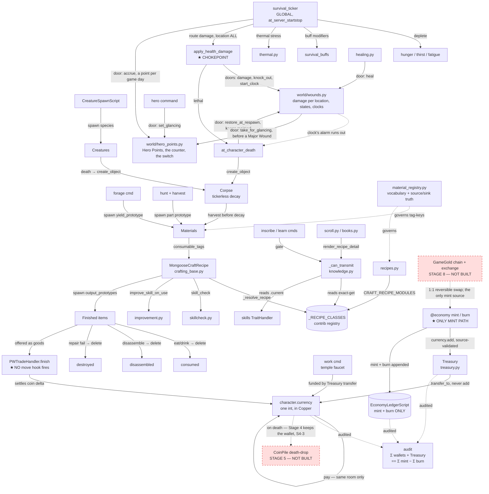

# PolishedWorld — System Map

> **Rev 7 · 2026-11-24** — **Hero Points have one writer, `world/hero_points.py`, with three doors** (Hero Points Decomposition HE-T9; merged as `3dc009d`, PR #35). The diagram gains the module and its three callers: the survival tick (`accrue`), the command `hero` (`set_glancing`) and the wound module, which asks before it writes a Major Wound (`take_for_glancing`). A new row, *Hero Points*, names the readers and the doors, each with one production caller (`tests/test_hero_points.py::TestHeroCensus`), and says that `tools/` — the mutation harness, HE-T1 — is outside the game. *Known gaps* gains what no one reads yet: `glancing` in a wound's outcome, and the points in the panel. Each consumer was found by searching `hero_points.<name>(` and `from world import hero_points` outside `tests/`, and every hit read as a call. No row removed.
> **Rev 6 · 2026-11-24** — **the damage path is one writer of hurt, in `world/wounds.py`** (Wounds Decomposition WN-T13; merged as `c3df740`, PR #34). The diagram's chokepoint now writes through the wound module's doors, and a clock that runs out reaches the death without the tick; the *Damage chokepoint* row gains the location argument and the doors, each with exactly one production caller (`tests/test_client_state.py::TestPushCensus`, `DOOR_WRITES`); a new row, *Health display*, names the readers. Each consumer was found by searching `wounds.<name>(` outside `tests/` and every hit read as a call. No row removed.
> **Rev 5 · 2026-11-16** — **four seam rows added by Names** (Combat Decomposition NM-T19; merged as `c4ac47a`, PR #31): the live short description, the character search, the names a line gives a player to type and to start with, and the room's character line with the panel's `{name, pose}` row. Each row's consumers were found by text search and every hit read as a call before it was credited. No row removed.
> **Rev 4 · 2026-11-15** — **one claim retired by Names NM-T1.** The `copper` entry in *Known gaps / dangling edges* said no object name can begin with a digit, because Evennia's disambiguation form was the suffix `copper-2`. The game's form is now the rpsystem contrib's prefix, `2-copper`, and `offer` asks the search's own `SEARCH_MULTIMATCH_REGEX` before it reads a digit-led segment as coin. Nothing else changed.
> **Rev 3 · 2026-08-03** — **graph fix: Rev 2's diagram did not render on GitHub.** `ECON[@economy mint / burn]` failed to parse, because Mermaid 11 reserves `@` for edge-ID and shape syntax (`a e1@--> b`, `a@{ shape: … }`) and so lexes a leading `@` in an *unquoted* node label as a `LINK_ID` token. Quoting the label fixes it; nothing else in the diagram was at fault — self-loops, `★`, em dashes, `Σ`, `==` inside quotes and dotted labelled edges all parse cleanly, verified one construct at a time against Mermaid 11.16. Both Mermaid blocks in the repo (this file and `roadmap.md`) now parse. **Rule of thumb: quote any node label that does not begin with a letter.** Rev 2's content is unchanged.
> **Rev 2 · 2026-08-03** — **two stages of drift closed, and the honesty method itself repaired.** Stage 4's currency layer is built and merged, so the `NOT BUILT` currency node is replaced by the real graph (Treasury, wallets, the single mint path, the ledger, the audit invariant) and five seam rows are added. **Three of the eight existing seam rows were wrong**, and the way they went wrong matters more than the rows: the §*How to keep it honest* recipe — plain `grep -rn` — is what produced two of the three. `typeclasses/books.py` was listed as a `_RECIPE_CLASSES` consumer on the strength of two comments that say Book is deliberately **not** one, and `world/material_registry.py` was credited with three runtime consumers when nothing in the codebase imports it at all. The reverse failure exists too: an AST-based check misses `crafting_base.py:314`, where `attempt_skill_improvement` is dispatched through a `getattr` **string literal** — which is why that row said four check-sites and the truth is five (`disassemble` became the fifth in Stage 3). §*How to keep it honest* now names both failure modes and requires the cross-check. Also fixed: the prose referred to a `BLOCKED` cluster that does not exist in the graph, and the currency gap note described a death-drop behaviour that Stage 4 does not implement (**S4-3** keeps the wallet on death; `CoinPile` is Stage 5).
> **Rev 1 · 2026-07-19** — first version. Structural (seam) view of how the built systems connect; a fourth view alongside the three altitudes.
> **Canonical:** `docs/PolishedWorld_System_Map.md` @ G0dlet/PolishedWorld — git wins. If a project-knowledge copy's Rev is lower than the repo's, it's stale.

## What this is (and what it is not)

A **structural cross-section**: how the systems that exist *today* wire into each
other, and where the load-bearing seams are. It answers *"if I touch X, what
else moves?"* and *"what is missing / dangling?"*.

It is a **fourth view** alongside the three altitudes, on a different axis:

| Doc | Axis | Answers |
|---|---|---|
| `roadmap.md` | temporal | what's next, in what order |
| `*_Decomposition.md` | tactical | how to build one feature, task by task |
| `*_Evennia_Reference.md` | reference | how a contrib/API behaves |
| **this** | **structural** | **how the built systems connect right now** |

**Scope rule (keeps it from rotting into a lie):** describe only what is *built*.
Future systems (combat, magic, GameGold) appear **only** as dangling edges
marked `NOT BUILT`, never as if they exist. When one gets built, it moves into
the graph proper in the same revision — currency did in Rev 2.

## How to keep it honest (grep-verifiable)

Every seam below names a real symbol + file. Start here:

```bash
grep -rn "_can_transmit" world/ commands/ typeclasses/
```

If the result no longer matches the "Consumers" column, the row is stale — fix
the row in the same commit (bump Rev). Same discipline `AGENTS.md` already
imposes on generated data.

**But do not stop at the grep, and do not trust it alone.** Rev 2 was needed
because this exact command produced two false rows, and it fails in *both*
directions:

- **It over-reports.** A comment or docstring that merely *names* a symbol looks
  identical to a call. `typeclasses/books.py` was listed as a `_RECIPE_CLASSES`
  consumer for two months on the strength of two lines that say Book is
  deliberately **not** one. (Same trap as the Stage 4 D regression guard, which
  grepped for `currency.add(` and matched the docstring forbidding it.)
- **It under-reports — and so does the obvious fix.** Parsing the AST for call
  sites removes the comment noise but cannot see dynamic dispatch:
  `world/crafting_base.py:314` reaches `attempt_skill_improvement` through a
  **string literal** inside `getattr()`. Only plain text search finds that one.

So neither method is sound on its own. **Cross-check:** text-search for the
candidate files, then confirm each one is a real reference and not prose. A hit
inside a comment is evidence about *intent*, sometimes the exact opposite of the
coupling it appears to prove — read the line before crediting it.

---

## The map



---

## Load-bearing seams

The precise, grep-checkable contracts. These are the edges that, if broken,
break more than one system.

| Seam | Symbol | Defined in | Consumers (grep target) | Contract |
|---|---|---|---|---|
| Knowledge gate | `_can_transmit(char, name)` | `world/knowledge.py` | `commands/crafting_commands.py` | know-recipe AND permanent `craft.current ≥ min_skill`; no roll |
| Recipe registry | `_RECIPE_CLASSES` / `_load_recipes()` | `evennia.contrib…crafting.crafting` | `commands/crafting_commands.py`, `world/knowledge.py` | exact `.get(name)`, None-guarded; **two consumers.** `world/crafting_base.py` has none, and `typeclasses/books.py` is deliberately *not* one — it stores canonical recipe names instead, and its two mentions of the symbol say so |
| Recipe module load | `CRAFT_RECIPE_MODULES` | `server/conf/settings.py` | `world/recipes.py` | concrete recipes only; **`crafting_base.py` must NOT be listed** (phantom-registration trap) |
| Craft engine | `MongooseCraftRecipe` | `world/crafting_base.py` | `world/recipes.py` (subclass) | `pre_craft` gates (min_skill, requires_knowledge) → `do_craft` (roll→quality→spawn) → `post_craft` (consume) |
| Material vocabulary | `MATERIALS`, `by_status()`, `orphan_materials()` | `world/material_registry.py` | **none — nothing in the codebase imports this module**; its readers are humans and `AGENTS.md` | one tag-key per concept; source/sinks/status per entry. Load-bearing *as a contract*, not as an import edge: generated content is written against it, so breaking it breaks the content pipeline rather than the runtime |
| Damage chokepoint | `apply_health_damage(amount, *, location, source=None, made=None)` → the doors `wounds.damage`, `knock_out`, `start_clock` *(Rev 6)* | `typeclasses/characters.py` → `world/wounds.py` | `survival_ticker.py` (`location=wounds.ALL`), (future: combat) | single route to death → one corpse per lethal event; **one writer of hurt** *(Rev 6)*: `db.body_damage`, `db.wound_states`, the clock and the unconsciousness are written only by `world/wounds.py`'s doors, each with one production caller — the writer, `world/healing.py` (`heal`) and `at_character_death` (`restore_at_respawn`); `stop_clock` and `revive` have none until slice HL |
| Health display *(Rev 6)* | `wounds.health_of` / `health_shown` / `report` | `world/wounds.py` | `typeclasses/characters.py` (`health_desc`), `commands/character_commands.py` (`status`, `sheet`), `world/client_state.py` (the `char` snapshot) | readers only; `health` is the worst location's margin, shown out of 100 (WN2, OQ-WN8); no `health` trait is created or read (WN2b) |
| Hero Points *(Rev 7)* | readers `hero_points.points` / `glancing_on`; doors `accrue`, `set_glancing`, `take_for_glancing` | `world/hero_points.py` | `world/survival_ticker.py` (`_deplete_character` → `accrue`), `commands/character_commands.py` (`CmdHero` → `set_glancing`; `CmdHero` and `CmdSheet` read `points`), `world/wounds.py` (`damage` → `take_for_glancing`) | **one writer** of `hero_points`, `hero_progress` and `hero_glancing_off` (P-2, HE6), each door with exactly one production caller, held by `tests/test_hero_points.py::TestHeroCensus`; a missing Attribute is two points and the switch on; `wounds` imports `hero_points`, never the reverse; `at_character_death` touches none of them (HE5); nothing of it is in a snapshot (HE7, WC12). `tools/mutate.py` and `tools/mutants/` (HE-T1) are development tools outside the game's packages and every census's `PRODUCTION` tuple: nothing in the game imports them |
| Global survival tick | `deplete_all_survival_traits()` | `world/survival_ticker.py` | `server/conf/at_server_startstop.py` | picklable module-level callback; iterates puppeted sessions, dedupes multisession |
| Skill improvement | `attempt_skill_improvement` (gated) → `improve_skill_on_use` | `typeclasses/characters.py` → `world/improvement.py` | **five** sites: craft (`world/crafting_base.py:314`, reached via a `getattr` **string** — invisible to AST search), repair, hunt-attack, hunt-harvest, and disassemble (`commands/crafting_commands.py:438`, added by Stage 3 E) | reads/writes `.current` (permanent), not `.value` |
| Wallet handler | `character.currency` (`CurrencyHandler`) | `world/currency.py` | `commands/currency_commands.py`, `commands/work_commands.py`, `world/barter.py` | sole writer of the `wallet` Attribute (**S4-R2**); no Attribute declared on the typeclass, so there is no bypass write to reach for (**D6**); `transfer_to()` returns `False` for *exactly one* reason — couldn't afford — and raises for everything else (**D7**); **no `yield` or `utils.delay` may ever separate `can_afford()` from the debit** (**S4-R1**) |
| Mint chokepoint ★ | `CurrencyHandler.add(amount, source)` | `world/currency.py` | `commands/currency_commands.py` (`@economy mint`) — **one production caller** | `source` validated against `MINT_SOURCES`; the faucet and barter *transfer*, never mint (**S4-1**) |
| Audit invariant | `economy_log.audit()` / `audit_report()` | `world/economy_log.py` | `commands/currency_commands.py` (`@economy audit`) | `Σ(wallets) + Treasury == Σ(mint) − Σ(burn)`. Only mint and burn are logged; transfers never are (**S4-4**) — the invariant *is* the proof, not the transaction history |
| Treasury resolution | `get_treasury()` / `resolve_treasury()` | `typeclasses/treasury.py` | `commands/work_commands.py`, `commands/currency_commands.py` | reads `settings.TREASURY_DBREF`; returns one of three problem codes (`unset` / `not_found` / `wrong_type`) — a caller that handles only "missing" will mis-report the other two |
| Trade settlement ★ | `PWTradeHandler.finish()` | `world/barter.py` | barter `CmdTrade` | assigns `obj.location` **directly**, so **no move hook fires anywhere in a trade**. Anything that must happen when goods change owner has to live inside `finish()` itself — coin settlement already does |
| Short description (live) | `LiveSdescHandler.get()` / `sdesc.compose(char)` | `world/sdesc.py` | the contrib's readers — `get_sdesc`, under `Character.get_display_name` (Evennia `rpsystem.py:1604`), and the search's candidate map (`:391`); the project's `world/names.py`, `world/sdesc.py` (`core_word`), `commands/names_commands.py` (the `recog` list, `pose`), `commands/admin_commands.py` (`@appearance`); `forget()` from `typeclasses/clothing.py`, `commands/names_commands.py`, `commands/admin_commands.py`, `world/chargen_menu.py` | composed from `db.appearance` (sex, age, feature), a build from SIZ, one state and the outermost garment, ≤ 40 characters; a one-second memo; the stored `_sdesc` for a character without facts or a composer that raises. **A writer of what the eye sees calls `forget()`**, or a stranger reads the old text for up to a second |
| Character search | `Character.get_search_result` | `typeclasses/characters.py` | every `caller.search` (`DefaultObject.search`, Evennia `objects.py:870`) — `get`, `give`, `hunt`, `craft`, `teach`/`learn`, `pay`, `trade`, `recog` | exact matches first; for a character what the searcher sees, never its key; `N-name` counted in the narrowed list; a Builder falls back to the key only when no description matched |
| Names to type and to start a line | `name_to_type`, `name_to_type_here`, `line_start`, `pronoun` | `world/names.py` | `commands/crafting_commands.py`, `commands/currency_commands.py`, `world/barter.py` | the reader's recog, else a word of the description, never the key; a line's first name takes `$You()`'s capital; a pronoun from `Character.gender` (`male`, `female`, `plural`) |
| Room line and panel row | `character_line` / `character_parts` | `world/room_text.py` | `typeclasses/rooms.py` (`get_display_characters`), `world/client_state.py` (`room_snapshot`) | one line per awake character with its pose; the panel gets `{name, pose}`, the pose `""` for the contrib's *is here.*, and `name + " " + pose` is look's line whenever a pose shows (Names NM-T8, NM-T17) |

★ = single point of failure worth guarding with extra care.

---

## Known gaps / dangling edges

- **Hero Points have one use and nothing reads it yet** *(Rev 7)*. Every wound's outcome carries `glancing`, True or False, for close combat to read — `NOT BUILT` (ML) — and no play reaches a Major Wound's test before it (HE2). The points are in `hero` and `sheet` only: the panel's `char` snapshot does not carry them, and when it does (CL, `NOT BUILT`) the tick must push `char` when a point lands, and `set_glancing`'s caller must push too (Hero Points Decomposition §11, point 8).

*(This is the "what's missing" section — the reason the doc exists. The material
layer's gaps are tracked in code and enumerated in
`docs/crafting/PolishedWorld_System_Backlog.md` (the 14 unbuilt systems, in build
order): smelting → smithing → steelmaking, kiln → charcoal/pottery, and so on.
That chain is deliberately **not drawn** — the scope rule keeps unbuilt systems
out of the graph, so the Backlog is its only home. The finished-goods side and
the `[SINK BLOCKED]` items live in the Source/Sink Ledger.)*

- **Currency is built (Stage 4) and is a single-mint, pegged currency board** —
  source/sink policy is owned by the economy docs
  (`PolishedWorld_Economic_Philosophy.md` principles 4–5,
  `PolishedWorld_GameGold_Economy.md`), not this map. Gold mints at *one* point
  (`crypto_exchange`, via `@economy mint`); the temple faucet redistributes
  Treasury holdings and never mints. **One true exit:** exchange back to
  GameGold. Circulation — repairs, fees, rent, a rival looting your corpse — is
  *not* a sink; it's another player's income.
- **The mint side is still dangling.** `@economy mint` exists, but the thing it
  is supposed to mint *against* — the GameGold chain and its exchange (Stage 8) —
  does not. Today an admin types the mint by hand; the 1:1 peg is a promise kept
  by a human, not by code. That is the intended Stage 4 shape, recorded here so
  it isn't mistaken for a hole.
- ⚠️ **Coin has no death behaviour yet.** Stage 4 keeps the wallet on the
  character through death (**S4-3**); nothing drops. `CoinPile` arrives in
  Stage 5 and lands on a **scheduled conflict**: `PlayerCorpse` deletes every
  item inside the body at expiry, which would be a second, *unlogged* exit and
  would show up in `@economy audit` as a discrepancy the invariant cannot
  explain. Full entry — including the three candidate resolutions — in
  `docs/BACKLOG.md` (*Death & Corpses*). **Do not resolve it here.**
- ⚠️ **`copper` is both a material and a denomination.** Harmless while coin has
  no object form; the `offer` verb is settled by the digit-first rule, which
  since Names NM-T1 asks `SEARCH_MULTIMATCH_REGEX` first: the disambiguation
  form is a *prefix* (`2-copper`), so a numbered item is number-hyphen-name and
  coin is number-space-denomination. What remains open is `caller.search()` facing two
  `copper`s in one room, which needs `CoinPile` to exist at all. Entry in
  `docs/BACKLOG.md` (*Currency*).
- **Knowledge has no sink.** `learn_recipe` is permanent; nothing un-learns.
  Intentional today, noted so it isn't mistaken for an omission.
- **Two independent tickers** (`survival_ticker`, `garment_wear`) — verify they
  never double-touch the same object per tick if a third is added.
