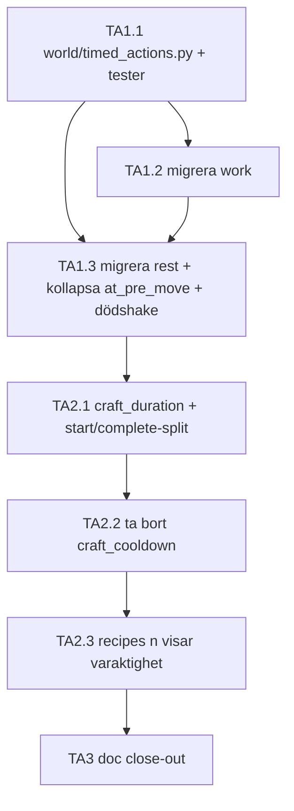

# PolishedWorld — Timed Actions Decomposition (Epic A)

> **Rev 5 · 2026-10-14** — **Decisions only; nothing here records a delivery beyond the Status line.** Logs **T20–T24**, locked at the start of TA2.2 before any code was written. T20 corrects the prose the removal falsified in TA2.2's own commit, including sites §8's list did not name. T21 **amends §7**: the middle-state test class is replaced rather than deleted, because a leftover `craft_cooldown` is silent in play and only a test can catch it. T22 leaves persisted `craft:*` cooldown keys alone. T23 makes `AGENTS.md` §4 an exception to docs-on-`main`: it is the data agent's schema, so it moves with the code. T24 defers a player-facing D3 sentence to TA3. §8 marks its false-docstring item as done (the `work_commands.py` half already in TA1.2), and gains a D3 help-text item, the documents on `main` that still name `craft_cooldown`, and nine Testing Reference candidates, seven of which until now existed only in handoff prompts. §9 notes that parallelism was lost in TA2.1, not TA2.2. Status updated: TA2.2 committed on the branch, **not merged**.
> **Rev 4 · 2026-10-09** — **Decisions only; nothing here records a delivery beyond the Status line.** Logs **T14–T19**. T14–T18 were locked at the start of TA2.1 before any code was written; **T19 was not on that list** — it surfaced while writing the completion half, follows from the Core Instructions' rule that error handling is never skipped, and is logged so that it is a decision rather than a habit. T14 widens D5's courtesy check from a name search to a dry run of the recipe's own `pre_craft`, and **supersedes the §7 sketch's `quiet=True`**: the non-quiet search answers a missing or ambiguous name with the very sentence completion would give. T15 settles the recipe lookup without touching the resolver-duplication entry. T16 is the double-throttle middle state §7 accepted in principle, now *computed*: the cooldown can never refuse a craft after its wait, but T14's dry run reads it at start, so until TA2.2 the throttling is visible. T17 fixes the messages the §7 sketch left as `...`; T18 records why the first end-to-end craft tests use the real twine recipe; T19 gives the completion its own error handling, because it no longer runs inside the command handler. §7 TA2.1 gains the test lines the decisions added; §10 confirms craft-abort-is-free for v1 and notes one wording consequence of death. Status updated: TA2.1 committed on the branch, **not merged**.
> **Rev 3 · 2026-10-08** — **Decisions only; nothing here records a delivery.** Logs **T10–T13**, locked at the start of TA1.3 before any code was written. T10 and T11 answer the two questions Rev 2 opened in §10 (`_rest_tick`'s callback shape; who empties the slot on the final tick); both entries there are marked closed, not deleted. T12 and T13 were not on the plan — they surfaced when `stop_resting()` and `at_character_death()` were read against live source: a literal "thin wrapper over `interrupt()`" would have broken `stop_resting`'s own documented contract, and D7's `interrupt(self)` makes death audible in a way §6 did not mention. One ordering that follows from T8 is written down under the table rather than numbered. §8 gains two items found during TA1.3: Evennia Reference §11.27 point 2 says a move hook does not catch teleport, but `@tel` moves **with** hooks (`evennia/commands/default/building.py`, pinned `v6.1.0`) — the same wrong claim stood in `commands/work_commands.py` and is corrected on the branch; and point 3 names `_rest_tick` as a method guarding `has_account` itself, which T10 retires.
> **Rev 2 · 2026-10-08** — **Decisions and plan corrections only; nothing here records a delivery.** TA1.1 and TA1.2 are committed on `feature/timed-actions` and are not merged, and `main` does not describe branch code as shipped — the failure roadmap Rev 23 had to clean up after Stage 4.5. What this revision does record: **(1) the nine implementation decisions locked during TA1 (T1–T9)**, which until now existed only in chat, in module docstrings on an unmerged branch, and in handoff prompts. T1–T5 were called Q1–Q5 in chat, which collides with §2's planning-session Q3/Q4 and with TA2.3's heading — two different Q3s in one epic is a lookup that silently returns the wrong decision — so they are renamed and the old names are given once for traceability. **(2) Two sketches are marked superseded.** §6 TA1.1 shows `start()` leaving the busy message to the caller and `_Record` as a bare `__slots__` class (T2 and T5 replaced both); §7 TA2.1 shows an `is_busy()` check with its own `caller.msg()` ahead of `start()`, which under T2 is a second copy of a sentence `start()` already writes. D6's `_complete_craft(cmd, marker)` reads `(caller, cmd, marker)` under T1. **(3) §5 and §6 contradicted each other about `at_pre_move`** — §5 said it collapses once, in TA1.3, without being edited twice; §6 TA1.2 said TA1.2 removes the working branch. Taken literally, §6 ships a commit where walking out of a chore is silent and an existing regression test has to be rewritten to assert the degraded behaviour. T6 resolves it: TA1.2 *replaces* the branch with the final `interrupt()` line, and TA1.3 only deletes the resting branch. **(4) Two test lines pointed at tasks that cannot reach them.** TA1.2's "`rest` during a chore is refused" needs `rest` on the slot (TA1.3); TA1.3's "`rest` during a craft is busy" needs craft on the slot (TA2.1). Each moves to the task that can reach it. **(5) §10 gains two open questions for TA1.3** — `_rest_tick`'s callback shape (`start()` injects `char` per T1, and `_rest_tick` is a bound method, so passing `self._rest_tick` hands it the character twice) and who empties the slot on the final tick, since `is_current()` is non-destructive by design. Registered, not decided. Also: the header *Status* no longer reads "no code written", and §4's description of the record is corrected (it carries `on_interrupt`, a callable, not a second message). Retired text stays in place and is marked, per the house superseding convention.
> **Rev 1 · 2026-09-09** — first version. Written after Stage 4.5 merged to `main`, against live source read the same day (`typeclasses/characters.py`, `commands/work_commands.py`, `commands/consumption_commands.py`, `commands/crafting_commands.py`, `world/crafting_base.py`, `world/recipes.py`, `world/knowledge.py`, and Evennia `CmdCraft` at the pinned `v6.1.0` tag). Locks decisions D1–D7 from the 2026-09-09 planning session, which existed only in chat until this file. **This document is also what defines "Epic A"** — the name is already cited as an ordering dependency by `docs/roadmap.md` (food professions: *"after Epic A"*) and by `docs/BACKLOG.md` (*two-stage healing*, whose Trigger and Status both name Epic A's `world/timed_actions.py`), and until this file lands it is cited but undefined.
> **Canonical:** `docs/PolishedWorld_Timed_Actions_Decomposition.md` @ G0dlet/PolishedWorld — git wins. If this project-knowledge copy's Rev is lower than the repo's, it's stale — re-upload from the repo.

**Feature branch:** `feature/timed-actions`
**Status:** in progress on `feature/timed-actions` — TA1.1, TA1.2, TA1.3, TA2.1 and TA2.2 committed, **not merged**. `main` carries the plan and its decision log only.
**Rough scope:** 5–6 commits, 2–3 sessions
**Philosophy:** skynda långsamt — extrahera mönstret från två fungerande implementationer *innan* den tredje skrivs för hand.

---

## 1. Varför den här epiken

Två backlog-poster pekar på samma pass och är korsrefererade från båda håll:

- ***Timed player actions have a pattern but no shared home*** (Tooling & Process) — `rest` och `work` implementerar "det här tar tid och kan avbrytas" var för sig. `at_pre_move` bär två handskrivna grenar och växer med en per framtida handling. Trigger: **Met (Rev 24)**.
- ***Crafting resolves instantly*** (Crafting & Tools) — `craft` är den **tredje** timade handlingen, och den som fyrade av triggern ovan. Trigger: **After Stage 4.5 Component D** (uppfyllt 2026-08-24).

Posterna säger uttryckligen: gör båda i ett pass. Att bygga craft-duration ensamt vore att skriva en fjärde `at_pre_move`-gren, vilket är precis det utfall den första posten finns för att förhindra.

Epiken har också konsumenter som redan väntar: `docs/roadmap.md`s **food professions** sekvenserar sig *efter* den här (plantera/skörda är timade handlingar), och `docs/BACKLOG.md`s **two-stage healing** listar `world/timed_actions.py` som en av två triggers (kirurgi är avbrytbar per konstruktion). Den här epiken är alltså inte städning — den är infrastruktur två framtida system redan är designade mot.

---

## 2. Designbeslut låsta 2026-09-09 (D1–D7)

| # | Beslut | Val | Konsekvens |
|---|--------|-----|------------|
| D1 | Hjälparens form | **Modul med rena funktioner** — `world/timed_actions.py`, **en** slot `ndb.timed_action` | Speglar `_finish_task`-mönstret (direkt anropbar från test), håller `Character` tunn, och **en** slot ger **en** `at_pre_move`-gren — hela poängen med posten. |
| D2 | `rest` | **Migreras** till sloten, behåller sin tick-loop | Annars kvarstår två grenar och posten är inte stängd. `ndb.resting` och `ndb.working` försvinner helt. |
| D3 | Ömsesidig uteslutning | **Alltid explicit**, aldrig tyst avbrott | En regel att lära sig. Meddelandet namnger pågående handling; `rest` är en toggle (verifierat) så det finns ett rent avslut att peka på. |
| D4 | `craft_duration` | **Ersätter `craft_cooldown` helt** | Två rattar med samma observerbara effekt går inte att kalibrera i efterhand — samma argument som frös `improvement_cooldown` på 30 i Stage 4.5. |
| D5 | Start vs. slutförande | **Artighetskoll vid start, contribens omsökning vid slutförande är den som räknas** | `work`-docstringens formulering, oförändrad: för-kontrollen är artighet, efter-kontrollen är korrekthet. |
| D6 | Callbackens hemvist | **Modulnivå-`_complete_craft(cmd, marker)`** som tar Command-instansen | `super().func()` läser `self.recipe/ingredients/tools` från ärvd `parse()`; alternativet är att återuppfinna contribens sökning. |
| D7 | Avbrott | **v1: rörelse enda avbrottet**, `persistent=False`, + `at_character_death()` anropar `interrupt()` | ndb och delay dör tillsammans vid `@reload`; inget konsumeras. Dödshaken är städning, inte en ny abort-källa. |

**Följdbeslut från samma session:** `recipes <n>` visar varaktighet (Q3, ja) · inget nytt rumsmeddelande vid slutförande (Q4, nej i v1 — startmeddelande till rum som `work`, contribens befintliga utdata går till hantverkaren) · skill-skalad varaktighet **uteslutet ur v1** (backlog-posten säger det: det interagerar med 4.5 C/D:s practice-line).

⚠️ **D6 läst mot T1 (Rev 2):** `start()` injicerar karaktären först (T1), så callbacken anropas `_complete_craft(caller, cmd, marker)` — som §7:s skiss redan visar. Tabellens `(cmd, marker)` beskriver vad callbacken *behöver*, inte dess signatur.

### Implementationsbeslut låsta under TA1–TA2 (T1–T24)

Låsta i chatten under TA1.1 (T1–T5), TA1.2 (T6–T9) TA1.3 (T10–T13, Rev 3), TA2.1 (T14–T19, Rev 4) och TA2.2 (T20–T24, Rev 5). Motiveringen för T1–T5 står också i `world/timed_actions.py`s docstrings på grenen; den här tabellen är **beslutsloggen**, inte en leveranspost.

⚠️ **Namnbyte:** T1–T5 hette **Q1–Q5** i chatten och i handoff-promptar. De döps om här eftersom stycket ovan redan använder Q3 och Q4 för planeringssessionens frågor, och TA2.3 bär "(Q3)" i rubriken. Två olika Q3 i samma epik är ett uppslag som tyst ger fel beslut.

| # | Beslut | Val | Varför |
|---|--------|-----|--------|
| T1 (Q1) | Callbackens signatur | `start()` injicerar `char`; callbacken anropas `callback(char, *args, marker)`, markören **sist** | Callbacken kan aldrig få en annan karaktär än den vars slot den ska ta. Matchar `_finish_task(caller, task_key, marker)`. |
| T2 (Q2) | Vem skriver D3-meningen | `start()` själv: `"You are already {label}."`, returnerar `None` | En formatregel spridd över tre filer är tre ställen att glömma den. Anropsplatsen kollar bara `is None`. |
| T3 (Q3) | Utloggad karaktär | `claim()` och `is_current()` **tömmer** sloten när `has_account` är falsk | Kroppen överlever sessionen (statue logout). En slot som lämnas kvar är en karaktär som är upptagen tills nästa reload. |
| T4 (Q4) | Avbrottsmeddelandet | `interrupt(char, reason)` — `reason` överrider `record.interrupt_msg`. **Ingen** `DEFAULT_INTERRUPT_MSG`: `interrupt_msg` defaultar till `None` och `interrupt()` tiger då | Rörelse och `rest`-togglen avslutar samma handling med olika meningar. Varje konsument sätter sin egen; en generisk standardmening skulle bara synas när någon glömt. |
| T5 (Q5) | Recordets form | `@dataclass(slots=True, eq=False)` | `slots` gör stavfel till fel i stället för nya fält; `eq=False` eftersom identitet frågas via `marker is`, aldrig `==`; genererad `__repr__` gör `@py`-utläsning läsbar. |
| T6 | `at_pre_move` under migreringen | TA1.2 **ersätter** working-grenen med `timed_actions.interrupt(self)`; resting-grenen står kvar; TA1.3 **raderar bara** den | Att bara radera grenen gav ett commit där man går ut ur en syssla utan meddelande, och ett befintligt regressionstest hade behövt påstå det degraderade beteendet. Logiken skrivs en gång. |
| T7 | `work`s upptaget-mening | `"You are already busy with something."` ersätts av T2:s `"You are already working."` | Följer av T2. Spelarsynlig ändring. |
| T8 | Busy vs. cooldown i `CmdWork` | Cooldown-gaten körs **före** `start()`. Upptagen + en annan syssla på cooldown → cooldown-svaret vinner | Den gamla ordningen kräver en andra kopia av D3-meningen eller en `is_busy()`-gren som avgör det `start()` avgör. Båda svaren är sanna; det som vinner gäller sysslan spelaren namngav. |
| T9 | Vaktordningen i `_finish_task` | `claim()` lyfter `has_account` över tabelluppslaget | Enda observerbara följd: en okänd tasknyckel når inte `log_err` när arbetaren loggat ut. Ingen betalningsväg ändras. |
| T10 | `_rest_tick`s callback-form | **Modulnivå** `_rest_tick(char, marker)` i `typeclasses/characters.py`; omschemaläggning `delay(char.rest_interval, _rest_tick, char, marker)` | En callback-form för hela epiken (`_finish_task`, `_rest_tick`, `_complete_craft`), direkt anropbar från test. Rattarna `rest_interval`/`rest_recovery` står kvar som klassattribut och läses via `char`. Avvisat: bunden metod som tar och ignorerar `char` (två referenser till samma karaktär i en signatur) och obunden `Character._rest_tick` (förbigår override; `type(self)._rest_tick` löser det men är ett idiom som kräver en kommentar för att inte se ut som en bugg). |
| T11 | Vem tömmer sloten på sista ticken | `claim(char, marker)` som **första sats** i båda slutgrenarna ("fully rested", fatigue `None`), före meddelandena; returvärdet konsulteras inte | Den repeterande handlingens sista tick *är* en engångsavslutning. Går genom slotens ägare (P-2). Tömmer före `msg()` så ett meddelande som kastar inte lämnar karaktären vilande för evigt. `claim()` kan inte vägra där: `is_current()` sa ja i samma synkrona anrop. Avvisat: direktskrivning av `ndb.timed_action` (bryter P-2) och `interrupt()` med `reason` (kör `on_interrupt` — rummet skulle se både "gets up." och "gets up, looking refreshed."). |
| T12 | `stop_resting` på delad slot | Vaktar `is_busy(self).key == "rest"`, returnerar annars `False`; därefter `interrupt(self, reason)` | Metodens dokumenterade kontrakt är "no-op if not resting, safe to call from anywhere". En bokstavligt tunn wrapper avbryter *vad som helst* i sloten — en syssla skulle avbrytas med "You stop resting.". |
| T13 | Död under en timad handling | D7:s `interrupt(self)` **otystad**, först i `try`, i ett eget `try/except` med `log_trace` | Spelaren får handlingens `interrupt_msg` före "You have died."; rummet ser `on_interrupt` (vila: "gets up.") i rummet där karaktären föll. Sant, ingen API-ändring, döden är sällsynt. Den inre vakten följer corpse-spawnens mönster: ett avbrott som kastar får inte avbryta dödssekvensen och lämna karaktären på 0 HP. Avvisat: `reason=""` (tystar bara aktören) och en `quiet`-flagga i API:t (öppnar TA1.1-modulen i ett rest-commit). |
| T14 | Artighetskollens omfång (D5) | Sökningen speglar `CmdCraft.func` — samma två anrop, samma ordning, **utan** `quiet` — och indata torrkörs genom `cls(caller, *inputs).pre_craft()` i `try/except (CraftingError, CraftingValidationError)` | Utan torrkörningen väntar en spelare under `min_skill`, eller med fel ingrediens, 20–45 s på ett nej som gick att ge direkt. `pre_craft` bara läser (contribens validering sätter instansattribut; kunskaps-, skill- och kooldown-gaten läser tags, traits och cooldowns) och konsumtion bor i `post_craft`, som aldrig anropas. Icke-quiet ger Evennias egna meningar för noll och flera träffar, ordagrant slutförandets; §7-skissens `quiet=True` hade krävt två egna meningar. Speglas **inte**: contribens vägran av puppetade eller nocraft-låsta objekt — fångas vid slutförandet, efter väntan, utan konsumtion. |
| T15 | Receptuppslaget före `start()` | Återanvänd `cls` från `_resolve_recipe`; `cls is None` ⇒ `super().func()` direkt, ingen slot. `cls.craft_duration` läses direkt, inte via `getattr` | Samma algoritm mot samma register som contribens `craft()` ⇒ samma klass vid start och slutförande, och därmed rätt väntetid. Ingen femte läsare av det privata registret (BACKLOG, *resolver-duplication*, constraint Rev 24). Ett olöst namn gick redan rakt till `super().func()` före TA2.1. Avvisat: publik resolver nu (scope), ett andra uppslag (dubblering). |
| T16 | Mellanläget, dubbel strypning (§7) | Accepteras som grentillstånd; ingen kod | Räknat: kooldownen kan aldrig vägra **efter** väntan. E = fl(t_c + d); nästa start t_s ≥ t_c (sloten serialiserar, och `claim` och `cooldowns.add` sker i samma synkrona anrop); delayn fyras när `time.time() ≥ fl(t_s' + d) ≥ E`; `ready()` ⇔ `now ≥ E`. Båda klockorna är `time.time` (`TaskHandler.clock = reactor`, `ReactorBase.seconds` = `twisted.python.runtime.seconds`); enda undantaget är en väggklocka som stegar bakåt, vilket är patologiskt. Men T14:s torrkörning läser kooldownen **vid start**: direkt efter en färdig craft vägras samma recept tills kooldownen löpt ut, så strypningen syns (twine: 20 s + 20 s) tills TA2.2. Invarianten `craft_duration == craft_cooldown` asserteras per recept; testet raderas i TA2.2. Avvisat: undanta kooldownen ur torrkörningen (kod som raderas i nästa commit). |
| T17 | Craftens meddelanden | Aktör: `You set to work on {cls.name}.` Rum: `{name} begins to craft something.` `interrupt_msg`: `You set your crafting aside; your materials are untouched.` Ingen `on_interrupt`; ingen tid i startraden | Rummet ser handlingen, inte receptet, och ingen rumsrad vid slutförande (Q4). Bara rörelse och död avbryter en craft; en flytt visar redan avfärden, och startraden sa aldrig vad som gjordes. `rest` har en `on_interrupt` eftersom vila kan sluta på plats. Tidsvisningen ägs av TA2.3. |
| T18 | Testfixtur för craft | Det riktiga `TwineRecipe` genom registret, fiber spawnad från `plant_fiber`; skill-golvet via `mock.patch.object(TwineRecipe, "min_skill", …)` | Det fanns inga tester för `CmdCraftGated` eller pipelinen. Twine har policyn `raw` ⇒ alltid en produkt oavsett slag, och inget verktyg, ingen kunskap ⇒ deterministiskt utan att mocka tärningen. Avvisat: stubbrecept i `_RECIPE_CLASSES` (privat registerstate i tester), mockad `super().func` (testar inte det som kan gå sönder). |
| T19 | Fel vid slutförandet | `claim()` först; sedan `super(CmdCraftGated, cmd).func()` i `try/except Exception` med `logger.log_trace` och `"Something went wrong as you finished your crafting."` till spelaren | Slutförandet körs inte längre i cmdhandlern, som förut loggade felet och sa "An untrapped error occurred.". Ett fel som lämnar en delay-callback går tillbaka in i dess Deferred (TaskHandlers `handle_error` kastar om det), Twisted loggar det som ohanterat, spelaren hör ingenting, och `do_task` når aldrig `self.remove(task_id)`. `claim()` före `try` gör att ett fel aldrig lämnar sloten upptagen. Avvisat: ingen hantering (tyst för spelaren). |
| T20 | Prosa som TA2.2 gör falsk | Rättas i TA2.2:s **eget** commit, på grenen — även sajter utanför §8:s lista | §8 säger "ersätts på plats, inte i efterhand", och ett commit som raderar mekanismen men lämnar prosan är mönstret med falska docstrings. TA3 är en docs-patch på `main` och når inte `.py`-filerna. Sajter utöver §8: kommentarerna i `pre_craft`, `do_craft` och `post_craft` (bl.a. "cf. … / cooldowns / …", som pekade på en åtkomst som försvinner), `_inputs_pass`-docstringen och `REPAIR_COOLDOWN`-kommentaren i `commands/repair_commands.py` — förankrad om till `craft_duration`, med att en craft väntar före och en repair efter. Samtidigt rättat: `craft_duration`-kommentaren sa "before this recipe ever runs", halvsant sedan T14:s torrkörning; det sanna är att `craft()` inte körs förrän efter väntan. |
| T21 | Testerna (§7 sa "radera") | `TestDurationMatchesCooldown` **ersätts**: `TestOneKnob` (varje recept har `craft_duration > 0`; ingen klass har `craft_cooldown`) och `TestNothingThrottlesARepeat` (samma recept startar igen direkt efter slutförd craft; en slutförd craft skriver ingen kooldown-nyckel utom `improve_craft`). Kooldown-asserterna och `test_a_running_cooldown_is_refused_at_start` raderas utan ersättare | Ett dött `craft_cooldown` är tyst i spel. Kvittot "ingen kooldown stämplad vid start" bärs redan av torrkörningens spion (`do_craft` anropas aldrig). Nycklarna jämförs före och efter, så en stämpel fångas under vilket namn och via vilken metod som helst; `improve_craft` tillåts eftersom XP-fönstret stämplas vid lyckat slag när det är öppet, alltså tärningsberoende. Avvisat: spion på `CooldownHandler.add` (missar `set = add`, som binds vid klassdefinitionen, och `extend`, som går via `set`) och "ingen nyckel börjar med `craft:`" (namnberoende, §11d). Mutationsverifierat 5/5: gate och stämpel tillbaka, bara stämpeln (bara nyckeljämförelsen fäller den), dött attribut i ett recept, dött attribut i basen, `craft_duration = 0`. |
| T22 | Persisterade `craft:*`-nycklar | **Lämnas** (no-backfill) | En nyckel lever högst 45 s (längsta `craft_cooldown` i katalogen); ingen läser en efter TA2.2, och ingen produktionskod läser hela kooldown-dicten. Contriben raderar utgångna nycklar när handlern byggs — en `lazy_property`, alltså vid första användning efter varje laddning. Avvisat: `@py`-städning vid merge (städar något som löser sig självt), permanent kod i `at_init` eller en migration. |
| T23 | `AGENTS.md` §4 | Ändras i TA2.2:s **kod**-commit på grenen (AGENTS Rev 6) — undantag från docs-på-`main` | Det är schemat dataagenten kopierar; det namngav `craft_cooldown` och saknade `craft_duration` sedan TA2.1. På `main` före merge skulle det beskriva ett attribut `main` inte har. Med T21:s gravsten fäller ett dött `craft_cooldown` sviten, så agentens §0A ("green before commit") stoppar den. Avvisat: på `main` i TA3 (ett fönster där agenten följer fel schema). |
| T24 | Spelarsynlig D3 | **Inte** i TA2.2; filad i §8 | Parallelliteten försvann i TA2.1, när sloten serialiserade allt — TA2.2 *återställer* genomströmningen för samma recept. Regeln "en sak i taget" gäller `craft`, `work` och `rest`; en mening bara i craft-hjälpen beskriver en regel för tre kommandon från ett av dem. |

**Följer av T8, inte numrerat (Rev 3):** `start_resting()` kollar "You are not tired." **före** `start()`. Upptagen *och* utvilad svarar alltså "You are not tired.", inte "You are already working." — gaten om handlingen spelaren namngav vinner, precis som `work`s kooldown-gate. Båda svaren är sanna.

### Namngivning
Epiken heter **Epic A** i två dokument på `main`. Komponenterna här heter därför **TA1–TA3**, inte A–C: "Epic A, Component A" är oläsbart, och Hunting-decompen har redan precedens för prefixade komponenter (H1–H7). Mappning till planeringssessionens skiss: TA1 = A, TA2 = B, TA3 = C.

---

## 3. Verifierade källankare (source-first, läst mot `main` 2026-09-09)

- `typeclasses/characters.py`
  - `rest_interval = 10`, `rest_recovery = 5` (klassattribut).
  - `start_resting()` / `stop_resting(reason=...)` / `_rest_tick()`. Ticken **schemalägger sig själv** via `delay(self.rest_interval, self._rest_tick)` och bevakar `ndb.resting` + `has_account`.
  - `at_pre_move(destination, move_type="move", **kwargs)` — två grenar, returnerar `super().at_pre_move(...)`.
  - `at_character_death(killer=None)` — `ndb._dying`-reentrancy-guard i `try/finally`.
  - `at_post_unpuppet()` kallar **inte** `super()`; kroppen står kvar i rummet (statue logout). **Detta är hela skälet till att `has_account` vaktar varje callback** — annars betalar/tickar världen till en obemannad kropp.
- `commands/work_commands.py`
  - Modulnivå-`_finish_task(caller, task_key, marker)`; `marker = object()`; guards `not caller.pk or caller.ndb.working is not marker`, sedan `has_account`, sedan `_temple_here()`-omkoll.
  - `delay(task["duration"], _finish_task, caller, task_key, marker)`, `persistent=False` **som beslut** (dokumenterat i modul-docstringen).
  - Modul-docstringen beskriver `ndb.working` explicit → **blir falsk efter TA1.2**.
- `commands/consumption_commands.py` — `CmdRest` (key `rest`, help_category `survival`) är en **toggle**: `if caller.ndb.resting: caller.stop_resting()` annars `start_resting()`. Hjälptexten säger redan "Use 'rest' again, or move, to stop."
- `commands/crafting_commands.py` — `CmdCraftGated(CmdCraft)` överlagrar **bara** `func()`, gör kunskaps-early-reject och avslutar med `super().func()`. `key`/`locks`/`parse` ärvs.
- Evennia `v6.1.0` `CmdCraft` — `parse()` sätter `self.recipe/ingredients/tools`; `func()` söker ingredienser i inventariet, verktyg var som helst, och anropar `craft(caller, self.recipe, *(tools + ingredients))`, därefter `obj.location = caller`.
- `world/crafting_base.py` — `craft_cooldown = 30` (klassattribut), `_cooldown_key` (property), gate i `pre_craft` **efter** kunskaps- och skill-gaten, `cooldowns.add(...)` överst i `do_craft` efter `rolled = True`. Modul-docstringen rad ~9/11/21/25 beskriver kooldownen → **blir falsk efter TA2.2**.
- `world/recipes.py` — åtta subklasser med explicita värden (20/25/30/40/45). Modul-docstringen rad ~6 säger "cooldown sink" → **blir falsk efter TA2.2**.
- `world/knowledge.py` — `render_recipe_detail(cls)` är ren presentation och **delas** av `CmdRecipes` (C.2) och scroll-`look` (F.3). En ändring, två ytor.
- `AGENTS.md` §0A — `tests/test_knowledge.py` är golden reference; `evennia test --settings settings.py .`; baslinje **429 tester gröna** (roadmap Rev 19).
- Mekanismen: `evennia.utils.utils.delay` — `PolishedWorld_Evennia_Reference.md` §11.27.

---

## 4. API — `world/timed_actions.py`

```python
start(char, key, seconds, callback, *args, label=None, interrupt_msg=None, on_interrupt=None) -> marker | None
is_busy(char) -> record | None       # record.label driver D3:s meddelande
is_current(char, marker) -> bool     # ICKE-destruktiv: för repeterande tickar (rest)
claim(char, marker) -> bool          # destruktiv: för engångsslut (work, craft)
interrupt(char, reason=None) -> bool # rensar sloten, meddelar, kör on_interrupt
```

**`is_current` vs. `claim` är inte kosmetik.** `work` och `craft` är engångs — deras callback tar sloten och lämnar den tom. `rest` tickar om och om igen och måste kunna fråga "är jag fortfarande den aktuella handlingen?" **utan** att nolla sloten, annars avslutar första ticken vilan. Skissen från planeringssessionen hade bara `claim`; det hade gått sönder på D2:s migrering. Båda vaktar `caller.pk`, markör-identitet och `has_account`.

`on_interrupt` finns för `rest`s rumsmeddelande ("gets up") — actor-meddelandet räcker inte, vila har en publik dimension. Recordet bär markör, nyckel, label, `interrupt_msg` och `on_interrupt` — det senare en callable, inte ett meddelande (Rev 1 sa "de två meddelandena"; rättat Rev 2).

**Ingen `_format_wait`-import.** Den bor i `commands/work_commands.py` och `world/` importerar inte från `commands/`. Craft-varaktigheter är sekunder och renderas som `Ns`. (`_format_wait`s trunkeringsdefekt har en egen backlog-post och rörs inte här.)

---

## 5. Beroendegraf



TA1.3 efter TA1.2 för att `at_pre_move` ska kunna kollapsa till **en** gren i ett enda commit i stället för att redigeras två gånger.

⚠️ **Rev 2:** meningen ovan och §6 TA1.2 ("`at_pre_move`s `working`-gren tas bort") sa emot varandra. Löst av **T6**: TA1.2 ersätter grenen med den slutliga `interrupt()`-raden, TA1.3 raderar bara resting-grenen. *Logiken* skrivs en gång; *filen* rörs två gånger.

---

## 6. Component TA1 — Delad timed-action-modul

### Task TA1.1 — `world/timed_actions.py` + `tests/test_timed_actions.py`
- **Goal:** En slot, fem funktioner, inga beroenden uppåt mot `commands/` eller `typeclasses/`.
- **Dependencies:** Inga (ren modul + `evennia.utils.utils.delay`).
- **Approach (key shape):**
  ```python
  # world/timed_actions.py
  from evennia.utils.utils import delay

  class _Record:
      """In-memory only. Dies with the process, exactly like the delay it pairs with."""
      __slots__ = ("marker", "key", "label", "interrupt_msg", "on_interrupt")

  def start(char, key, seconds, callback, *args,
            label=None, interrupt_msg=None, on_interrupt=None):
      if is_busy(char):
          return None                      # caller messages; D3 = explicit
      marker = object()                    # identity token; cannot collide
      char.ndb.timed_action = _Record(...)
      delay(seconds, callback, char, *args, marker)   # persistent=False (default)
      return marker
  ```
  ⚠️ **Superseded (Rev 2):** skissen låter `start()` lämna meddelandet åt anroparen (`# caller messages`) — **T2** lägger det i `start()`. `_Record` som klass med `__slots__` blev `@dataclass(slots=True, eq=False)` — **T5**. Skissen står kvar som historik.
- **Multiplayer:** ndb är per objekt, reaktorn enkeltrådad → ingen delad state, ingen race. Sloten är per karaktär, aldrig global.
- **Test:** andra `start` returnerar `None` medan upptagen · `interrupt` rensar + meddelar + kör `on_interrupt` · stale markör vägras av både `claim` och `is_current` (walk-away-och-starta-om: första callbacken får **inte** landa på andra försöket) · `claim` rensar sloten, `is_current` gör det inte · `has_account=False` vägras. `delay` mockas för att fånga callbacken; funktionerna anropas direkt.
- **Mutationstest:** ta bort identitetskollen → walk-away-testet **måste** falla. Ett test som passerar utan den vaktar ingenting.
- **Commit:** `feat(timed): add shared timed-action slot in world/timed_actions.py`

### Task TA1.2 — Migrera `work` till sloten
- **Goal:** `work` använder hjälparen; `ndb.working` finns inte längre.
- **Dependencies:** TA1.1.
- **Approach:** `_finish_task` byter `if not caller.pk or caller.ndb.working is not marker: return` mot `if not timed_actions.claim(caller, marker): return` (som redan omfattar `pk` och `has_account`). Startvägen byter `if caller.ndb.working:` + manuell markör mot `start(..., label="working", interrupt_msg="You break off what you were doing.")`. **Kooldownregeln rörs inte:** `cooldowns.add()` sitter kvar efter en lyckad `transfer_to()` och ingen annanstans — allt-eller-inget-regeln är låst och den här migreringen är rent mekanisk. `at_pre_move`s `working`-gren tas bort. Modul-docstringens hazard-lista (punkt 1–4) uppdateras till att beskriva sloten.
- **Test:** befintlig `work`-regression grön + nytt test att `rest` under pågående chore vägras med labeln.
- **Commit:** `refactor(work): move temple chores onto the shared timed-action slot`
- ⚠️ **Rättat (Rev 2):** "`at_pre_move`s `working`-gren tas bort" ovan är ersatt av **T6** — grenen *ersätts* med `timed_actions.interrupt(self)`. Testraden "`rest` under pågående chore vägras" är inte nåbar i TA1.2 (`CmdRest` läser `ndb.resting` tills TA1.3) och flyttas dit. Det nåbara substitutet i TA1.2: en andra `work` under pågående syssla ger T2-meningen "You are already working." Följ också T7–T9.

### Task TA1.3 — Migrera `rest`, kollapsa `at_pre_move`, dödshake
- **Goal:** En `at_pre_move`-gren totalt; `ndb.resting` finns inte längre.
- **Dependencies:** TA1.2.
- **Approach:** `start_resting()` anropar `start(..., label="resting", interrupt_msg="You get up, interrupting your rest.", on_interrupt=<rummets "gets up">)` och behåller `delay(self.rest_interval, self._rest_tick)`. `_rest_tick` byter `if not self.ndb.resting or not self.has_account` mot `is_current(self, marker)`; markören når ticken via `delay(..., marker)`. `stop_resting(reason)` blir en tunn wrapper över `interrupt`. `CmdRest`-toggeln läser `is_busy` — **och måste skilja på "vilar" och "gör något annat"**: `rest` under en craft ska ge D3-meddelandet, inte tyst avbryta craften. `at_pre_move` blir:
  ```python
  def at_pre_move(self, destination, move_type="move", **kwargs):
      timed_actions.interrupt(self)      # no-op when idle; messages when not
      return super().at_pre_move(destination, move_type=move_type, **kwargs)
  ```
  `at_character_death()` får `timed_actions.interrupt(self)` inuti `try` (D7). Ordning: före corpse-spawn, så en pågående handling aldrig ser en halvflyttad karaktär.
- **Test:** vila tickar till full · rörelse avbryter med rätt meddelande + rumsmeddelande · `rest` under craft ger busy, avbryter inte · död rensar sloten · `has_account`-guard behållen (statue logout).
- **Commit:** `refactor(rest): move resting onto the shared slot; collapse at_pre_move to one branch`
- ⚠️ **Rättat (Rev 2):**
  - **`at_pre_move`-steget:** raden `timed_actions.interrupt(self)` står redan där sedan TA1.2 (T6). TA1.3 **raderar bara resting-grenen**; skissen ovan är slutformen, inte en ny skrivning.
  - **Testraden "`rest` under craft ger busy"** är inte nåbar förrän craft ligger på sloten och flyttas till TA2.1. Nåbart i TA1.3: `rest` under `work` → "You are already working." och `work` under `rest` → "You are already resting." — där den första är raden TA1.2 lämnade hit.
  - **Rörelse under vila har inget test idag** (konstaterat i TA1.2). "Rörelse avbryter med rätt meddelande + rumsmeddelande" ovan är alltså ny täckning, inte en regression som redan hålls grön.
  - **Två öppna frågor i §10 låses innan kod:** callback-formen för `_rest_tick`, och vem som tömmer sloten på sista ticken.
  - ✅ **Låsta (Rev 3):** T10 och T11. Källäsningen gav två till, T12 (`stop_resting`s vakt) och T13 (död otystad, med inre vakt). Se §2.

---

## 7. Component TA2 — Craft duration

**Commit-ordningen är avsiktlig och omvänd mot planeringsskissen.** Att döpa om/ta bort `craft_cooldown` *först* skulle lämna ett commit där craft varken har kooldown eller varaktighet — helt ostrypt. Att lägga till varaktigheten först lämnar i stället ett commit med **dubbel** strypning (varaktighet + kvarvarande kooldown), vilket är strikt säkrare och gör borttagningen trivialt granskbar. Mellanläget är ett branch-tillstånd, aldrig ett merge-tillstånd.

### Task TA2.1 — `craft_duration` + start/complete-split
- **Goal:** `craft` väntar innan den löser sig; hela `collect → roll → consume` landar i en tick vid slutförandet.
- **Dependencies:** TA1.1 (TA1.3 för att undvika en tredje `at_pre_move`-redigering).
- **Approach:** `craft_duration = 30` på `MongooseCraftRecipe`; `world/recipes.py` får `craft_duration` med samma värden (mekanisk ändring — **vi** gör den, inte OpenCode: `world/recipes.py` ligger i AGENTS §0-scope men det här är en logikflytt, inte data). `CmdCraftGated.func()` splittas:
  ```python
  def func(self):
      # ... befintlig usage-check + kunskaps-early-reject (oförändrad) ...
      if timed_actions.is_busy(caller):
          caller.msg(...)                       # D3
          return
      # D5: artighetskoll -- caller.search(..., quiet=True), inget tillstånd rörs
      marker = timed_actions.start(caller, "craft", cls.craft_duration,
                                   _complete_craft, self, label="crafting", ...)

  def _complete_craft(caller, cmd, marker):     # module level, D6
      if not timed_actions.claim(caller, marker):
          return
      super(CmdCraftGated, cmd).func()          # contriben söker om, gates, roll, consume
  ```
- **Multiplayer:** en Command-instans lever under fördröjningen (medvetet, D6) — per spelare, inte delad. Ingen check-här-commit-där: **inget** tillstånd läses vid start som fattar beslut vid slutförande.
- **Test:** inget konsumeras vid start · ingrediens borttappad under craften → contribens fel vid slutförande, noll konsumtion · rörelse under craft → avbrottsmeddelande, delay fyras tyst, ingen produkt · `work` under craft → busy.
- **Commit:** `feat(craft): make crafting take time via the shared timed-action slot`
- ⚠️ **Rättat (Rev 2):**
  - **Skissens busy-gren är superseded av T2.** `if timed_actions.is_busy(caller): caller.msg(...)` före `start()` är en andra kopia av meningen `start()` redan skriver. Mönstret från TA1.2 (T8): artighetskollerna först, sedan `if timed_actions.start(...) is None: return`.
  - **Tillagd testrad, flyttad från TA1.3:** `rest` under pågående craft ger D3-meningen ("You are already crafting.") och avbryter **inte** craften.
- ⚠️ **Rättat (Rev 4):**
  - **Skissens `caller.search(..., quiet=True)` är superseded av T14** — icke-quiet sökning plus torrkörd `pre_craft`.
  - **Tillagda testrader:** courtesy-vägrorna (usage, okänt recept, okänt namn, för få ingredienser, skill-golv, löpande kooldown) schemalägger ingenting; kunskaps-reject sker före all sökning; torrkörningen kör `pre_craft` en gång och aldrig `do_craft`/`post_craft`; `craft` under `work` och under `craft` vägras; ett fel vid slutförandet loggas, meddelas och tömmer sloten; invarianten `craft_duration == craft_cooldown` (T16). Felhanteringen i slutförandet är T19. `rest` under craft kräver att karaktären är **trött** — annars svarar `start_resting()` "You are not tired." före `start()`.

### Task TA2.2 — Ta bort `craft_cooldown`
- **Goal:** En ratt, inte två.
- **Dependencies:** TA2.1.
- **Approach:** ta bort kooldown-gaten ur `pre_craft`, `cooldowns.add()` ur `do_craft`, `_cooldown_key` ur klassen, `craft_cooldown` ur båda filerna. `improvement_cooldown = 30` rörs **inte**.
- **Commit:** `refactor(craft): remove craft_cooldown, superseded by craft_duration`
- **Test (Rev 5, T21):** samma recept startar igen direkt efter slutförd craft · en slutförd craft skriver ingen kooldown-nyckel utom `improve_craft` (alla nycklar jämförs före och efter) · varje recept har `craft_duration > 0` · ingen klass har `craft_cooldown`. Kooldown-asserterna och `test_a_running_cooldown_is_refused_at_start` raderas.
- ⚠️ **Rättat (Rev 5):** `TestDurationMatchesCooldown` **ersätts** av `TestOneKnob`, i stället för att raderas som planen ovan och klassens egen docstring sa (T21). `AGENTS.md` §4 följer med i kod-commitet (T23).

### Task TA2.3 — `recipes <n>` visar varaktighet (Q3)
- **Goal:** Tiden är synlig innan man binder upp sig.
- **Approach:** `render_recipe_detail` får en `Time:`-rad bredvid `Skill:`. Delad renderare → `recipes <n>` och `look <scroll>` uppdateras samtidigt, vilket är hela skälet den delas.
- **Commit:** `feat(recipes): show craft duration in the recipe detail view`

---

## 8. Component TA3 — Doc close-out

- `docs/BACKLOG.md`: båda posterna **OPEN → DONE** med Rev-rad.
- `docs/roadmap.md`: **definiera Epic A** i parallel-backloggen (den citeras redan av food professions och av two-stage healing) och notera att den är levererad. Se §11.
- `docs/PolishedWorld_Evennia_Reference.md` §11.27: den delade sloten som det kanoniska mönstret.
  - **Tillagt Rev 3:** punkt 2 påstår att en move hook inte fångar teleport — `@tel` flyttar **med** hooks (`building.py`, `v6.1.0`), så `at_pre_move` körs. Död fångas sedan TA1.3 av `at_character_death()` (D7). Det som återstår för omkollen är direkt `location =` och `move_to(..., move_hooks=False)`. Punkt 3 nämner `_rest_tick` som en metod som vaktar `has_account` själv; efter T10 är den modulnivå och vaktar via `is_current()`.
- `docs/PolishedWorld_Testing_Reference.md`: bara om körningen producerar en ny fälla (mock-av-`delay`-idiomet är en kandidat).
  - **Kandidat tillagd Rev 3:** döden skickar egna rader utöver "You have died." (`DeathWeakness` meddelar sig själv). Ett test i TA1.3 antog "fångsten är bara dödsraden" och föll. Lösningen — en spion som mäter vad som sades *under* det anrop som testas — är den generella formen av §11d.
  - **Kandidater tillagda Rev 5** — (a)–(g) fanns hittills bara i handoff-promptar: (a) `git apply -R --check` ser bara hunkar — den lokaliserar, bevisar inte; sha256 över de ändrade filerna är kvittot. (b) En `@py`-sänkt gauge: tickerns "You feel X." är protokollets eko. (c) En avbruten bakgrundskörning räknas inte. (d) Guidesimuleringen läser blocken ur guidefilen, inte ur minnet; "exakt en träff" räknas på delsträngar — en rad kan vara prefix till en annan. (e) In-game-material: `spawn` lägger i rummet; `get N <namn>` plockar upp. (f) Förväntade fel beror på konfigurationen (stashad `TREASURY_DBREF` ⇒ 0 FAIL) och verifieras på namn. (g) Kvitton som citeras i prosa kopieras ur den levererade filen efter sista regenereringen. **Nya i TA2.2:** (h) Mutatorn ska vara **atomär**: alla ersättningar valideras i minnet innan något skrivs. En mutant med två ersättningar där den andra föll skrev den första till disk, och `set -e` stoppade loopen före återställningen — fångat av `cmp` mot kopian. (i) En spion via `mock.patch.object(Klass, "metod")` missar alias som binds i klasskroppen (`CooldownHandler.set = add`) och metoder som anropar aliaset (`extend`); när frågan är "skrevs något", jämför tillståndet före och efter i stället.
- **Falska docstrings som blir falska av det här arbetet** — ersätts på plats, inte i efterhand: `commands/work_commands.py` modul-docstring (beskriver `ndb.working`), `world/crafting_base.py` rad ~9/11/21/25, `world/recipes.py` rad ~6 ("cooldown sink"). ⚠️ **Rev 5:** Inget kvar för TA3. `commands/work_commands.py` rättades redan i TA1.2 (`f6c34e3`, "There is no `ndb.working`."); `crafting_base.py` och `recipes.py` rättades på grenen i TA2.2, tillsammans med sajterna listan saknade (T20).
- **Tillagt Rev 5 — D3 i hjälptexterna (T24):** `craft`, `work` och `rest` säger inte att de utesluter varandra. En mening per kommando i ett commit. Det är kod (kommandodocstrings), alltså ett commit på grenen före merge, inte en del av docs-patchen.
- **Tillagt Rev 5 — dokument på `main` som fortfarande namnger `craft_cooldown`:** `docs/roadmap.md`, `docs/BACKLOG.md`, `docs/PolishedWorld_Hunting_Decomposition.md`, `docs/PolishedWorld_Crafting_Progression_Decomposition.md`, `docs/crafting/PolishedWorld_System_Backlog.md`, `docs/crafting/deer_batch_gold_standard.md`. Historik står kvar; påståenden om nuläget rättas.

**Commit:** `docs: close out Epic A (timed actions) across backlog, roadmap and references`

---

## 9. Konsekvenser värda att läsa två gånger

**Parallellitet försvinner.** Per-recept-kooldownnycklar tillät att man craftade twine medan waterskin-kooldownen löpte. Sloten serialiserar allt. Genomströmningen för *ett* recept är oförändrad (45 s före i stället för 45 s efter), men den som körde två recept omlott märker en reell nedgång. Avsiktligt — en handling i taget är hela poängen — men det är en spelbar förändring, inte bara en refaktor.

⚠️ **Rev 5:** Förlusten skedde i **TA2.1**, när sloten serialiserade allt — inte i TA2.2. TA2.2 återställer tvärtom genomströmningen för *samma* recept: mellanläget (T16) gav twine 20 s + 20 s, efter TA2.2 20 s, som före epiken.

**Kortaste craften understiger XP-kooldownen.** `craft_duration = 20` mot `improvement_cooldown = 30`: twine-spam bromsas nu av XP-kooldownen, inte av crafttiden. Ingen åtgärd — 30 är fryst som väggklocksgolv sedan Stage 4.5 — men det är första gången de två talen korsar varandra.

**`rest` och `work` blir ömsesidigt uteslutande**, vilket de inte är idag. Det är D3 och det är avsiktligt, men det är en beteendeändring för `rest`, inte bara för craft.

---

## 10. Öppna frågor / risker

- **Skill-skalad varaktighet** — uttryckligen ur v1 (interagerar med 4.5 C/D:s practice-line). Backlog-post om den efterfrågas.
- **Craft-abort ⇒ ingen kostnad alls.** Avbryt vid sekund 29 av 30 kostar ingenting. Med kooldownen borttagen finns inget spam-golv under `craft`-kommandot självt. Troligen rätt (allt-eller-inget, samma som `work`s payout-regel), men det är ett balansval som bör mätas när recept-katalogen finns.
  **Bekräftat för v1 i TA2.1 (Rev 4):** strukturellt — konsumtion kräver `rolled=True`, som bara sätts inne i slutförandet, och `interrupt()` ogiltigförklarar markören så att `claim()` vägrar. **Följd vid död:** T17:s `interrupt_msg` ("your materials are untouched") är sann om craften, men `at_character_death()` flyttar inventariet till liket direkt efter. Ingen åtgärd i v1; värt att läsa om när dödskonsekvens-policyn tas.
- **`ndb._dying` migreras inte.** Det är en reentrancy-guard, inte en timad handling. Att dra in den i sloten vore att göra hjälparen till en generisk flagg-butik.
- ✅ **Stängd Rev 3 → T10.** ~~Öppen~~ — texten nedan står kvar som historik.
  **`_rest_tick`s callback-form (Rev 2 — öppen, låses i början av TA1.3).** `start()` schemalägger `delay(seconds, callback, char, *args, marker)` (T1). `_rest_tick` är idag en bunden metod, `def _rest_tick(self)`, och TA1.3:s skiss "behåller" den. Skickas `self._rest_tick` in får den `(char, marker)` utöver `self` — karaktären dubbleras. Alternativen: modulnivåfunktion `_rest_tick(char, marker)` (D6/`_finish_task`-mönstret) · bunden metod som tar och ignorerar `char` · obunden `Character._rest_tick`, så att `char` blir `self` (kostnad: förbigår subklass-override). Oavsett val går omschemaläggningen **inte** via `start()` — sloten är upptagen av vilan själv — utan via `delay(..., marker)` direkt.
- ✅ **Stängd Rev 3 → T11.** ~~Öppen~~ — texten nedan står kvar som historik.
  **Vem tömmer sloten på sista ticken (Rev 2 — öppen).** `is_current()` är icke-destruktiv per konstruktion (§4). Grenarna "You feel fully rested." och fatigue-`None` avslutar vilan och måste alltså tömma sloten själva. `claim(self, marker)` där ligger nära till hands, men det är ett beslut, inte en självklarhet.
- **Fjärde konsumenten.** Food professions (plantera/skörda) och two-stage healing (kirurgi) är redan designade mot den här sloten. Om någon av dem behöver *köade* eller *samtidiga* handlingar bryter en-slot-modellen — då är det ett medvetet API-beslut, inte en tyst tillägg av en andra ndb-flagga.

---

## 11. Vad det här dokumentet inte fixar (doc-skuld hittad 2026-09-09)

Tre saker på `main` som inte hör hemma i den här epiken men som hittades när den skrevs:

1. **Stage 4.5:s merge till `main` är inte bokförd.** Rev 19 säger "delivered on `feature/skill-progression`"; ingen Rev säger att den är på `main`. Precedens finns och är explicit: Rev 11 skrev "merge to `main` pending", Rev 12 skrev "Stage 4 merged to `main` (PR #14, `02d1807`)". Dessutom saknas Stage 4.5 i listan **"✅ Numbered stages — all merged on `main`"**, och Mermaid-noden `S45` saknar den `✅` som S1–S4 bär — vilket betyder att scan-the-headings-vyn, den enda någon faktiskt använder, visar 4.5 som öppen. Det är exakt felet Rev 11 dokumenterade om Stage 3 och Rev 12 generaliserade till fyra ställen till.
2. **"Epic A" citeras av två dokument och definieras av inget.** Den här filen är det avsedda svaret, men roadmapens parallel-backlog behöver posten som pekar hit.
3. **De två backlog-posterna bär inte namnet "Epic A"** och inte heller D1–D7. Tills TA3 körs är de låsta besluten odokumenterade på `main`.
