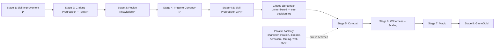

# PolishedWorld — Strategic Roadmap

> **Rev 29 · 2026-10-26** — **the Alpha Content epic is merged (`a4bf108`), and three entries say what it changed.** The alpha entry's **prerequisite 1 is half met**: E.1 shipped as AC5.1 — 29 recipes on rungs 0/20/40/60 under a ceiling of 60 — and E.2, the trivial-work gate, remains with its BACKLOG home. *Legend character creation* gets the constraint the ladder puts on it (a rolled DEX+INT under 20 locks the 20-rung recipes), and *Search / disambiguation UX* gets a case from AC4.3 (`stones` reaches the milling stones). No decision changed.
> **Rev 28 · 2026-10-18** — **one decision, a pointer and two corrections.** **(E) Weight is a seventh alpha prerequisite**, outside (A)'s chain and required on `main` before the persistent instance opens: pillar 1 tests emergent prices, and without weight distance costs nothing, so haulage is no service and a price cannot differ between where a thing is gathered and where it is used. The data starts in the alpha content epic; the mechanic is filed in `docs/BACKLOG.md` (*Containers*) for its own decomposition. The alpha entry's (D) also gains a pointer to `docs/PolishedWorld_Alpha_Content_Decomposition.md` (Rev 1), where the epic's two open choices are locked — a stone axe with a tool check in `forage`, because without it FAS 1's flint has no consumer in the alpha; generic `wood`, because DECISION #10's revisit condition is mechanical and a bow has no mechanic before combat. Two of (D)'s figures are corrected in place, as (B)'s were by (D): the bow does not need `sinew` (its fiber string is its own `[DATA]` branch), and the reachable catalogue is 24 items by name, not about 29.
> **Rev 27 · 2026-10-17** — **The track order is decided: the alpha track is coded first, Stage 5 while the cohort plays** — the question Rev 25 (C) held open until FAS 1 was costed, recorded as **(D)** in the alpha entry. Costing FAS 1 against live source changed what FAS 1 is, and four findings drove the answer. **Tanning already exists:** `LeatherRecipe` shipped on 2026-06-30 (`896ce33`), while `world/material_registry.py`, System Backlog §4 and Rev 25's own (B) describe it as gated on DECISION #2 — the decision was answered in code and never ratified; it is ratified here as shipped, with bark and water filed as an upgrade. **Seven of FAS 1's eleven materials have no sink in the alpha** — none of the 44 `[DATA]` items uses iron, copper or tin ore, sand, ochre, sulfur or saltpeter — so the alpha's FAS 1 is the sink-bearing cut (wood, flint, clay; stone exists) and the rest waits for the system that consumes it. **No world data is versioned:** the seeding file `docs/BACKLOG.md` names does not exist on `origin`, so where nodes stand is unversioned database state; seeding moves onto the alpha track as the placement path. **The catalogue is not yet recipes** — eight exist, two of them among the 44 — so authoring the rest is a priced step before E.1. Priced: ~9–10 sessions; mastery, E.2, character creation and the launch minimum unpriced; Stage 5 unpriced until its design session. What decides the order is calendar time: pillar 1 needs weeks in a persistent world, and an alpha that opens first turns them into test data while code moves to Stage 5. **The persistent alpha instance** gets an owner (a new `docs/BACKLOG.md` entry) and is wiped at alpha close-out. The Stage 6 entry gains an interim placement rule, and the critical-path diagram gains the alpha. The alpha content epic is filed for decomposition in `docs/BACKLOG.md` Rev 40; **no code changes in this Rev**.
> **Rev 26 · 2026-10-17** — **The death-consequence policy is decided, and its entry goes [OPEN] → [RESOLVED]** — the next decision session that Rev 25 (C) sequenced before code on either track, taken the same day. Five points, recorded in the entry. **(i) Not permadeath** — ratifying at this altitude what `PolishedWorld_Hunting_Decomposition.md` §12 settled at feature altitude on 2026-07-05; `at_character_death()`'s docstring saying *NOT permadeath* was current behaviour, not a decision, until now. **(ii) Everything non-`soulbound` drops to the body**, `soulbound` reserved for admin objects and never equipment (the door §13 left open is closed); **coin goes with the body**, not to the room; and **currency is never deleted by any cleanup path** — an abandoned `CoinPile` is transferred to the Treasury with a ledger entry. That last rule decides `docs/BACKLOG.md`'s *`CoinPile` vs the corpse's atomic content delete* here rather than at Stage 5 kickoff, because it is a policy and not a `CoinPile` detail, and because it also covers Stage 6 room recycling, which two of the entry's three candidates would have walked straight into. **(iii) Retrieval is a run** counted in days, owner-only for a grace window and then open. **(iv) Wound tiers coexist with `DeathWeakness`, and *maimed*/*severed* persist through respawn** — which answers the hit-location entry's sub-question (a) and closes a hazard the shipped code has: death sets `health.current = health.max`, and a respawn that also cleared maiming would make starvation the cheapest surgeon in the world. **(v) The death message carries the contract**; T17's *"your materials are untouched"* stays true of the craft and unchanged. **Two inconsistencies found while reading, neither in the handoff:** `PolishedWorld_Economic_Philosophy.md` §5 said coin drops *to the room* while the code and `commands/currency_commands.py` said *with the corpse* (§5 corrected, Rev 4); and nothing stated what death does to a persistent wound, so Rev 20's decision that made surgery a player service was one respawn away from being undercut. **No code changes in this Rev** — the implementation items are filed in `docs/BACKLOG.md` Rev 39 with triggers, and the seven prose sites in four files that the policy falsifies are listed there, counted before writing (Testing Reference §11c). The alpha's fifth prerequisite is settled; alpha-track-vs-Stage 5 order stays open, as Rev 25 (C) left it.
> **Rev 25 · 2026-10-17** — **The alpha milestone is defined, and the decision-log entry that asked for it goes [OPEN] → [RESOLVED].** Due since 2026-08-24 (Rev 19); taken now because the next item on the critical path is Stage 5 planning and Rev 19 put this before it. Three decisions, recorded in the entry. **(A) Scope:** the six prerequisites the entry already listed in dependency order are adopted as the alpha definition, unchanged and unnumbered (Rev 17's reason stands: a number invented on a guess is expensive to unwind, and a milestone is not a stage); combat stays off the list, for the reason the entry already gives. **[OPEN] GameGold trigger** is anchored to it — not before the alpha closes, player count set at close-out — so the one trigger in this log that was dated nowhere now has a place in the sequence. **(B) The catalogue question is answered by counting, and the count reframes it.** The entry asked whether the `[DATA]` subset spans enough of the skill scale to ladder. Measured against `docs/crafting/PolishedWorld_Crafting_Decomposition_AoL_Complete.md`: the figures cited here and in `docs/BACKLOG.md` — 110 `[DATA]` against 152 `[BLOCKED]` — are **tag occurrences**, and most `[DATA]` tags sit on sub-nodes (resource nodes, intermediates). At item level there are **44 `[DATA]` finished items against 43 `[BLOCKED]`**, and the two sets have the **same tree-depth distribution** (depths 1/2/3: 4/34/6 vs 6/35/2) — what is blocked is blocked on *systems* (33 of 43 name smithing), not on being more complex. Neither the decomposition nor *Arms of Legend* carries a per-item difficulty: AoL's crafting chapter has a quality table and Task Rounds, nothing per item. So "does the subset span the scale" has no answer in the content — `min_skill` will be an assignment, not a reading, which is the two-jobs hazard Skill Progression decomp Rev 5 recorded. **Decided:** ladder once the subset is actually data — after `PolishedWorld_System_Backlog.md` FAS 1 (Systems 1–3, gathering nodes) and System 4 (tanning, DECISION #2) — because 22 of the 44 need a `[NEW MATERIAL]` node and 10 cite leather; only 10 stand on `[EXISTS]` alone. Smithing (FAS 3) is outside the alpha. **(C) Sequencing:** the **[OPEN] death-consequence policy** is the *next decision session*, before code on either track — it is the one prerequisite that is both dependency-ordered (after character creation) and time-bound (before the first cohort), and Stage 5's hit-location sub-question (a) reads it, so it blocks both tracks. Whether the alpha track or Stage 5 is coded first is **deliberately left open** until FAS 1 has been costed; that is a 5 h/week priority call, not a design question. **One conflict surfaced and not resolved here:** `docs/BACKLOG.md`'s *public test server* entry sequences hosting *after Stage 5* and says a nightly-wiped box cannot test the economy pillar, while this alpha excludes combat and exists to test pillar 1 — no entry owns a persistent alpha instance. Recorded in the entry and annotated on the BACKLOG side (Rev 38), to be settled with the track order. Also: **Legend character creation** gains a note that its own condition — *"if a launch milestone gets scheduled"* — has now fired.

> **Rev 24 · 2026-10-17** — **Epic A merged to `main`** (`34b2ee4`, the merge of `feature/timed-actions`; no PR — the SHA is cited, as Rev 23 did for Stage 4.5). Its parallel-backlog entry said what Epic A *would* do — "`craft` would be the third", a commit estimate, a decomp at Rev 1 — and now says it was delivered and points at the decomp's final revision (Rev 7). The description of the design stays, because it is what shipped. The **Done & merged on `main`** list gains a timed-actions line, for Rev 23's reason: a list that omits a merged system reads as complete, so the omission reads as "not merged". **[OPEN] Death-consequence policy** gains one sentence: an interrupted craft tells the player their materials are untouched, which is true of the craft and not of a death, because `at_character_death()` moves the inventory to the corpse straight after. It was a note in the decomp, which closes with this epic, and `docs/BACKLOG.md`'s scope says notes left in a closing decomp stop being read — so it moves to the entry that will decide it. No sequencing changes: **[OPEN] No alpha milestone is defined**, DUE since 2026-08-24, is still taken before Stage 5 planning.
> **Rev 23 · 2026-09-09** — **Stage 4.5 merged to `main`** (`e0ac843`; merged directly, no PR — Rev 12's Stage 4 entry cites PR #14 *and* a SHA, and the SHA is the half that is always available). The merge Rev 19 never recorded is now history. Rev 19 announced the epic complete *on `feature/skill-progression`* and stopped there, so this document has since said "delivered on a branch" while the branch was gone — the same failure Rev 11 caught on Stage 3's heading and Rev 12 generalised to four more places. Three fixes, because a changelog entry is not a status marker: the **merged-stages list gains Stage 4.5** (it was absent, not merely unticked), and the Mermaid node `S45` gains the **✅** that S1–S4 carry — the scan-the-headings view is the one anybody actually uses, and it showed 4.5 open. **Also: "Epic A" is defined.** The name has been cited as an ordering dependency by two documents — *food professions* here (*"after Epic A"*) and `docs/BACKLOG.md`'s *two-stage healing*, whose Trigger and Status both name Epic A's `world/timed_actions.py` as though the file existed — while nothing anywhere said what Epic A **is**. It is now a parallel-backlog item pointing at `PolishedWorld_Timed_Actions_Decomposition.md` (Rev 1), which carries the locked decisions D1–D7. Filed at roadmap altitude rather than in `BACKLOG.md` for Rev 16's reason: that file's scope is deferrals smaller than a stage, and two future items sequence themselves against this one.
> **Rev 22 · 2026-09-09** — three parallel-backlog items **added** in one pass, from a sweep of design discussions that had been settled in chat and never filed: **food professions** (farming · fishing · livestock), **temperature & exposure**, and a **Godot 2.5D client**. One commit rather than three because the unit of work is the sweep — they arrive at the same altitude, from the same backlog, on the same day. All three are **unnumbered**, and for the reason Rev 16 gave recipe mastery: they are stage-sized, so `docs/BACKLOG.md` explicitly excludes them, but their size cannot be judged yet, and a stage number invented on a guess is expensive to unwind once code comments cite it by name. **Food professions is filed as one item, not three**, because the three share the failure mode — five food sources with overlapping outputs collapse each other's prices, and pillar 1 dies quietly rather than loudly — so the output-differentiation decision has to be made once, across all of them, and an entry per profession would let it be made three times by accident. **Temperature & exposure** is the piece `BACKLOG.md` Rev 31 deliberately did not keep: weather inertia and day length are function bodies, but a cold gauge is a trait, a clothing coupling and a death mode. One decision-log entry is added with it — **[RESOLVED] the graphical client is additive, never authoritative** — which is the load-bearing half of the Godot item: it constrains what commands may do *now*, long before any client exists, and constraints that bind current work do not belong in a bullet about future work.
> **Rev 21 · 2026-09-09** — one decision-log entry **added**, and it is a *rejection*: **organ-level damage is not the model**. A RimWorld-style proposal (≈28 organs, each with its own HP, mapped under the hit/clothing locations, with organs wired to functions like breathing and consciousness, plus triage, surgery and transplant) was evaluated against Rev 20's just-locked wound model and declined. It is recorded rather than dropped because the *idea* is good and will be proposed again — the argument for declining is what has to survive, not the outcome. The short form: Legend's Serious and Major Wound rules already deliver every behaviour the organ layer was wanted for — function loss, drop-what-you-hold, prone, unconsciousness, a `CON+POW` bleed-out clock and *"most Major Wounds require some form of surgery or major magic"* — so the layer adds **nouns, not decisions**, at the cost of a third state model beneath a taxonomy whose *second* one is still an open sub-question under Rev 20 (armour AP ↔ `ContribClothing` slots is unsolved at seven locations; twenty-eight multiplies it). **What is kept** is the part that was actually new: the split between **stabilising in the field and repairing afterwards**, which is filed in `docs/BACKLOG.md` (*Health & Injury*, Rev 29) rather than here, because it is a feature smaller than a stage. No sequencing changes; Rev 20's model stands unamended.
> **Rev 20 · 2026-09-09** — Stage 5 gains its first **locked** design decision: **hit locations & wound permanence**. This document has cited hit locations as Stage 5 Legend-alignment since Rev 1 without ever choosing the *data model* behind them, and the model is not a combat detail — it is read by the shipped `apply_health_damage()` chokepoint, by per-location armour AP, and by the `ContribClothing` slot taxonomy, so it is expensive to retrofit once the epic is underway. It lands **now, between 4.5's close and Stage 5 planning**, which is the only window where it costs a document edit rather than a migration. Decided: **asymmetric HP** (locational for players, Legend's own optional **General Hit Points + Critical Wound** rule for creatures and NPCs), **three wound tiers** (disabled → maimed → severed), and **permanence feature-gated at ship** — the severed tier is implemented but switched off until a cure exists, because a world with no healers and no magic would permanently maim its first cohort with no route out. Gating rather than deferring is the point: the retrofit is what costs, not the flag. Two constraints are recorded because they are easy to violate silently — locational HP must permit **negative** values (Major Wound is *defined* as negative HP equal to the location's starting HP, and `CounterTrait` clamps at `min` without saying so), and lasting wound state is **not** a buff (`buffs.add()` stacks rather than sets, and a buff is semantically temporary). Four sub-questions stay open under the entry, and one of them is **not this entry's to answer**: whether wounds replace or coexist with `DeathWeakness` belongs to the **[OPEN] death-consequence policy**, which Rev 19 already declared due *before* Stage 5 planning. Deciding it here would have been half a player contract settled in passing. No sequencing changes; combat-first stands.
> **Rev 19 · 2026-08-24** — **Stage 4.5 (Skill progression) is complete and its heading now says so.** Components A–D delivered on `feature/skill-progression`, 429 tests green, in-game verified; the 100% cap is gone and Legend's >100% band is live. **Component E does not ship and has left the epic** — it is blocked on a recipe catalogue that belongs to no scheduled stage, and keeping a blocked component inside a stage would have held 4.5 open indefinitely, which blocks Stage 5 (Combat) by construction rather than by decision. E's armed home is `docs/BACKLOG.md` (*Crafting & Tools*, BLOCKED); its design stays in the decomp. **Rev 11's lesson is applied deliberately here:** a changelog entry is not a status marker, so the heading gains its ✅ in the same commit as this line — Stage 3 spent two weeks looking open because Rev 10 announced a close in prose only. **And a trigger this document set for itself has now fired:** the **[OPEN] no alpha milestone is defined** entry carries *"Trigger to revisit: Stage 4.5 close-out"*. It is not resolved by this Rev — it is due, and it is due **before** Stage 5 planning rather than after, because the **[OPEN] death-consequence policy** it sequences toward is a player contract that must be settled before the first test cohort, not during Combat.
> **Rev 18 · 2026-08-14** — Stage 6's implementation note **answered**. It had said *"`evennia.contrib.grid.xyzgrid` is the likely base (verify at source)"* since Rev 2; the verification is now done and written up as `PolishedWorld_Evennia_Reference.md` §14 (read against Evennia `main`, diffed against the pinned `v6.1.0` tag, identical). The note is replaced with the working shape — **xyzgrid for authored structure, wilderness for resource areas, separate coordinate spaces, no built-in bridge** — and the stage gains four **Open questions**, plus one matching `[OPEN]` decision-log entry. The distinction this Rev is careful about: source reading produced *candidates*, not decisions. Writing them in as settled would be a banner rather than a fix. Two of the four questions touch code already shipped — `ResourceNode` and tag-based creature spawning both assume a room that survives being left, which is precisely what a recycled wilderness shell does not do — so they are logged where they will be seen before the stage starts, not left in a chat log. No sequencing changes; combat-first stands.
> **Rev 17 · 2026-08-12** — one decision-log entry **added**: **[OPEN] no alpha milestone is defined**. Nothing in the plan changes; what changes is that a gap acquires a home. Three items already condition themselves on a milestone this document never defines — character creation (*"if a launch milestone gets scheduled"*), recipe mastery (*"once the recipe catalogue exists"*) and the GameGold trigger (*"a player-count milestone"*) — so the milestone is load-bearing for sequencing while existing nowhere as a decision. Deliberately **not** a numbered stage: Rev 16 declined to number recipe mastery because its size cannot be judged before the recipe catalogue exists, and a Stage 4.75 would inherit exactly that problem, with the added cost that stage numbers are cited by name in `docs/BACKLOG.md` triggers and production comments — one invented on a guess is expensive to unwind. It is recorded at roadmap altitude rather than in `BACKLOG.md` for the reason Rev 16 gave: that file's scope is deferrals smaller than a stage, and this is sequencing. The entry also corrects a claim this document has never made but which the *absence* of `docs/crafting/` from it invites — that the catalogue must be authored from nothing. It must not: a full *Arms of Legend* dependency decomposition is already on `main`; what it lacks is the difficulty axis. The **[OPEN] Death-consequence policy** entry gains a **timing** clause from the same discussion — it is a player contract, and contracts are agreed before the cohort arrives, not during Stage 5. **Trigger to revisit: Stage 4.5 close-out.**
> **Rev 16 · 2026-08-11** — one parallel-backlog item **added**: **recipe mastery & craft disciplines**. It sits here rather than in `BACKLOG.md` because that file's scope is explicitly *deferrals smaller than a stage*, and this is stage-sized. It is **unnumbered** because its size cannot be judged until the recipe catalogue exists — the same content trigger that blocks Stage 4.5's Component E. The decision log records the ordering constraint, which is the part worth reading twice: switching `_can_transmit` from `min_skill` to a per-recipe mastery threshold leaves `min_skill` single-purpose, relieving one of the three readers behind E's dual-semantics blocker, so **mastery lands before E, not after** — though both wait on the same catalogue, so neither is scheduled. Also records why `PROFESSIONS` must not double as the display category: it is a deliberately *overlapping* starting-knowledge bundle (`cloth` sits under both weaver and generalist, by design, to force interdependence), while a category heading is one-to-many. Reusing it would be the same one-field-two-jobs shape that produced the E blocker in the first place.

> **Rev 15 · 2026-08-05** — Stage 4.5 corrections from its own sub-decision close-out. **Scope changes from five call-sites to six**: `CmdScribe` was excluded by omission rather than by decision, and a rule of the form *"some Craft rolls teach and some do not, and you are not told which"* is not learnable by a player. **Rough scope grows from ~4–6 to ~6–8 commits** — Components A and B each took one, and a fifth component was added. **Component E (difficulty gate) is opened and immediately BLOCKED on recipe content**, which is the entry worth reading twice: the eight-recipe catalogue tops out at `min_skill = 30`, so a trivial-work gate would stop teaching Craft above 61 and strand every crafter who got there. It is recorded here because a blocked component that lives only in a decomposition gets forgotten at stage-planning time, which is exactly when a content trigger needs to be visible. Also records the measured effect the epic actually has: **38 eligible ticks today vs 2 931 after C.1**, a 77× slowdown, against the 43-craft measurement that opened Stage 4.5 in Rev 14.
> **Rev 14 · 2026-08-03** — **Skill progression (XP) opens as Stage 4.5**, and the Stage 1 pacing decision is superseded — the first RESOLVED entry in this log to overturn another. It is overturned by *measurement*, not by a change of mind: Stage 1 chose its pacing model before the shipped system had been measured, and at INT 12 **43 successful crafts take a skill from 0 to 100** — under two hours including gathering. Legend's Improvement Roll is calibrated for a table that meets weekly; in a world that is online continuously it is not a pacing curve at all. Three of the old entry's four parts survive untouched (raw percentage as the single mechanical truth, no cosmetic 1–99 badge, success-plus-cooldown gating); only "no hidden XP accumulator" reverses. **Numbered 4.5, not 5.** A renumber would have moved 82 `Stage N` references across 11 files — four of them production source — and four `docs/BACKLOG.md` entries carry the literal trigger *"Stage 5 kickoff"*, which would silently have come to mean this epic instead of Combat. Stage numbers stopped being ordinals the moment code comments started citing them as names; the maintenance rules now say so.
> **Rev 13 · 2026-08-03** — one-line correction found while verifying the System Map's seam table: the Stage 1 bullet said improvement-on-use was wired at **four** check-sites. It is **five** — Stage 3's `disassemble` became the fifth (`commands/crafting_commands.py:438`, and the code says so in a comment), which is why the number was true when written and false a stage later. Left deliberately untouched in Rev 12 because the count had not yet been checked against the source; checked now.
> **Rev 12 · 2026-08-03** — **Stage 4 merged to `main`** (PR #14, `02d1807`); the "merge pending" status Rev 11 recorded is now history. Rev 11 fixed the *instance* — Stage 3's heading — but the pattern behind it survived in four more places, so this revision fixes the pattern: **a branch name belongs in a changelog entry (past tense, permanently true), never in a status heading (present tense, it rots at merge).** The Nuläge section's `🔄 Feature-complete on feature/skill-improvement` heading named a branch that merged on 2026-07-10 and had since become a parking spot for two *closed* stages, while Stage 2 and Stage 4 appeared nowhere in Nuläge at all — it is replaced by **✅ Numbered stages — all merged on `main`**, keyed on a criterion that cannot expire. Stage 0 moves into it from the systems list; Stage 1/2/4 headings drop their branch names; the critical-path graph gains the three ✅ it never received. Also corrected: the Stage 3 bullet cited its decomposition at Rev 10 — it is at Rev 11. **Changelog entries are append-only** — same discipline as the economy ledger (**S4-4**): Rev 11's line stands exactly as written, and the *topmost* entry is the status.
> **Rev 11 · 2026-08-03** — **Stage 4 (In-game currency) complete on `feature/currency`, in-game-verified; merge to `main` pending.** Components A–F: currency math + `CurrencyHandler` + ledger + audit (A), `wallet`/`pay` (B), `Treasury` + `@economy` (C), the temple faucet `work` command funded by Treasury transfer (D), the barter currency bridge (E), documentation close-out (F). 316 tests green. Stage 4's two open design questions are answered and the notes rewritten to say so rather than still asking: a single Copper integer (**S4-2**) makes rounding bugs structurally impossible, and wallet-on-character beat coin-as-objects — coin-as-objects returns as `CoinPile` in Stage 5, where it is a death-drop question rather than a wallet question. **Also corrected: Stage 3 never got the ✅ its own Rev 10 changelog announced.** Rev 10's prose said "CLOSED and merged to `main`" while the heading still read like an open epic, so the scan-the-headings view of this document — the one anybody actually uses — had Stage 3 open for two weeks. A changelog entry is not a status marker.

> **Rev 10 · 2026-07-26** — **Stage 3 (Recipe Knowledge & Discovery) CLOSED and merged to `main`.** Shipped Components A–H: the per-character known-recipe set + `requires_knowledge` flag (A), the dual gate — `pre_craft` backstop + `CmdCraft` early-reject (B), the `recipes` discovery surface (C), and **five knowledge channels** — profession-grants at chargen (D), destructive reverse-engineering (E), the one-use scroll (F), the perishable multi-recipe book (G) and live consenting teaching (H). Knowledge is now a gated, tradeable resource with sources, sinks and a discovery surface, exactly as the Rev 2 decision-log entry specified. **Component I (world-loot scroll seed) deferred to `docs/BACKLOG.md`** — its failure mode needs players, the valve is manually operable, and there is no world content to seed into; trigger is *before the first real player cohort*. All four Stage 3 sub-decisions are now RESOLVED (see decision log). Decomp: `PolishedWorld_Recipe_Knowledge_Decomposition.md` (Rev 10). **Next: Stage 4 (In-game Currency).**
> **Rev 9 · 2026-07-11** — Stage 3 (Recipe Knowledge & Discovery) underway on `feature/recipe-knowledge`; the in-progress pointer moves off the now-merged Stage 2. Component A (foundation) complete & in-game-verified: per-character known-recipe set + `requires_knowledge` recipe flag (storage + declaration; the gate is Component B). Decomp: `PolishedWorld_Recipe_Knowledge_Decomposition.md` (Rev 2).
> **Rev 8 · 2026-07-11** — Stage 2 Component **G (superior-tool scaling) complete & in-game-verified → Stage 2 CLOSED**. G.1 (a *superior* crafted tool, `quality > 100`, grants `+10` on the craft check via `_tool_modifier` reading the tool's own `db.quality`; `None`-guarded, broken = absent; tool recipes gain a `superior <key>` alias) and G.2 (`CmdRepair._tool_modifier` generalised per target-type via `db.repair_tool_tag` — unset → needle default, `""` → no tool for stone knife / bone needle; superior repair tool grants +10; the old garment-centric needle bug is fixed). Ceiling reconcile: max craft quality **110 → 111** (a superior tool's +10; `skillcheck` never clamps `target`). The three orthogonal gates — knowledge (Stage 3), skill (F/E), capability (tools/G) — are all live. **Next: Stage 3 (Recipe Knowledge & Discovery)**, its own decomposition. Tactical detail in `PolishedWorld_Crafting_Progression_Decomposition.md` (Rev 8).
> **Rev 7 · 2026-07-11** — Stage 2 Component **F (skill-gate) complete & in-game-verified**: F.1 (`min_skill` floor on `MongooseCraftRecipe`, default 0 = ungated, enforced in `pre_craft` *before* consume — under-skilled crafts abort with `rolled=False`, materials untouched; the gate reads *effective* skill, so a buff/mod can lift you over it) and F.2 (only `leather boots` gated at `min_skill = 30`; every other recipe inherits the ungated default, so the survival bootstrap loop never locks). The three orthogonal gates are now distinct in code: knowledge (Stage 3), skill (this + Stage 1 improvement + E's quality scaling), capability (tools/G). Remaining Stage 2: **G (superior-tool scaling)**. Tactical detail in `PolishedWorld_Crafting_Progression_Decomposition.md` (Rev 7).
> **Rev 6 · 2026-07-11** — Stage 2 Component **E (quality → capability) complete & in-game-verified**: E.1 (`world/crafting_quality.py` band helper, single source of truth), E.2 (waterskin reads the band — superior tier finally reachable, dead `>=125` branch removed), E.3 (garment start-`condition` scaled by craft tier + `superior <key>` alias). Crafted quality is now *felt* — a critical yields a measurably better item. Remaining Stage 2: **F (skill-gate) → G (superior-tool scaling)**. Tactical detail in `PolishedWorld_Crafting_Progression_Decomposition.md` (Rev 6).
> **Rev 5 · 2026-07-10** — Stage 2 Component **D (tool wear sink) complete & in-game-verified**: D.4 (repair convergence — `CmdRepair` broadened to tools *and* garments, data-driven repair materials) and D.5 (bootstrap start-condition 40/30, prototype-override verified) shipped. The full craft loop is closed and repairable: gather/hunt → tool wears → breaks (lingers) → repair. Remaining Stage 2: E (quality → capability) → F (skill-gate) → G (superior-tool scaling). Tactical detail in `PolishedWorld_Crafting_Progression_Decomposition.md` (Rev 5).
> **Rev 4 · 2026-07-10** — Stage 2 Component **D (tool wear sink) underway**: D.1 (per-use tool wear), D.2 (broken tool = absent/improvised, not deleted), D.3 (colour-banded condition shown on `look` for tools & garments) complete & in-game-verified; D.4 (repair convergence — tools become repairable) and D.5 (bootstrap start-condition tuning) remain. The craft source→sink loop now closes (gather/hunt → tool wears → breaks → repair). Tactical detail in `PolishedWorld_Crafting_Progression_Decomposition.md` (Rev 4).
> **Rev 3 · 2026-07-10** — Stage 2 (Crafting progression & tools) **underway** on `feature/crafting-progression`: Components A (tool-modifier flip), B (shared `condition` durability axis), and C (tool bootstrap — `Tool` typeclass, stone/stick primitives + nodes, stone-knife & bone-needle recipes) complete & in-game-verified. The zero-to-tool loop is playtestable both ways (forage→stone knife, hunt→bone→bone needle). Remaining Stage 2: D (tool wear sink) → E (quality→capability) → F (skill-gate) → G (superior-tool scaling). Tactical detail in `PolishedWorld_Crafting_Progression_Decomposition.md` (Rev 3).
> **Rev 2 · 2026-07-10** — Stage 1 (Skill Improvement) **complete & in-game-verified** on `feature/skill-improvement`: primitive → gated trigger → felt-progress (tick-feedback + desc-tier celebration + `progress` command). Resolves the skill-improvement pacing/display open question (raw % is the single mechanical truth, surfaced via on-use ticks + desc-tier-crossing celebration, no 1–99 badge). Hunting (Stage 0) merged to `main`. **Critical-path reorder:** the two crafting-economy epics that cash in Stage 1 are promoted out of the backlog ahead of currency — new order S2 Crafting progression & tools → S3 Recipe knowledge & discovery → S4 In-game currency → S5 Combat → S6 Wilderness → S7 Magic → S8 GameGold (later stages renumbered +2).
> **Rev 1 · 2026-07-01** — initial strategic roadmap: felt-progress + legibility (Stage 1), recipe-knowledge economy epic, search/disambiguation UX item, full decision log.
> **Canonical:** `docs/roadmap.md` @ G0dlet/PolishedWorld — git wins. If this project-knowledge copy's Rev is lower than the repo's, it's stale — re-upload from the repo.

> **Supersedes** `PolishedWorld_Implementation_Plan.md` (retired — its content is fully implemented/merged).
> This document operates at **epic/milestone altitude**: *what we tackle next and why, in which order*.
> It deliberately contains **no tasks, no code, no `@py` tests** — those live in per-feature decomposition docs.

---

## How this document relates to the others

PolishedWorld has three planning altitudes. Keep them distinct to avoid drift:

| Altitude | Document(s) | Answers | Updated when |
|---|---|---|---|
| **Strategic** | *this file* | What's next, why, in what order | An epic starts/finishes or sequencing changes |
| **Tactical** | `*_Decomposition.md` (e.g. hunting, skill improvement) | How to build one feature, task by task | During a feature's design session |
| **Reference** | `*_Evennia_Reference.md`, `*_Mongoose_Legend.md`, `*_Code_Standards.md`, `GameGold_*` | Hard-won facts, gotchas, rules | As learnings accrue |

**Workflow per epic:** when an epic comes off this roadmap, run *one* design/source-verification session → produce a decomposition doc → implement task-by-task. This file then marks the epic Done.

---

## North star (design pillars the roadmap serves)

1. **100% player-driven economy** — no NPC vendors; every item player-crafted from gathered/hunted resources; prices emerge.
2. **Sandbox survival** — hunger/thirst/fatigue as the core loop.
3. **Dynamic environment** — 13-month calendar (4× speed), seasons, weather, day/night.
4. **GameGold (experimental)** — crypto layer, 1:1 with in-game gold, hobby/experiment framing.

Every epic below is justified against at least one pillar. Anything that serves none is a candidate for the cut list.

---

## Nuläge

### ✅ Done & merged on `main`
- **Character foundation** — TraitHandler stats/survival gauges/skills; character commands (stats/status/skills/sheet).
- **Environment** — gametime infrastructure (13-month calendar, 4× speed); `world/gametime_utils.py` central time bridge (single source of truth: `get_current_time`/`get_absolute_gametime`/`get_time_of_day`/`get_season`); weather system; ExtendedRoom-driven time/season descriptions.
- **Survival loop** — hunger/thirst/fatigue ticker, conditions, Food/Drink typeclasses, consumption commands.
- **Foraging** — `ResourceNode` with lazy regeneration, `CmdForage`/`CmdRefill`, `CooldownHandler`.
- **Crafting foundation** — `MongooseCraftRecipe`, `world/skillcheck.py` (d100 utility), starter recipes (twine/waterskin/cloth/linen shirt).
- **Timed actions (Epic A)** — `world/timed_actions.py`: one interruptible-action slot (`ndb.timed_action`) shared by `rest`, `work` and `craft`; a craft waits its recipe's `craft_duration` and resolves at completion.
- **Barter** — `PWTradeHandler`, timeout/staleness guards, worn-item no-trade guard.
- **Clothing & thermal** — `ClothingWithBuffs`, `world/thermal.py` (per-regime `COMFORT_BANDS`, replacing the old flat `COMFORT_MARGIN`), Cold/Heat stress buffs, garment prototypes.
- **QoL/infra** — statue logout system, custom menu-login connection screen.

### ✅ Numbered stages — all merged on `main`

- **Stage 0 — Hunting** ✅ — full loop: `Creature` + tag-based `CreatureSpawnScript`, `hunt` skill-check command, corpse system with decay, harvesting (meat/hide → craftable materials, activating the stubbed wool/fur/leather recipes), respawn ticker, and player death (`at_character_death()` hook + `apply_health_damage()` chokepoint — the seams combat will reuse). Canonical doc: `PolishedWorld_Hunting_Decomposition.md` (Rev 2).

- **Stage 1 — Skill Improvement** ✅ — Legend-faithful improvement-on-use (`world/improvement.py` pure primitive → `improve_skill_on_use` chokepoint → `attempt_skill_improvement` gated wrapper, wired at five check-sites: craft, repair, hunt-attack, hunt-harvest, and disassemble — the fifth added by Stage 3 Component E), plus the felt-progress layer: per-tick feedback, desc-tier-crossing celebration, and the `progress` command (deltas since login). In-game-verified. Canonical doc: `PolishedWorld_Skill_Improvement_Decomposition.md` (Rev 3).

- **Stage 2 — Crafting progression & tools** ✅ — Components A–G: tool-modifier flip (A), shared `condition` durability axis (B), tool bootstrap — `Tool` typeclass, stone/stick primitives, stone-knife & bone-needle recipes (C), tool wear sink + `CmdRepair` convergence (D), quality → capability via `world/crafting_quality.py` bands (E), `min_skill` recipe gate (F), superior-tool scaling (G). The three orthogonal gates — knowledge, skill, capability — are all live; max craft quality 111. Canonical doc: `PolishedWorld_Crafting_Progression_Decomposition.md` (Rev 9).

- **Stage 3 — Recipe knowledge & discovery** ✅ **CLOSED & merged** — Components A–H. Known-recipe set + `requires_knowledge` flag (A); dual gate, `pre_craft` backstop + `CmdCraft` early-reject (B); `recipes` discovery surface (C); and five knowledge channels: profession-grants (D), reverse-engineering (E), scroll (F), perishable book (G), live teaching (H). Component I (world-loot seed) deferred → `docs/BACKLOG.md`. Canonical doc: `PolishedWorld_Recipe_Knowledge_Decomposition.md` (Rev 11).

- **Stage 4 — In-game currency** ✅ — Components A–F: currency math + `CurrencyHandler` + append-only ledger + audit invariant (A), `wallet`/`pay` (B), `Treasury` + `@economy` (C), the temple faucet `work` command funded by Treasury transfer (D), the barter currency bridge (E), documentation close-out (F). Wallet is a single Copper integer with no declared Attribute (**S4-2**, **D6**); `Treasury.add()` is the only mint path (**S4-1**). 316 tests green. Canonical doc: `PolishedWorld_Currency_Decomposition.md` (Rev 7).

- **Stage 4.5 — Skill progression (XP)** ✅ — Components A–D: the curve as pure functions (A), the XP store with read-time level fallback (B), the primitive banking XP instead of adding points across all six improvement call-sites (C), the derived progress bar and Legend's >100% band with the 100 cap removed (D). `skill.current` is a materialised cache with exactly one writer (**S4-R2**). 429 tests green. Component E (difficulty gate) did not ship and left the epic — its armed home is `docs/BACKLOG.md`. Canonical doc: `PolishedWorld_Skill_Progression_Decomposition.md` (Rev 8).

---

## The roadmap (post-Stage-1)

Ordering principle: **make progression real → make it *matter* (skill-gated recipes, better goods) → turn knowledge into an economy → put money in → add stakes → add space → add depth → the experimental layer last.** Estimates are *very rough*, in commits, at the ~5 h/week, 3–5 tasks/session rhythm.

### Critical path

---

### Stage 0 — Hunting ✅ *(complete, merged to `main`)*
**Delivered:** H2.x–H7 per the hunting decomposition — hunt → corpse → harvest → meat/hide/leather in crafting; HP 0 = death works.
**Pillars:** survival, player-driven economy (source+sink).
**Strategic payoff:** closed the survival→harvest→craft→economy loop with animal-sourced materials (a new *source* feeding existing clothing/food *sinks*), **and** laid the death seams combat reuses.

---

### Stage 1 — Skill Improvement System ✅ *(complete — merged to `main`)*
**Goal (met):** an automated, Legend-faithful progression layer so skills grow through use — no GM, no levels, no XP-as-a-character-stat — **and is *felt*.** Because Legend has no level-up "ding," a mechanically correct system can still ship as an invisible backend that feels dead. The epic is not done when the number quietly grows; it's done when the player *notices* growth. This epic owns the skill-number axis **and its presentation**.
**Why here (before combat):** relatively contained, but it retroactively makes *all* existing skill use — hunting, crafting, foraging — progression-meaningful at once, and combat + magic will both lean on it. Highest leverage per unit effort on the board.
**Legend alignment:** Legend has **no character levels and no XP**. Its two advancement paths port very differently:
- *Improvement Rolls* — GM-awarded at narrative beats (roll 1D100 + INT vs current skill → >current gives +1D4+1, else +1). The real trigger is the **GM's judgment of a story beat**, which has no multiplayer equivalent, so this path **does not port**. Replaced with **improvement-on-use that resolves at the check itself** (RuneScape-style): immediate feedback, rewards activity. ✅ shipped.
- *Training* — downtime + teacher + funds; a week of study, then 1D100 vs current skill; can't train the same skill twice in a row. This **ports cleanly** (classic MUD trainer tradition). The teacher is a *player* with high skill + Teaching charging coin — a progression sink *and* an economic activity (pillar 1). *(Deferred; pairs with Stage 3 recipe-teaching and Stage 4 currency.)*

**Anti-grind throttle (shipped):** the action's own cooldown + Legend's self-throttling curve (high skills rise slowly) — **not** forced rest. Improvement is gated to success-against-real-difficulty under a per-skill real-time cooldown.
**Felt-progress / legibility layer (✅ delivered):** immediate feedback on each meaningful tick, celebration on crossing a skill's **named desc-tier boundaries**, and the `progress` command showing deltas since login. This is what converts "the number grew" into "I made progress." *(Tactical detail — command, message copy, tier logic — lives in the Stage 1 decomposition, Rev 3.)*
**Outcome (see decision log):** raw % is the single mechanical truth; surfaced RuneScape-near via frequent on-use ticks + desc-tier-crossing celebration; no cosmetic 1–99 badge for now.
**Pillars:** progression backbone for every skill-using system; the Training path (deferred) doubles as player-to-player economic activity (pillar 1).

---

### Stage 2 — Crafting progression & tools ✅ *(complete — merged to `main`)*
**Goal:** turn Stage 1's skill numbers into **felt capability** — gate higher recipes behind skill thresholds, scale output quality with skill (crit-craft → superior item) — and make tools a player-crafted quality/efficiency layer with a durability sink.
**Why here (promoted ahead of currency):** it depends only on Stage 1 (now done) and is the cheapest, highest-"makes-progression-matter" payoff on the board. Without it the Stage 1 numbers stay a stat readout; with it they become a growing craft menu and better goods.
**Scope — two threads:**
- *Skill → capability:* recipe skill-gates + quality tiers driven by the craft-check outcome (the fumble/success/critical tiers `skillcheck.py` already resolves). Rides straight on the improvement layer.
- *Tools:* tools must be player-crafted (no implicit NPC source, per pillar 1). Design them as quality/efficiency **modifiers, not hard gates** (fits the existing `consume_policy="raw"` philosophy), to avoid the bootstrap chicken-and-egg where the first tool can't be made. **Tool durability/wear = the sink**, and creates recurring economic demand.
**Bonus:** individuating crafted items by material/quality ("a superior steel dagger") also feeds the search/disambiguation root-cause fix (backlog) for free.
**Dependencies:** Stage 1 (✅), crafting foundation (✅).
**Pillars:** player-driven economy (recurring tool demand = sink), progression (felt capability).
**Rough scope:** small–moderate — a refinement of the existing crafting system, not a from-scratch epic.

---

### Stage 3 — Recipe knowledge & discovery ✅ *(complete — merged to `main`)*
**Goal:** make recipe knowledge a **gated, tradeable resource** rather than a universal capability (decision log: RESOLVED). Today every character can craft every recipe but can't even *see* which exist; knowledge is neither gated nor a resource. Players learn / buy / sell / teach recipes → knowledge becomes an economic good driving specialisation and interdependence (pillar 1).
**Why here (before currency):** pillar-1-core, and it pairs tightly with Stage 1's training loop (teaching) and Stage 2's skill gate. Buy/sell ideally wants coin, but **barter works in the interim** — so it can precede currency without blocking.
**Keep three orthogonal gates distinct:** **knowledge** (binary — do you know it? *this epic*), **skill** (how good — Stage 1 + Stage 2's quality scaling), **capability** (tools/stations — Stage 2 tools / deferred metallurgy).
**Scope:** a per-character known-recipe set; a craft-time knowledge check; a discovery/legibility surface (what you know, with a hint that more exists); and knowledge *sources* — tradeable books/scrolls, player teaching (matches Stage 1's training loop **and** Legend's teacher-gate: Craft can't be self-taught, rulebook p.70–71), and profession grants at chargen.
**Cold-start hybrid (near-certain):** basic survival recipes = common knowledge; only advanced recipes must be learned — else new players can't eat or make twine (the same cold-start shape the GameGold temple-faucet solves).
**Bootstrap concern:** books/teachers need their *own* first source (world-loot seed or a starting master), or no one can write the first book.
**Legend fidelity:** "recipes" are a MUD convention (Legend has only Craft rolls), but gated knowledge *transfer via teacher* is rulebook-faithful.
**Dependencies:** crafting foundation (✅); pairs with **Stage 1** (teaching = the training loop), **Stage 2** (the skill gate), and **Stage 4** (buy/sell wants real coin — barter interim).
**Open sub-decisions (its design session):** book vs scroll (sink strength); exact cold-start baseline; bootstrap source (world-loot seed vs starting master vs profession grants); whether player teaching requires Legend's Teaching skill. See decision log.
**Pillars:** player-driven economy (knowledge as a tradeable good; specialisation + interdependence).
**Rough scope:** moderate–large. **Needs its own design session** before decomposition.

---

### Stage 4 — In-game currency ✅ *(complete — merged to `main`)*
**Goal:** Gold/Silver/Copper as actual money (100:1:1), with a character wallet and basic give/pay/price plumbing — the medium of exchange the economy currently lacks.
**Why here:** the economy is **barter-only** today (no coin system in the repo). Several items assume money: Stage 1's Training-via-teacher, Stage 3's recipe buy/sell (charging coin), and **Stage 8 GameGold, which is defined as 1:1 with in-game gold** — gold must exist as a currency before the crypto layer can bridge to it. Kept small and early so it unblocks all coin-based trade while the economy is still small.
**Pillars:** player-driven economy (the exchange primitive everything else trades through).
**Dependencies:** none hard; pairs with barter (`PWTradeHandler`), Stage 1's training loop, and Stage 3's recipe trade.
**Hard requirement:** must land **before Stage 8 (GameGold)**.
**Rough scope:** small, ~3–5 commits.
**Design notes:** *(both questions now answered — kept for the reasoning.)* Denominations are a single base-unit integer under the hood (stored in Copper, rendered as G/S/C), which is what makes rounding bugs structurally impossible rather than merely guarded against — **S4-2**. Wallet-on-character won over coin-as-objects for Stage 4: an integer Attribute, with no `wallet` Attribute declared on the typeclass so there is no bypass write (**D6**), and no coin objects at all. Coin therefore reaches the barter table as a number on the trade handler rather than as goods. Coin-as-objects returns as `CoinPile` in **Stage 5**, where it is a death-drop question rather than a wallet question.
**Shipped:** `world/currency.py`, `world/economy_log.py`, `typeclasses/treasury.py`, `wallet`/`pay`/`@economy`/`work`, and the barter currency bridge. 316 tests. Components A–F; see `docs/PolishedWorld_Currency_Decomposition.md`.

---

### ✅ Stage 4.5 — Skill progression (XP) — **COMPLETE 2026-08-24** *(small; blocks nothing, shapes everything)*
**Goal:** give every skill a growth curve that survives a persistent world, by reinterpreting Legend's Improvement Roll rather than replacing it. The roll stays verbatim; its *output* becomes XP banked toward the next whole percentage point instead of points added directly.
**Why here:** Stage 1 shipped a mechanically faithful system that is **43 successful uses wide**. Measured at INT 12: 0 → 100 in about 22 minutes of pure cooldown, under two hours including gathering. Every epic after this one — combat, magic, wilderness — hangs progression off the same primitive, so the curve is far cheaper to fix now than once three more systems ride on it. It also blocks nothing: no other stage depends on it.
**Scope — the shared primitive, so all six improvement call-sites move together:** craft, repair, hunt-attack, hunt-harvest, disassemble, scribe. Crafting-only would leave hunting maxing in 43 kills, and two progression engines in one game. *(Rev 15: five → six. Scribe rolls Craft with a material cost and a real failure mode; it was left out by omission, and the resulting rule — some Craft rolls teach, some do not, and the player is not told which — is not one anybody could infer.)*
**Storage:** lifetime-total XP per skill is the sole persisted truth. Level and progress bar are **derived**, never stored — so recalibrating is a settings change rather than a migration, and the bar cannot drift out of step because there is nothing to drift. `skill.current` becomes a materialised cache with exactly one writer, the same discipline `world/currency.py` holds over the wallet Attribute (**S4-R2**).
**Curve shape (measured, not assumed):** normalised to equal total playtime, Tibia's cubic and a doubling-every-20-points exponential put **68%** and **70%** of playtime in the last quartile of the scale; RuneScape's (×2 per 7 levels) puts **94%** there, which on a 100-point scale erases the lower half entirely. RuneScape's shape is ruled out; the other two are effectively the same design.
**Calibration is deliberately NOT fixed by this epic.** It cannot be known before there is content and players. One documented constant in `settings.py` carries a provisional value plus the procedure to recompute it. **Generous now, tightened never** — lowering the curve later is free, raising it de-levels people.
**Cap:** Legend's >100% band, which `world/improvement.py` deliberately left unimplemented (the formula is already sitting in its docstring), becomes reachable. No hard cap at 100.
**⛔ Component E (difficulty gate) did not ship, and has been moved out of the epic (2026-08-24).** Without it the optimal route to Craft 100 is to repeat the cheapest recipe you know ~2 900 times; the curve taxes that grind but does not object to it. The gate that fixes it — a craft far below your skill teaches nothing, which is Legend-faithful and uses a seam `attempt_skill_improvement` already carries — needs recipes at graduated `min_skill` values. There are eight recipes and the highest is 30, so the gate would stop teaching Craft above 61 and strand every crafter who reached it. **Trigger: a recipe catalogue that ladders across the scale** (`docs/BACKLOG.md`, *Crafting & Tools*, BLOCKED — now E's only armed home). A–D shipped without it. It was moved out rather than left inside a closing epic because the trigger belongs to no scheduled stage: a stage held open by an unscheduled trigger blocks the next one silently, and Stage 5 must not start behind a component nobody has scheduled.
**Measured effect (2026-08-05, 400 simulated careers, INT 10):** craft 20 → 100 takes **38** eligible ticks on the shipped system and **2 931** after Component C — a 77× slowdown, or ~19 minutes against ~24 hours at the 30 s cooldown. The cooldown is deliberately **frozen** at 30 and reclassified from anti-spam guard to wall-clock floor: the curve is the sole calibration knob, because two levers with the same observable effect cannot be told apart after the fact.
**Delivered (2026-08-24):** A (curve as pure functions), B (XP store + read-time level fallback), C (the primitive banks XP instead of adding points), D (derived progress bar; Legend's >100% band, cap removed). **429 tests green**, in-game verified. Two findings worth carrying forward: `skill.current` is a materialised cache and every out-of-band write to it suspends P-1's direction — the epic's own test protocols manufactured that state twice and produced two false claims doing it; and **five production comments were falsified** by mechanisms changing underneath them, all the same shape (prose asserting what a mechanism guarantees, left standing after the mechanism changed). Prose has no tests, so a grep loop over the retired wording is now part of the close-out (Testing Reference Rev 7 §11c).
**Dependencies:** Stage 1 (✅). **Pillars:** progression backbone for every skill-using system.
**Rough scope:** small–moderate; **delivered in 8 commits** across A–D (A and B took one each; E moved out and is not counted). Decomp: `PolishedWorld_Skill_Progression_Decomposition.md` (Rev 8).

---

### Stage 5 — Combat *(recommended big epic)*
**Goal:** opposed-d100 combat that turns the survival *simulation* into a survival *game* with stakes.
**Why here:**
- Hunting **Stage 0 already provides the seams** (`at_character_death()`, `apply_health_damage()` chokepoint) — combat plugs straight in.
- It gives **existing crafting a purpose**: weapons and armor currently have no use.
- It's the **highest-leverage gameplay addition** for the few early players.

**Mongoose Legend alignment:** opposed d100, combat actions, hit locations, fumble/critical tiers (already in `skillcheck.py`), weapons/armor from *Arms of Legend*. **Key adaptation decision:** real-time-with-cooldowns vs turn-based rounds — project stance is real-time/cooldowns, which needs careful multiplayer-fairness design.
**Locked (Rev 20) — hit locations & wound model:** asymmetric HP (locational for players, General HP + Critical Wound for creatures/NPCs), three wound tiers (disabled / maimed / severed), permanence feature-gated until a cure exists. Full entry and its four open sub-questions in the decision log.
**Dependencies:** Stage 0 (death seams), crafting (gear), thermal/clothing (armor-layering interaction to resolve — now sharpened by the hit-location decision: the `ContribClothing` slot taxonomy and Legend's seven Hit Locations are two different taxonomies that must be mapped, and AP stacking across layers needs source verification in *Arms of Legend*).
**Pillars:** survival (stakes), player-driven economy (activates weapon/armor sinks).
**Rough scope:** large, ~10–15+ commits. **Needs its own design/source-verification session** (Legend combat + *Arms of Legend*) before decomposition.
**Open questions:** PvE-only first or PvP? Cooldown model for fairness under 10+ concurrent players. Where does non-combat damage (cold, starvation) land now that damage is located — Legend routes drowning to Chest *and* Head, so a policy is required rather than a default?

---

### Stage 6 — Wilderness / XYZ grid + dynamic world scaling
**Goal:** give the world Daggerfall-scale room; tie world growth to population milestones (story-justified frontier setting).
**Why here (after combat):** new space populated with *stakes* (encounters, danger) rather than empty rooms; more room for hunting/foraging/combat.
**Implementation note:** source-verified 2026-08-14 — see `PolishedWorld_Evennia_Reference.md` §14 (read against Evennia `main` and diffed against the pinned `v6.1.0` tag; identical). Working shape is **two contribs side by side**: `evennia.contrib.grid.xyzgrid` for authored persistent structure (roads, villages) and `evennia.contrib.grid.wilderness` for large homogeneous resource areas (forest, mountain). They have separate coordinate spaces and **no built-in bridge** — grid↔wilderness transitions are project code at trailhead rooms. The shape is not yet a locked decision; see the open questions below. **Procedural generation is the long-term vision — initial scope is a hand-built frontier with scaling hooks**, not a generator.
**Dependencies:** creature spawning (done), combat (so wilderness has stakes), gametime bridge.
**Pillars:** dynamic environment, dynamic world scaling.
**Rough scope:** large.
**⚠️ Main sequencing fork:** Stage 5 ↔ Stage 6 order. Recommendation is combat-first (Stage 0 seams + crafting payoff). Flip to world-first only if "more space" feels more compelling to early players than "more danger." Record the decision below when made.
**Open questions (all unlocked — source reading produced candidates, not decisions):**
1. **Shared room base.** Neither `XYZRoom` nor `WildernessRoom` inherits `ExtendedRoom`, so weather, seasonal descs and room states don't come along. Candidate is a mixin consumed by both sides; the grid side composes for free, the wilderness side needs the *behaviour* re-implemented in memory because its *storage* (Tags/Attributes on a recycled shell) leaks between coordinates (Reference §14.5, §14.7).
2. **Resources: coordinate-data vs objects-in-rooms.** The wilderness contrib's per-step lookup is O(total objects in the wilderness) (Reference §14.6), which argues for data materialised into an object only on harvest. That conflicts with how `ResourceNode` works today, and with tag-based creature spawning — both assume a room that survives being left. *(Interim rule until decided: decision log, Stage 6 entry — Rev 27.)*
3. **Building workflow for grid areas.** `xyzgrid spawn` deletes rooms off-map and overwrites prototype-defined attributes (Reference §14.2), so grid areas are authored in versioned map modules rather than in-game. Habit change, and the command is destructive.
4. **Sub-sequencing within the stage.** Grid-first is the candidate — smaller, lower risk, and it yields in-game minimap and pathfinding immediately (Reference §14.8).

---

### Stage 7 — Magic (Common, Divine, Sorcery, Spirit, Blood)
**Goal:** layer Legend's magic schools onto the game.
**Why here:** several schools are combat-adjacent (Sorcery offensive, Divine/Spirit support) — combat gives them something to plug into. POW/Magic Points already exist in the trait foundation.
**Mongoose Legend alignment:** Legend core (Common/Divine/Sorcery) + Spirit magic book + Blood magic ebook (all in project knowledge). Huge surface area.
**Dependencies:** combat (for offensive magic to matter), POW/MP traits (exist).
**Pillars:** depth, Legend fidelity.
**Rough scope:** very large — **decompose school-by-school, each as its own feature.** Likely Common first (simplest), then expand.

---

### Stage 8 — GameGold integration
**Goal:** the experimental crypto layer (blackcoin-more fork, 1:1 with in-game gold, temple-faucet cold-start, manual exchange initially).
**Why last:** explicitly post-MVP, and its whole point — emergent market value — **needs market participants**, i.e. a living player economy first. Also the highest external/infra risk (node on Orange Pi, upstream Bitcoin Core rebase maintenance).
**Dependencies:** **Stage 4 (in-game currency) — hard prerequisite**, since GameGold bridges 1:1 to in-game gold; plus a functioning player economy (barter ✅) and enough players for exchange to be meaningful.
**Pillars:** experimental economy.
**Design docs already exist:** `GameGold_Design.md`, `GameGold_Blockchain_Platform.md`.
**Framing guardrail:** hobby/experiment, speculation discouraged, value set by free market.

---

## Parallel / opportunistic backlog (off the critical path)

Low-dependency epics to slot in when a week's 5 hours don't suit a heavy epic — palate-cleansers and motivation wins:

- **Epic A — timed actions** ✅ *(merged to `main`, `34b2ee4`, 2026-10-17)* — the shared home for "this takes time and can be interrupted". Before it, `rest` (Stage 2) and `work` (Stage 4) implemented it independently and `craft` would have been the third, so `at_pre_move` in `typeclasses/characters.py` grew a hand-written branch per action. Epic A extracts `world/timed_actions.py` — **one** slot (`ndb.timed_action`), an identity marker per attempt, `persistent=False` so the marker and the delay die together on `@reload` — migrates `rest` and `work` onto it, collapses `at_pre_move` to one branch, and then uses it for craft duration: `craft_duration` replaces `craft_cooldown`, and `CmdCraftGated.func()` splits into start/complete so the collect → roll → consume sequence still lands atomically in one tick at completion. **It is named as a dependency by two later items** — *food professions* below (planting and harvesting are timed actions) and `docs/BACKLOG.md`'s *two-stage healing* (surgery is interruptible by construction) — so it is infrastructure they are already designed against, not cleanup. Delivered as seven commits on `feature/timed-actions` (TA1.1–TA2.3 and the D3 help text) plus a docs close-out on `main`. Decomp with the locked decisions D1–D7 and T1–T32: `PolishedWorld_Timed_Actions_Decomposition.md` (Rev 7).

- **Recipe mastery & craft disciplines** — a per-recipe completed-craft counter (`RecipeMasteryHandler` as a `@lazy_property` on Character, mirroring `world/skill_xp.py`; no backfill), written from exactly one production call-site: `MongooseCraftRecipe.do_craft`, inside the `_should_produce` branch, so successes and criticals count and fumbles do not. Mastery is a **roll modifier, never a gate** — +5 per 5 crafts, hard cap +20, which exactly cancels `improvised_penalty` and lifts the quality ceiling 111 → ~113 — the same stance `_tool_modifier` already takes. It closes two measured gaps: `_can_transmit` reads *global* Craft today, so a smith who has never made a waterskin may teach it; and every recipe rolls the same `craft` trait, so specialisation has no mechanical existence at all. A new one-per-recipe `discipline` class attribute groups the catalogue for display (`recipes` gains discipline-summary and discipline-list modes) and carries cosmetic titles ("Journeyman Weaver"); mechanical cross-recipe aggregation is **rejected** — it would reintroduce the generic-competence gap the counter exists to fix. `discipline` is deliberately *not* `PROFESSIONS`. Grinding is self-limiting: common recipes cannot be taught, so mastering twine is worth nothing. *(Consider elevating to a numbered stage once the recipe catalogue exists.)*

- **Legend character creation** — replace the current hardcoded static traits/skills (every player identical) with proper Legend Adventurer Creation: roll *or allocate* the seven Characteristics (STR/CON/SIZ/DEX/INT/POW/CHA) → derive attributes (HP, damage modifier, Magic Points, Strike Rank, Improvement Roll modifier) → layer **Cultural Background** (Barbarian/Civilised/Nomad/Primitive: Common-skill bonuses, Combat Styles, Advanced Skills, starting money) + **Profession** + **free skill points** + community/family + starting gear. Works now with hardcoded values, so off the gameplay critical path — but **heavier than the other backlog items and a soft prerequisite for any wider/public launch**: it's what gives characters identity and replayability, and it's what lets the stat-derived mechanics (STR damage, DEX strike rank, POW magic points, INT skill improvement) actually produce variation worth testing. Pairs naturally with the character/skill layer (same backfill/migration concern — existing hardcoded characters must be grandfathered or offered a one-time re-roll). Build as a guided Evennia `EvMenu` chargen flowing from the existing `menu_login` screen. *(Consider elevating to a numbered stage if a launch milestone gets scheduled. — One is, as of Rev 25: this is the alpha's fourth prerequisite, kept unnumbered with the rest; see the decision log.)* *(2026-10-26, Alpha Content AC5.1: the recipe ladder assumes a new character's Craft of 20 — DEX 10 + INT 10, static today in `typeclasses/characters.py`. Rung 0 holds the bootstrap tools and the waterskin, so any roll can start; rung 20 holds `cloth` and `leather`, so a rolled DEX+INT under 20 cannot make either at creation. Settle with the chargen design whether Craft gets a floor or the rung moves.)*
- **Food professions — farming · fishing · livestock** — the non-combat player roles the economy is missing, and the only food sources that *scale* (hunting and foraging are bounded by respawn by construction). Legend already carries the skills: `Craft (Farming)` with `Lore (Regional)` secondary, `Craft (Fishing)`, `Lore (Animal)`. **One item, not three, because they share a failure mode:** five food sources with overlapping outputs collapse each other's prices, so each source needs *exclusive* products decided once across the whole set — grain and linen to farming, wool and bulk leather to livestock, fish oil and preservable salt fish to fishing, and so on. Split into three entries, that decision gets made three times by accident. **Architecture, settled ahead of code:** never tick crops or animals — store `planted_at` / `last_fed` and derive state on read, the same lazy no-backfill shape `world/currency.py` already uses; 20 players × 12 plots is 240 pointless subscriptions otherwise, and offline time falls out for free. One `FarmPlot` object owning a slot dict rather than an object per seed (one attribute to version, one lock, one `at_object_delete`); one `Pen` holding the herd as an aggregate (adults, juveniles, condition, fodder) rather than per-animal AI. **Every one of them needs a real sink or it is a faucet:** field fertility and depletion plus a seed-vs-food tradeoff for farming, fodder consumption and density-scaled disease for livestock. Skill check at *harvest*, not at planting — critical yields superior quality, fumble halves the crop, which is Legend's craft resolution unchanged. **Ordering:** after Epic A, because plant and harvest are timed actions and building the wait mechanic a third time by hand is precisely what Epic A exists to stop; after the crafting tool slice, because farming without tools is a command with no economy under it. Fishing is the cheapest of the three (it reuses the existing harvest-node pattern, plus passive traps on the same lazy-eval trick) and can run in parallel; livestock is the most expensive and should go last.

- **Temperature & exposure** — a cold/heat survival gauge alongside hunger, thirst and fatigue, coupled to season, time of day, weather and worn clothing. This is the change that converts the environment systems from scenery into mechanics: today seasons gate weather, weather gates descriptions, and nothing reads either. It is **stage-sized and belongs here rather than in `BACKLOG.md`** — the cheap weather work (inertia, season-dependent day length, regional weather) is filed there, and the line between them is exactly the scope rule: those are function bodies, this is a new trait, a new coupling to `ContribClothing`, a new death mode, and a migration surface on every existing character. It also has a hard prerequisite it does not obviously look like it has: **clothing must mean something mechanically first**, or the gauge is a timer the player cannot answer. Pairs with the disease system below.

- **Godot 2.5D client** — an optional graphical front end, to reach players who will not start a text-only game. Technically clear: `evennia.contrib.base_systems.godotwebsocket` (verified at source 2026-09-05) is a Portal plugin on its own websocket port (default 4008) that translates Evennia's `|`-colour codes to BBCode and forwards **all OOB data** — anything passed as `msg(text, **kwargs)` — as structured data to the client. Evennia stays authoritative; Godot is a thick client drawing an isometric TileMap from payloads the server would be sending anyway. **The real dependency is coordinates:** 2.5D needs rooms to have x/y/z, which they do not today, so the item is downstream of Stage 6's grid decision — with XYZGrid the coordinates are free, without it the client degrades to a graph map. That makes this a *second input* to the Stage 6 decision rather than an independent project. **Proof-of-concept scope, if one is run:** separate repo (`PolishedWorld-client`), branch `feature/godot-poc` on this side, three steps — establish the websocket pipe, emit one OOB message from the survival ticker, draw an iso stub against hand-set `db.coords` on test-world rooms. Everything in the PoC is throwaway except the two payload field names (see the decision log). **Trigger for serious work: the pre-alpha → alpha transition**, not before — it is a second application, and 5 h/week does not fund two.

- **Disease system** — seasonal, ties to gametime + survival. Pairs naturally with herbalism.
- **Herbalism** — extends foraging + crafting toward medicine; pairs with disease.
- **Animal taming** — extends creatures/hunting.
- **Web character sheet UI** — Evennia web; independent of game systems, so safe parallel work with low blast radius.
- **Heroic Abilities / Hero Points** — Legend's prestige/perk track (rulebook p.218): abilities bought with Hero Points once an Adventurer *qualifies* (skill thresholds, and often a cult/brotherhood or a specific master to learn from). These are the rare "ding" moments — the punctuation marks above Stage 1's otherwise smooth curve, and the top of the felt-progress ladder. Mostly combat/magic-adjacent, so it slots naturally alongside **Stage 5/7** and a future brotherhood/cult system rather than standing alone. Logged here so it isn't lost; not near-term.
- **Achievements / milestones / firsts** — the legibility/juice layer that complements Stage 1's felt-progress goal: track and celebrate firsts and personal records (first steel ingot, 100th arrow crafted, first successful hunt). Attribute-flag based, low blast radius, independent of game-system internals — safe parallel work like the web-sheet item. Small.
- **Search / disambiguation UX + item identity** — the default multimatch prompt (`dagger-1`, `dagger-2`) is a *symptom* of items sharing an identical key, not a bug to reskin. Evennia exposes this deliberately as tunable (a settings-level regex+template pair, and a fully replaceable result-formatting hook — technical details in `PolishedWorld_Evennia_Reference.md` §12). Two-layer fix, root-cause first: **(1)** individuate crafted items with distinguishing adjectives/aliases (material, quality, maker's mark) so `steel dagger` resolves to a single match — rides *free* on **Stage 2**'s crafting-quality scaling and **Stage 3**'s recipe work (crit-craft → "a superior steel dagger"); **(2)** stack truly-identical consumables (arrows, twine) into one quantity-bearing object rather than N disambiguable ones — also lighter on the DB (fewer objects = perf win with many players). **Residual polish (low priority):** reskin the multimatch prompt to a clean numbered list, or make it interactive (pick by keypress) instead of re-typing `dagger-2`. Low blast radius; pairs with crafting/inventory. Not its own epic — a cross-cutting UX concern to fold in as crafting/consumables mature. *(2026-10-26, Alpha Content AC4.3: a multi-word key reaches across items. Evennia prefers an exact key match — `stone` finds only the stones — but `stones` fuzzy-matches **milling stones** through a word of its key, so a player who means two stones gets the quern. Verified in an `EvenniaTest` probe.)*

> **Promoted to the critical path (Rev 2):** *Crafting tools & progression chain* → **Stage 2**; *Recipe knowledge & discovery* → **Stage 3**. They were the two backlog items that most directly cash in Stage 1's skill numbers (skill-gated recipes, quality scaling, teaching/knowledge trade), so they moved ahead of currency.

**Noted, not yet scheduled** (raised in review; flesh out when they come into focus):
- **Persistent storage / housing / settlements** — somewhere to keep goods offline and claim space; partly implicit in Stage 6 (wilderness) but not designed. Load-bearing for a survival sandbox with Daggerfall-scale ambition.
- **Launch readiness** — admin/moderation + anti-grief tooling and an economy-health view (faucet-vs-sink audit). PvP + a real economy create exploit surface; needed before any wider opening, not before.

---

## Decision log & open questions

Record outcomes here as they're settled so the roadmap stays a single source of truth.

- **[RESOLVED] Near-term ordering (Rev 2)** — crafting progression & tools (**Stage 2**) and recipe knowledge & discovery (**Stage 3**) promoted ahead of in-game currency (**Stage 4**). Rationale: both depend only on the just-completed Stage 1 and directly convert its skill numbers into felt capability and economic activity; currency is small and can follow (recipe buy/sell runs on barter in the interim). Later stages renumbered +2 (Combat 5, Wilderness 6, Magic 7, GameGold 8).
- **[RESOLVED] Skill-improvement pacing model** — Legend formula (occasional self-throttling jumps) vs RuneScape-style hidden-XP accumulator vs cosmetic 1–99 level badge. Percentage stays the mechanical input in all three. **Decision (Stage 1 build, in-game-verified):** raw percentage is the *single mechanical truth*, surfaced RuneScape-near via frequent small on-use ticks + **desc-tier-crossing** celebration (the skills' own named ranks — the 25/50/75/100 quarters were dropped as decoupled from those ranks). No cosmetic 1–99 badge for now — revisit only if playtesting shows the raw % reads as flat. Ticks fire only on success against real difficulty (the `meaningful` gate) under a per-skill real-time cooldown.
- **[RESOLVED] Skill progression → XP-per-level, superseding the pacing entry above (Stage 4.5).** The entry above was settled *before the shipped system was measured*. Measured: at INT 12, **43 successful crafts move a skill from 0 to 100** — Legend's Improvement Roll is a reward mechanic for a table meeting weekly, not a pacing curve for a world that is online continuously. **Decision:** keep the roll verbatim and reinterpret its output — `1D100 + INT > current` banks **2–5 XP** instead of adding 1D4+1 points; the floor banks 1. An exponential per-skill threshold stands between each whole percentage point. **What does not change:** the raw percentage remains the single mechanical truth that every check, gate, buff and desc-tier reads via `skill.current`, and no second number is shown to the player — the cosmetic 1–99 badge stays rejected. Only "no hidden XP accumulator" reverses. **Storage:** lifetime-total XP is the sole persisted truth; level and progress bar are derived, never stored, so recalibration is a settings change and the bar cannot drift. **Shape:** Tibia-cubic / doubling-every-20 (both ≈70% of playtime in the top quartile); RuneScape's ×2-per-7 ruled out by measurement (94%). **Calibration deferred on purpose** — unknowable before content and players; one settings constant, provisional value, generous now and tightened never. **Scope:** the shared primitive, so all five call-sites move together. **Cap:** Legend's >100% band becomes reachable.
- **[RESOLVED] Recipe-knowledge model → gated + tradeable** *(now elevated to Stage 3, Rev 2)*. Recipe knowledge is a gated, tradeable resource, not a universal capability: players learn / buy / sell / teach recipes (pillar 1 — specialisation + interdependence). Supersedes the current "everyone can craft everything" state. **Sub-decisions still open, for the Stage 3 design session:** (a) *book vs scroll* — reusable permanent unlock vs consumable one-shot (sink strength); (b) *cold-start baseline* — exactly which recipes count as common knowledge; (c) *bootstrap source* — how the first books/knowledge enter the world (world-loot seed vs starting master vs profession grants); (d) *teaching mechanic* — whether player teaching requires Legend's Teaching skill and how it gates. *(e) elevate to a numbered stage → ✅ done: Stage 3.)*
- **[RESOLVED] Craft specialisation model → per-recipe mastery, not split Craft skills (2026-08-11).** Legend's own answer is `Craft (Weaver)`-style specialisation skills, and it would reuse Stage 4.5's machinery untouched — but it needs a DB-stored trait migration and still cannot tell a waterskin from twine inside one trade. Per-recipe mastery serves both goals (a real teaching gate, and specialisation that pays) more cheaply. **Ordering constraint:** switching `_can_transmit` from `min_skill` to a mastery threshold leaves `min_skill` single-purpose, so mastery lands **before** Stage 4.5 Component E, not after; both wait on the same recipe-catalogue trigger. The `discipline` attribute is the forward seam if Legend-style specialisation skills are ever adopted — `skill_name` would be derived from it rather than hardcoded to `"craft"`.
- **[RESOLVED] Alpha milestone defined (2026-10-17) — a closed alpha with six prerequisites (seven from Rev 28), combat excluded.** *(Filed at Rev 17 as **[OPEN] No alpha milestone is defined — and three items are already waiting on one**; the original text stands as history, the decision follows it.)* `Legend character creation` defers to *"if a launch milestone gets scheduled"*; `recipe mastery & craft disciplines` to *"once the recipe catalogue exists"*; **[OPEN] GameGold trigger** to *"a player-count milestone."* None of the three can be scheduled, because the thing they defer to is not a decision anyone owns. **What a closed alpha would minimally need, in dependency order:** a recipe catalogue laddering across the skill scale — which also unblocks Stage 4.5 Component E *and* recipe mastery, so one piece of content clears three items → per-recipe mastery → Component E → Legend character creation (without it every character is identical, so there is no variation to balance against and nothing for the stat-derived mechanics to vary) → **death-consequence policy settled** → the minimum of *Launch readiness* (admin/anti-grief, faucet-vs-sink view). Combat is **not** on this list: the gather → craft → trade → survive loop is closed without it, and pillar 1 is testable without stakes. **The catalogue is further along than this document implies:** `docs/crafting/` carries a complete *Arms of Legend* dependency decomposition, so the remaining work is not authoring one but **laddering `min_skill` across its `[DATA]`-buildable subset** — `min_skill` appears zero times in that decomposition, and 152 nodes are `[BLOCKED]` on unbuilt systems against 110 `[DATA]`. **Open, and settled by judgement rather than by measurement:** whether that subset spans enough of the scale to ladder at all — if it tops out below the intended ceiling the gate reproduces today's failure one rung higher. Detail and trigger live in `docs/BACKLOG.md` (*Crafting & Tools*, BLOCKED). **Not scheduled, not numbered** — recorded so it gets scheduled deliberately at the next stage-planning point rather than assembled ad hoc. **⚠️ Trigger fired 2026-08-24 (Stage 4.5 close-out) — this entry is now DUE, and due *before* Stage 5 planning.** Not resolved here: it needs a decision session, not a changelog line. Two of its dependencies sharpened while 4.5 ran. First, one piece of content still clears three items, and that content now clears a fourth — Stage 4.5's Component E left its epic at close-out and its only armed home is `docs/BACKLOG.md`, so the recipe catalogue is the trigger for E, for per-recipe mastery, and for the ladder the alpha needs. Second, the **[OPEN] death-consequence policy** below is sequenced *after* character creation in this entry's dependency order, and its own timing clause says it must be settled before the first test cohort — so if Stage 5 starts first, that ordering has to be honoured explicitly rather than assumed. **Decision (2026-10-17, alpha session):** **(A)** The six prerequisites above, in the order given, *are* the closed alpha: catalogue laddered across the scale → per-recipe mastery → Component E → Legend character creation → death-consequence policy → the minimum of *Launch readiness*. Unnumbered, for Rev 17's reason. *(A seventh, the weight mechanic, was added 2026-10-18 outside this chain — see (E).)* Combat is excluded, for the reason this entry already gives. *(2026-10-17, same day: the fifth prerequisite — the death-consequence policy — is settled; see its entry below.)* **[OPEN] GameGold trigger** is anchored here: not before the alpha closes; the player count is set at close-out. **(B)** The open question is answered by counting, and the count says it was the wrong question. The 110/152 figures above are tag occurrences; at item level the decomposition holds **44 `[DATA]` finished items** (17 adventuring gear, 1 riding & animal supplies, 11 clothing, 4 armour, 8 wooden weapons/ammunition, 3 basic transport — one of the 44 is tagged `[DATA for basic]`; **0** in *Tools & Utility*) against **43 `[BLOCKED]`**, and the two sets have the same tree-depth distribution (depths 1/2/3: 4/34/6 vs 6/35/2). Blocked items are blocked on systems — 33 of 43 name smithing in their block tag — not on complexity, and neither the decomposition nor *Arms of Legend* carries a per-item difficulty. So the subset spans exactly as much of the scale as `min_skill` is *assigned* to span, and Skill Progression decomp Rev 5's hazard (one field, two jobs) is what E.2 has to resolve. Of the 44, **10** stand on `[EXISTS]` alone, **22** need a `[NEW MATERIAL]` gathering node and **10** cite leather (`[DECISION #2]`), five of them with no cloth alternative *(two of these figures are corrected in (D): only 9 of the 22 need a material FAS 1 provides, and the leather 10 were never gated — tanning shipped on 2026-06-30)*. **Decided:** the alpha catalogue is the `[DATA]` subset, laddered *after* `docs/crafting/PolishedWorld_System_Backlog.md` FAS 1 (Systems 1–3) and System 4 (tanning) are delivered, so that it is laddered as data rather than as a promise; smithing (FAS 3) is outside the alpha. **(C)** The **[OPEN] death-consequence policy** is the next decision session, before code on either track — see its entry. Whether the alpha track or Stage 5 is coded first is **left open on purpose** until FAS 1 has been costed. *(Decided the same day — see (D).)* **Not resolved here, and recorded so it is not lost:** `docs/BACKLOG.md`'s *public test server* entry sequences hosting *after Stage 5* and says a nightly-wiped box cannot test the economy pillar, while this alpha excludes combat and exists to test pillar 1 — no entry owns a persistent alpha instance. It is decided with the track order. **Decision (2026-10-17, FAS 1 costing session) — (D) track order, FAS 1 scope, persistent instance.** Costing FAS 1 against live source changed what FAS 1 is, so the answers are recorded with the findings that drove them. **Findings.** *(1) Tanning already exists.* `LeatherRecipe` (`raw_hide`×2, knife optional) shipped in `896ce33` on 2026-06-30; it is loaded through `CRAFT_RECIPE_MODULES`, tested, and granted by the `tanner` profession. `world/material_registry.py` (`leather` = DECISION, `raw_hide` with no sink), System Backlog §4 (*BLOCKAD*) and (B) above (*10 cite leather*) all describe it as unbuilt: DECISION #2 was answered in code — soft hand-craft, no bark, no water — and no document ratified the answer. *(2) FAS 1 reaches less of the catalogue than (B) implies.* Of the 22 `[DATA]` items that cite a `[NEW MATERIAL]`, **9** need one FAS 1 provides (wood or logs, stone, flint, clay — the bow also needs `sinew`, a harvest part) *(corrected 2026-10-18: it does not — the bowstring's fiber branch is its own `[DATA]` node, so `sinew` is not in the alpha; `docs/PolishedWorld_Alpha_Content_Decomposition.md` AD4)* and **13** need materials FAS 1 does not provide at all (pitch, tallow or beeswax, papyrus, paper, ink, limestone, salt, fur, felt, lacquer). **None** of the 44 uses iron, copper or tin ore, sand, ochre, sulfur or saltpeter: their sinks are smelting, glass and pottery, pigment and alchemy, all outside the alpha. The split was measured by parsing the AoL decomposition, which first reproduces (B)'s 44 and 22. *(3) No world data is versioned.* `world/testworld_data.py`, which `docs/BACKLOG.md`'s *Public test server* entry says exists, is not on `origin` in any commit, and `server/conf/at_initial_setup.py` is the template; where today's six node types stand is unversioned database state. *(4) The catalogue is not yet recipes.* `world/recipes.py` holds eight, two of them among the 44 (a linen shirt and leather boots), so authoring the rest — about 29 reachable items once the FAS 1 cut lands *(24 by name — five trees do not resolve as written; same document, §4)* — is a step between FAS 1 and E.1 that (A)'s list did not name. **Cost**, in sessions at 5 h/week, calibrated on `3caaefc` (stone, stick and two nodes in one 65-line commit) and on Epic A (first code 2026-09-10, merged 2026-10-17): the FAS 1 cut, System 4 and seeding together 2.5–6, likely about 4; catalogue batches 3–4; E.1 0.5–1; the death contract 1 — **about 9–10 priced sessions**, with per-recipe mastery, E.2, character creation and the launch minimum unpriced. Stage 5 is unpriced in full until its design session. **(D1) The alpha track is coded first; Stage 5 is coded while the cohort plays.** Calendar time decides it: pillar 1 is tested by prices that need weeks in a persistent world, so an alpha that opens first turns that time into test data while development moves to Stage 5. Nothing Stage 5 builds is consumed by an alpha that excludes combat, and nothing on the alpha track is invalidated by Stage 5. **(D2) FAS 1 for the alpha is the sink-bearing cut:** wood, flint and clay (stone exists since `3caaefc`). Ore, sand, ochre, sulfur and saltpeter move to the system that consumes them — built now, they are sources with no sink, and the specialised nodes (volcanic, cave) have no honest placement before the biome layer. **System 4 is ratified as shipped** (soft hand-craft, `raw_hide`×2); bark and water are filed as an upgrade in `docs/BACKLOG.md`. (B)'s ordering stands with this scope: E.1 runs after the FAS 1 cut and the catalogue batches. **(D3) A persistent alpha instance**, owned by a new `docs/BACKLOG.md` entry: seeded once by *Public test server* part (a), not wiped during the alpha, **wiped at alpha close-out** and told so in the cohort contract — so no-backfill stays free afterwards and Stage 5's character-state changes never migrate a cohort character. Seeding moves onto the alpha track as the placement path for the alpha's nodes; the wiped box (b) stays a smoke test after Stage 5. Node placement follows the interim rule in the Stage 6 entry below: versioned seed only, a bounded authored area only. The FAS 1 cut, the registry corrections, seeding, the catalogue batches and E.1 are one epic and get a decomposition before code — filed in `docs/BACKLOG.md` with that trigger. *(Decomposed 2026-10-18 in `docs/PolishedWorld_Alpha_Content_Decomposition.md` Rev 1: felling is a stone axe with a tool check in `forage`, which gives flint its only consumer in the alpha; DECISION #10 is generic `wood` for the alpha, revisited at Stage 5.)* **Decision (2026-10-18, alpha content decomposition session) — (E) a seventh prerequisite: weight.** Legend's encumbrance rule — ENC per item, STR+SIZ carried without penalty, *Overloaded* above it — becomes an alpha prerequisite **outside (A)'s dependency chain**: it depends on none of the six and none depends on it, and like *Death contract surfaces* it must be on `main` before the persistent instance opens, because objects spawned there before `enc` has a reader would need a migration. The reason is pillar 1: without weight, distance costs nothing — one character carries any quantity anywhere, haulage is no service, and a price cannot differ between where a thing is gathered and where it is used — so an alpha that tests emergent prices in a world without geography measures less than it claims. The data starts now: every item prototype carries `enc` from the alpha content epic on (`docs/PolishedWorld_Alpha_Content_Decomposition.md` AD8). The mechanic gets its own decomposition, filed in `docs/BACKLOG.md` (*Containers*, *Weight and encumbrance*), because the rule does not translate directly: a room-based world has no Movement rate to halve, the project's fatigue is a survival counter rather than Legend's Fatigue test, and coin is a wallet attribute, not objects. **(2026-10-26, Alpha Content epic merged — `a4bf108`.)** Prerequisite 1 (*catalogue laddered across the scale*) is **half met**: E.1 shipped as AC5.1 — 29 recipes on rungs 0/20/40/60 under a ceiling of 60 (journeyman, the Craft scale's own word), pinned by `tests/test_min_skill_ladder.py` — and the trivial-work gate (E.2) remains, homed in BACKLOG *⛔ The recipe catalogue does not span the skill scale*. Every item prototype carries `enc` (AD8); the seventh prerequisite (weight) is unchanged.
- **[OPEN] Stage 6 world architecture — grid + wilderness split (candidate, not decided).** Source verification on 2026-08-14 closed the *"verify at source"* note that had sat in the Stage 6 entry since Rev 2, and the reading is written up in `PolishedWorld_Evennia_Reference.md` §14. What it produced is a **working shape, not a decision**: xyzgrid for authored structure, wilderness for resource areas, project code for the transition. Four questions stay open and are listed under the Stage 6 entry — shared room base, resources as coordinate-data vs objects, the grid building workflow, and grid-first sub-sequencing. Two of them touch systems already shipped: `ResourceNode` and tag-based creature spawning both assume a room that persists when you leave it, which is exactly what the wilderness contrib does not provide. Nothing is committed here; the stage still needs its own design session before decomposition. **Interim placement rule (2026-10-17, Rev 27 — alpha entry (D3)):** until question 2 is decided, `ResourceNode`s are placed only by versioned seed (`docs/BACKLOG.md`, *Public test server* part (a)), only in a bounded authored area, and never in rooms this stage may recycle. The debt question 2 creates is in placement, not in prototypes: material and node prototypes survive either answer, while where nodes stand — and `CmdForage`'s lookup through `location.contents` — is what an answer of *coordinate-data* would move. The alpha's nodes add three types to a shape six already use, so they add no new kind of debt; the rule keeps their count in a persistent database small.
- **[OPEN] Stage 5 vs Stage 6 order** — combat-first recommended (Stage 0 seams + crafting payoff). Revisit if space > danger for early players.
- **[RESOLVED] Death-consequence policy — respawn with consequence, everything drops to the body, currency is never deleted, owner-first retrieval, wounds survive death (2026-10-17).** *(Filed at Rev 1 as **[OPEN] Death-consequence policy**; the original text stands as history, the decision follows it.)* Stage 0 built the *mechanic* (HP 0 → death → player-corpse), but the *consequence* is undecided: permadeath or not, item loss on death, corpse-retrieval runs? It's simultaneously a stake (combat) and a sink (economy), and it interacts with coin-as-objects (Stage 4) — decide it deliberately, not implicitly in a commit. **Timing:** it is a player contract, not only a mechanic — settle it *before* the first real test cohort, not during Stage 5. Retro-fitting item loss onto players who started without it is a different act from shipping with it. **Epic A note (2026-10-17):** the line an interrupted craft prints, *"your materials are untouched"* (Timed Actions decomp T17), is true of the craft but not of a death, because `at_character_death()` moves the inventory to the corpse straight after the interrupt (decomp §10) — re-read it when item loss is decided. **Sequencing (2026-10-17, alpha decision C):** this is the next decision session, taken before code on either the alpha track or Stage 5 — it is the only alpha prerequisite that is both dependency-ordered (after character creation) and time-bound (before the first cohort), and Stage 5's hit-location sub-question (a) cannot be answered without it. **Decision (2026-10-17, death-policy session) — five points, each answering a question this entry or one of its neighbours asked.** **(i) Not permadeath.** `PolishedWorld_Hunting_Decomposition.md` §12 settled this at feature altitude on 2026-07-05 (*"respawn with consequence, not deletion"*) and `at_character_death()`'s docstring has said *NOT permadeath* since; it is ratified here at roadmap altitude so that it is a decision rather than a description of current behaviour. The reason is pillar 1: a skill percentage is the one thing Stage 4.5 made expensive, and a dead crafter is a supplier removed from a market with no NPC vendor to fill the gap. A per-character hardcore flag was rejected as a second ruleset to balance against one cohort. A *dying state* (H7.4 — bleed-out, First-Aid rescue) is **not** this question: it changes the trigger of death, not its consequence, and lives with Stage 5 and *Two-stage healing* in `docs/BACKLOG.md`. **(ii) Item loss — everything drops to the body.** All non-`soulbound` inventory moves into the `PlayerCorpse`, worn items stripped first, as shipped (H7.1). `soulbound` is an **admin tool for quest and admin objects, never equipment**: the door Hunting decomp §13 left open — *tag basic clothing/tools later if loss-frustration becomes a problem* — is closed, because every soulbound garment is a garment nobody sells, and the respawned, naked player is the one recurring demand for clothing that the alpha catalogue (11 of its 44 `[DATA]` items) can count on. **Coin goes with the body, not to the room:** `CoinPile` (Stage 5, Currency decomposition S4-3) materialises *inside* the corpse like every other belonging — one container, one lock, one retrieval run. `PolishedWorld_Economic_Philosophy.md` §5 said *"drops to the room"* while the code and `commands/currency_commands.py` said *"with the corpse"*; §5 is corrected (Rev 4) to match. **Currency is never deleted by any cleanup path.** This answers `docs/BACKLOG.md`'s *`CoinPile` vs the corpse's atomic content delete*, which was scheduled for Stage 5 and is decided here instead, because it is a policy and not a `CoinPile` detail: when a cleanup must remove a `CoinPile` — the corpse crumbling at expiry, or a wilderness room being recycled in Stage 6 — the pile is **transferred to the Treasury with a ledger entry**, never deleted. That keeps §5's single-exit rule and the `@economy audit` invariant intact, means no pile can ever lie in a room that may be reset, and is thematically right: ownerless gold returns to the temple that funds the faucet. The cost is treasure-hunting *after* the window, not during it. Gear is different — it has a source, crafting — so the atomic delete of everything else at expiry **stands** as the loot sink. **(iii) Corpse retrieval — a run, counted in days, owner-first.** The corpse lies where the character fell and holds the loot for a recovery window (today `_PLAYER_EXPIRY_HOURS = 288` game hours ≈ 72 real hours at `TIME_FACTOR = 4`, environment-scaled); the player contract promises *days*, not a number, so the constant stays a calibration knob. **Looting is owner-only for a grace window, then open to anyone** — H7.3b's `get_from:true()` becomes a time-conditioned lock. Open looting from the first second is the honest reading of §5 (*"whoever finds your remains"*), but in an alpha without combat the only player-on-player loss is looting a starved body, and it would fall on the players still learning to eat; the grace turns a first-cohort death into *run back*, not *robbed*. The grace length is a calibration constant, not part of the contract. **(iv) Wounds coexist with `DeathWeakness`, and survive death** — the sub-question the hit-location entry below left for this one. `DeathWeakness` stays what it is: a timed, self-expiring respawn debuff (its `fatigue_rate` retarget remains a separate BACKLOG item). Wound tiers are character state (Rev 20), and **the *maimed* and *severed* tiers persist through respawn**; death restores Hit Points and therefore clears *disabled*, which RAW already makes temporary. The rule exists because of a hazard the shipped code has: `at_character_death()` sets `health.current = health.max`, and if respawn also cleared maiming, starving to death would be the cheapest surgeon in the world — the one NPC healer pillar 1 forbids. Filed in `docs/BACKLOG.md` as a Stage 5-blocked change to the restore block. **(v) The death message carries the contract.** An interrupted craft prints *"your materials are untouched"* (T17) and a death prints *"You have died."* one line later, with the materials already in the corpse. T17 stays true of the craft and unchanged; the death line gains the contract instead — where the body is, that it keeps the belongings for days, that the weakness passes — plus a `help death` topic. The prose sites this decision falsifies were counted before writing (Testing Reference §11c): **seven sites in four files** — the death line and the `at_character_death()` docstring (`typeclasses/characters.py`), the crumble line and the `PlayerCorpse` docstrings (`typeclasses/corpse.py`), T17's `interrupt_msg` (`commands/crafting_commands.py`, stays), and the module docstring of `commands/currency_commands.py`. They are listed in the BACKLOG entry that implements the contract; nothing in code changes in this Rev. **Consequences elsewhere:** Economic Philosophy §5 reworded (Rev 4); Currency decomposition S4-3 gains a pointer (Rev 8); BACKLOG Rev 39 rewrites the `CoinPile` entry, aligns *Bank / post office*, and adds two entries (the contract surfaces; the restore block). The alpha's fifth prerequisite is settled.
- **[RESOLVED] Hit locations & wound permanence (Stage 5) — asymmetric locational HP, three wound tiers, permanence feature-gated (2026-09-09).** Legend divides every body into Hit Locations and this roadmap has cited them as Stage 5 alignment since Rev 1, but the *data model* was never chosen. It is not a combat detail: it is read by the shipped `apply_health_damage()` chokepoint, by per-location armour AP (seven locations = seven craft orders per suit, which is pillar 1 with depth), and by the `ContribClothing` slot taxonomy — three systems, so retrofitting it after the epic starts is the expensive path. **Decided:** (1) **Asymmetric HP** — players get Legend's seven locational Hit Points; creatures and NPCs get **General Hit Points + Critical Wound rating**. That is not a house rule — it is Legend's own *Optional Combat Rules For Non-Player Characters*, written for exactly this bookkeeping problem, so full fidelity lands where the player feels it and a single integer lands where only the server cares. (2) **Three wound tiers** — *disabled* (RAW Serious Wound: location unusable until back to positive HP; temporary), *maimed* (long-lived; cleared by another player's Healing/surgery), *severed* (Major Wound to a limb; ritual/high magic or a prosthesis). (3) **Permanence feature-gated at ship** — the severed tier is implemented but switched off until a cure exists in the world. A launch with no healers and no magic would permanently maim the first cohort with no route out, and in a game whose core loop is crafting a one-armed character is retired, not challenged; without levels there is no growing out of it. Gate rather than defer, so no migration debt accrues. **Why permanence is worth having at all:** the drama is the bleed-out window, not the stump — Legend gives an untreated severed location `CON+POW` minutes before death from blood loss and shock, which is a downed player, a running clock and a rescue, and it turns Healing/First Aid into a *service another player sells* (pillar 1) plus a prosthesis market for crafters. **Constraints that fall out, recorded because they are easy to violate silently:** locational HP must permit **negative** values — Major Wound is defined as negative HP equal to the location's starting HP, and `CounterTrait` clamps at `min` without complaining, so a default `min=0` makes the tier unreachable rather than rare; lasting wound state is **not** a buff (`buffs.add()` increments stacks rather than setting them, and a buff reads as temporary) — it is character state written through the existing single-writer chokepoint, whose signature gains a location; and the `health` gauge becomes **derived on read** from the locations rather than a second writer (P-2). **Open sub-questions, for the Stage 5 design session:** (a) whether wound state *replaces* or coexists with the `DeathWeakness` debuff — this one is **not** answered here: it is part of **[OPEN] death-consequence policy**, which Rev 19 records as due *before* Stage 5 planning, and half a player contract settled inside a combat entry is how contracts get made implicitly; **answered 2026-10-17 in that entry, (iv): they coexist — wound state persists through respawn (*maimed*, *severed*), `DeathWeakness` stays a timed respawn debuff;** (b) the non-combat damage location policy (see the Stage 5 entry); (c) armour-layering AP stacking and the `ContribClothing`-slot ↔ Hit-Location mapping, both needing *Arms of Legend* source verification before decomposition; (d) **severed stays PvE-only even after the gate opens** — permanent maiming is a harassment vector the moment PvP exists, which feeds the entry below.
- **[RESOLVED] Organ-level damage model rejected — Legend's wound tiers already carry it (2026-09-09).** Proposed (via another Evennia developer's implementation): a per-organ layer beneath the Hit Locations — roughly 28 organs and bones, each with its own HP and status, each mapped to a hit/clothing location, with named organs wired to functions (brain → consciousness, lungs → breathing), producing a triage layer and a surgery layer, plus transplants. **Declined**, for four reasons worth keeping. (1) **It is redundant against the ruleset we already chose.** Legend's Serious Wound already renders a limb useless, drops what the arm holds, puts a leg-hit prone and knocks an Abdomen/Chest/Head hit unconscious; Major Wound already maims or severs, already starts a `CON+POW`-minute bleed-out clock, and the rulebook already says most Major Wounds need surgery or major magic. The organ layer restates that in higher resolution — it adds *nouns*, not player decisions. (2) **It multiplies an unsolved mapping.** Rev 20's open sub-question (c) — armour AP stacking and the `ContribClothing`-slot ↔ Hit-Location mapping — is unsolved at **seven** locations; a sub-taxonomy of twenty-eight would be solved *under* an unsolved one. Same for the shipped `apply_health_damage()` chokepoint, which Rev 20 already gives a location argument: giving it an organ argument as well makes every hit two resolutions and two writes per combatant per swing (P-2, and a real cost at ten simultaneous players). (3) **The failure mode is the one Rev 20 already gated for.** Permanence was feature-gated because a world with no healers has no route out of a maiming; an organ model *deepens* that hole — a player with a destroyed liver and nobody online to operate is a retired character, not a challenged one, and pillar 1 forbids the NPC surgeon that makes RimWorld's version work. (4) **Transplants would make player organs tradeable items**, which is a harassment vector before it is an economy, and it collides with Rev 20 sub-question (d) (severed stays PvE-only). **Kept from the proposal:** the triage/surgery split, which is the genuinely new idea and is filed as a BACKLOG entry (*Health & Injury*), and it lands exactly where Rev 20 already pointed — Healing/First Aid as a service another player sells. **Also noted as free:** per-location flavour variation in hit messages ("the blade grates along your ribs") buys the felt detail of an organ model at zero persistent state, because it is presentation, not damage.
- **[RESOLVED] A graphical client is additive, never authoritative (2026-09-09).** Settled now, years before any client exists, because it constrains what commands may do *today*. **The text stream stays canonical:** anything visible in a Godot client must be doable in telnet — no mechanic may exist that only the graphical player can reach, or the "optional" client becomes mandatory and every telnet player is playing a worse game. **What follows for current work:** when a command has spatial or environmental state to report, send it as OOB kwargs *alongside* the text, not instead of it. That costs almost nothing today and is the identical preparation a web-client map would need, so it is not speculative work for a client that may never be built. **Two things are locked so the throwaway PoC leaves something behind:** the client lives in a **separate repository** (`PolishedWorld-client`) — it is a different application with a different release cadence, and vendoring it here would make every tileset commit noise in the MUD's history; and the OOB payload **field names `survival` and `map_update`** are fixed now, so server-side emission written before the client exists does not have to be rewritten when it does. Everything else about the payload schema is explicitly provisional. **What stays open:** whether rooms get coordinates at all is Stage 6's question, not this entry's — recorded here as an input to that decision rather than a presumption of its outcome.
- **[OPEN] Combat: PvE-only first vs PvP** — affects fairness/design scope. **Note (2026-10-17, death-consequence policy):** two PvP-facing protections already stand before this is decided — the severed tier stays PvE-only (hit-location entry, (d)) and a player corpse is owner-only for a grace window before open looting (death policy, (iii)). Whichever way this goes, those two are inputs to it, not consequences of it.
- **[OPEN] Combat timing model** — real-time-with-cooldowns is the stance; needs explicit multiplayer-fairness design before decomposition.
- **[OPEN] GameGold trigger** — tie launch to a player-count milestone, not a calendar date. **Anchored (2026-10-17, alpha decision A):** not before the alpha closes; the player count is set at alpha close-out, when there is a cohort to count.
- **[OPEN] Character creation: rolled vs point-buy** — Legend offers both random (3D6 / 2D6+6) and a non-random points method. Pure random rolls invite re-roll abuse in a MUD (recreate until good stats); point-buy or a constrained standard array is the multiplayer-fair choice and stays Legend-faithful. Also: map cultural/professional skill grants onto the *locked skill taxonomy* (hunting/craft/…), not Legend's full skill list.
- **[DEFERRED] Procedural world generation** — hand-built frontier + scaling hooks first.

---

## Document metadata

- **Home:** `docs/roadmap.md` in the `G0dlet/PolishedWorld` repo — this is now the canonical copy; git history is the changelog (no manual "last updated" bookkeeping).
- **Replaces:** `PolishedWorld_Implementation_Plan.md` (retire it from project knowledge)
- **Altitude:** strategic (epics/milestones)
- **Framework:** Evennia · **Ruleset:** Mongoose Legend (d100)
- **Cadence:** ~5 h/week, 3–5 tasks/session, "skynda långsamt"
- **Maintenance rule:** update on epic start/finish or when sequencing changes; keep tasks out of this file.
- **Stage numbers are identifiers, not ordinals.** They are cited by name in `docs/BACKLOG.md` triggers and in production code comments — 82 references across 11 files as of Rev 14 — so renumbering silently repoints them at the wrong epic. An epic inserted between two existing ones takes a **decimal** (Stage 4.5); never renumber.
- **Status vs. history:** branch names belong in changelog entries (past tense, permanently true), never in status headings (present tense — they rot the moment the branch merges). Changelog entries are append-only; the topmost entry is the status, and older entries are left exactly as written.
